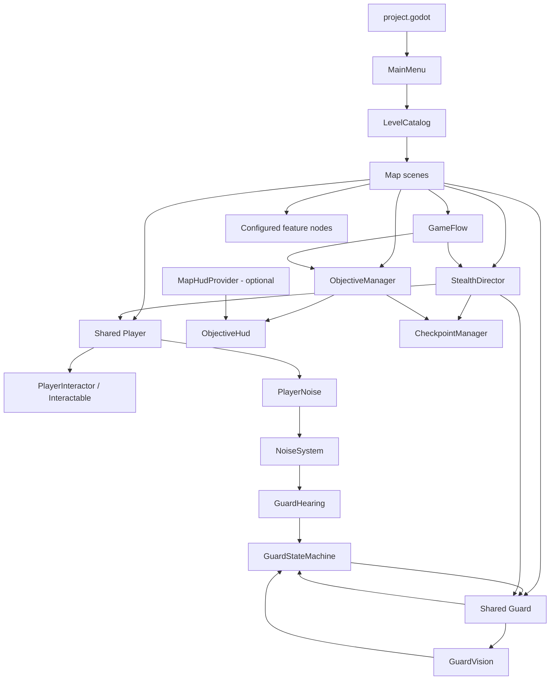

# Kiến trúc

## Phân vùng source

| Thư mục | Trách nhiệm | Ranh giới |
|---|---|---|
| `shared/` | Scene/script/tài nguyên runtime dùng chung: player, NPC, interaction, game flow, UI, noise, stealth, presentation và utilities. | Thay đổi có thể ảnh hưởng nhiều map. Không đặt logic riêng của một nhiệm vụ ở đây nếu feature/map module phù hợp hơn. |
| `features/` | Cơ chế tái sử dụng: inventory, stamina, objectives, checkpoints, puzzles, security. | Được scene map instance và cấu hình; không phải các plugin độc lập để xóa khỏi project. |
| `maps/<id>/` | Scene chính, navmesh, quy tắc nhiệm vụ, asset, test và tools riêng. | Một map không được mặc định phụ thuộc vào map khác; dùng shared API/feature contract. |
| `templates/map/` | Khung tham khảo để khởi tạo map. | Không phải nội dung runtime/catalog. |
| `tests/`, `tools/`, `docs/` | Runner, kiểm thử và tài liệu/công cụ cấp dự án. | Test riêng của map có thể ở trong thư mục map; phải xác định runner thực sự gọi test nào. |

## Khởi động, chọn map và vòng đời scene

`project.godot` mở `shared/scenes/ui/main_menu.tscn`. `MainMenu` đọc `LevelCatalog.LEVELS` và tạo nút theo thứ tự catalog; `start_level(id)` chỉ tải scene có đường dẫn trong catalog. Test scene tùy chọn được đặt trong cùng entry, ví dụ biến thể K17.

Mỗi map là một PackedScene riêng. Menu và `GameFlow` chuyển cảnh bằng `SceneTree.change_scene_to_file` (deferred trong runtime); Restart dùng `owner.scene_file_path` để tải lại chính map đó. Trở về menu tải scene menu. Không có scene manager giữ nhiều map song song: node/group của map cũ phải được giải phóng trước khi map mới trở thành runtime scene. `tools/map_flow.gd` kiểm tra scene cũ, group hệ thống, signal connection và số node qua nhiều chu kỳ.

## Giao tiếp giữa hệ thống

- **Groups:** các scene đăng ký node runtime theo nhóm (`player`, `guards`, `game_flow`, `stealth_director`, `noise_system`, `noise_listeners`, `objective_manager`, `checkpoint_manager`, `map_hud_provider`, `interactables`, `checkpoint_state`...). Các module tìm collaborator bằng group thay vì hard-code node path của mọi map. Group là registry runtime, không phải API để giữ reference qua lúc chuyển scene.
- **Signals:** module phát sự kiện nghiệp vụ; subscriber kết nối theo lifecycle scene. Ví dụ `NoiseSystem.noise_emitted`, `Guard.ai_state_changed`, `StealthDirector.player_caught/level_reset`, `ObjectiveManager.objective_completed/level_completed` và `GameFlow.state_changed`.
- **Scene-local contract:** map giữ scene, navmesh, patrol routes, nhiệm vụ và các node feature riêng. Các API tùy chọn như `MapHudProvider` tránh để HUD chung import script của một map.

## Player và Guard dùng chung

`shared/scenes/player/player.tscn` gắn `FirstPersonPlayer`, camera, interactor và các thành phần noise/feedback; `Stamina` và `Inventory` có mặt ở scene nhưng được bật/tắt theo cấu hình player (`use_stamina`, `use_inventory`). Scene map chọn giá trị và cấu hình spawn/physics của mình.

`shared/scenes/npc/guard.tscn` là actor dùng chung. `Guard` kết hợp route/navigation với `GuardVision`, `GuardHearing` và `GuardStateMachine`; marker/route do scene map cung cấp. Các cấu hình như `expanded_security` hay `checkpoint_snapshot` được bật theo map, không tạo AI guard khác.

## GameFlow, stealth, AI và objectives

- `GameFlow` sở hữu state cấp game (PLAYING, CAUGHT, PAUSED, WIN, FAILED); state machine này khác state machine của guard.
- `StealthDirector` tổng hợp trạng thái stealth, phát hiện bắt người chơi khi guard đang CHASE, nhìn thấy player và đủ gần; sau delay gọi reset actor và phát `level_reset`.
- `CheckpointManager` nghe `level_reset`, khôi phục mission state/objective progress và các guard đã snapshot nếu vị trí an toàn.
- `ObjectiveManager` sở hữu tiến độ objective. `ExitDoor` hoặc trigger/pickup hoàn tất objective; `level_completed` được `GameFlow` dùng để vào WIN. Cửa thoát gọi `StealthDirector.finish_level()` khi thoát thành công để đóng băng actor.
- AI của guard chỉ quyết định từ `GuardPerception` snapshot. Vision/hearing xây perception; state machine chọn ưu tiên chuyển trạng thái; `Guard` thực hiện navigation/movement.

## HUD dùng chung và MapHudProvider

`ObjectiveHud` đọc dữ liệu từ `ObjectiveManager`, `CheckpointManager`, `PlayerInteractor`, inventory và các signal của interactables/puzzles. `MapHudProvider` là Node scene-local tùy chọn trong group `map_hud_provider`:

- `maps/library/scripts/escape/escape_routes.gd` cung cấp thông tin đường thoát/trạng thái riêng của Expanded Library.
- `maps/intelligence/scripts/mission_controller.gd` là provider cho K17; các script map tra cứu nó qua `MapHudProvider.find_for()`.
- Map không có provider vẫn dùng HUD mục tiêu/tương tác chung. Museum hiện dùng HUD mục tiêu chung.

Provider trả status, BBCode, hint cửa thoát và result lines; HUD chung không cần tham chiếu trực tiếp lớp cụ thể của map. Một scene map chỉ nên có provider phù hợp; tránh group provider bị sót sau scene transition.

## Sơ đồ phụ thuộc chính

Sơ đồ thể hiện quan hệ khái niệm; mỗi map scene thực tế chọn các node/feature cần thiết. Xem [`MODULE_INDEX.md`](MODULE_INDEX.md) để tra file triển khai và consumer cụ thể.
