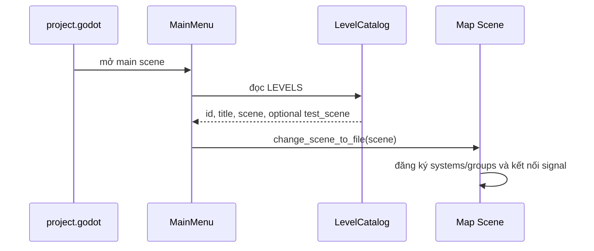
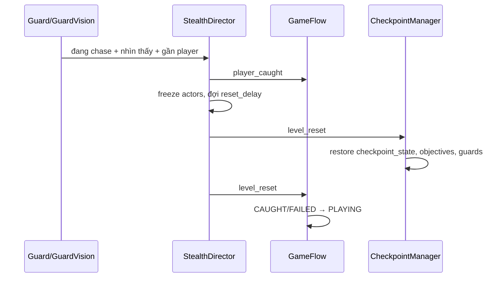

# Luồng dữ liệu và gameplay

Các luồng này dựa trên script dùng chung, catalog và scene hiện tại. Từng map có thể không dùng mọi feature hoặc dùng trigger/objective khác nhau.

## Khởi động → menu → map

1. `project.godot` khởi chạy `shared/scenes/ui/main_menu.tscn`.
2. `MainMenu` duyệt `LevelCatalog.LEVELS` và dựng nút cho mỗi scene; entry có `test_scene` được dựng thêm nút test.
3. Chọn nút gọi `start_level()` hoặc `start_test_level()` → scene đổi theo đường dẫn trong catalog.
4. Map scene tạo systems scene-local; các node thêm vào group như `player`, `guards`, `game_flow`, `objective_manager`, `checkpoint_manager` và `noise_system`.
5. `GameFlow._ready()` bỏ pause cũ, áp dụng settings, giữ mouse và kết nối `StealthDirector`/`ObjectiveManager` sau khi scene sẵn sàng.

## Player movement → noise → guard investigation

1. `FirstPersonPlayer` đọc input, cập nhật crouch/stamina và di chuyển.
2. `PlayerNoise` theo dõi khoảng cách stride khi player ở trên sàn; đứng yên, trên không hoặc teleport không tạo bước chân. Crouch phát WALK nhỏ; đi bộ/chạy dùng preset noise tương ứng.
3. `NoiseSystem.emit_noise()` tạo event có id/timestamp/radius/lifetime rồi gửi tới mọi `noise_listener`.
4. `GuardHearing` lọc event trùng, stale, ngoài tầm hoặc bị tường giảm; nếu nghe được, báo vị trí ước lượng (không nhất thiết chính xác) qua `Guard.hear_noise()`.
5. `Guard.build_perception()` tạo `GuardPerception`. Nếu đang PATROL và không có ưu tiên cao hơn, `GuardStateMachine` chuyển sang INVESTIGATE tại noise estimate.

## Guard vision → suspicion/alert → chase

1. `GuardVision` kiểm tra player points, tầm, FOV và raycast obstruction; detection meter tăng khi nhìn thấy và giảm sau thời gian mất sight.
2. Awareness SUSPICIOUS/ALERTED và last known position được dùng trong snapshot perception.
3. `GuardStateMachine` ưu tiên sighting xác nhận trước; xác nhận chuyển PATROL/INVESTIGATE sang CHASE. Sighting đáng ngờ khi PATROL có thể chuyển INVESTIGATE; noise chỉ được xét sau sighting.
4. Khi mất sight quá thời gian chase window, state CHASE có thể chuyển INVESTIGATE. Guard thực hiện di chuyển qua navmesh.
5. `StealthDirector` tổng hợp status HUD; chỉ bắt player nếu guard đang CHASE, vẫn nhìn thấy player và đủ gần catch distance.

## Player interact → objective → HUD

1. `PlayerInteractor` raycast từ camera, chặn bởi vật cản, tìm `Interactable` trong reach và cập nhật focus.
2. Nhấn/giữ E kiểm tra `can_interact()`; khi đạt điều kiện gọi `interact()`.
3. Các feature như `ObjectiveTrigger`, `AccessCard` hoặc `ExitDoor` thực hiện hành động và gọi `ObjectiveManager.complete()` hoặc phát signal riêng.
4. `ObjectiveManager` cập nhật state và phát objective signals; `ObjectiveHud` nhận thông tin, cập nhật checklist/prompt/message.
5. Nếu tất cả mục tiêu bắt buộc đã hoàn tất, `level_completed` được phát; `GameFlow` chuyển sang WIN. Objective đồ thị có thể có nhiều active objectives và optional objectives không chặn hoàn thành.

## Caught → checkpoint restore

1. Guard trong CHASE nhìn thấy player ở khoảng cách catch → `StealthDirector` phát `player_caught`, freeze actors và chuyển status CAUGHT.
2. `GameFlow` chuyển state sang CAUGHT; sau reset delay, `StealthDirector.reset_level()` đưa player về spawn đã lưu và guard về điểm bắt đầu.
3. `StealthDirector` phát `level_reset`; `CheckpointManager` khôi phục các node trong `checkpoint_state`, objective progress, rồi guard snapshots hợp lệ.
4. `GameFlow` nhận reset và chuyển CAUGHT/FAILED về PLAYING.
5. Nếu map không có checkpoint active, spawn/progress/state ban đầu được sử dụng. Kịch bản K17 có thể có mission checkpoint logic riêng ngoài contract dùng chung; kiểm tra K17 controller trước khi sửa.

## Objective → exit → WIN

1. Trigger/pickup hoàn thành objective qua `ObjectiveManager`.
2. `ExitDoor` từ chối nếu objective/card/extra objective/power/unlock chưa thỏa; walk-through exits còn kiểm tra trigger khi player đi qua.
3. Khi thoát hợp lệ, exit hoàn tất escape objective và gọi `StealthDirector.finish_level()` để đóng băng actors/đặt ESCAPED.
4. `ObjectiveManager.level_completed` được `GameFlow` xử lý để vào WIN; UI của map có thể cung cấp result lines qua `MapHudProvider`.
5. Nút Play Again tải lại scene hiện tại; Restart cũng reload scene hiện tại. Nút Main Menu tải `shared/scenes/ui/main_menu.tscn`.

**Giới hạn tài liệu:** Museum vẫn dùng chuỗi mục tiêu tuyến tính và một exit, nhưng không gian đã được chia rõ thành lobby, exhibition hall, restricted archive và security desk, giúp củng cố nhánh lén lút mà không thay đổi flow chung. Không được áp dụng sơ đồ route/puzzle của Expanded Library sang Museum. K17 có mission controller/exit logic riêng; đọc `maps/intelligence/scripts/` khi task chạm vào flow của K17.
