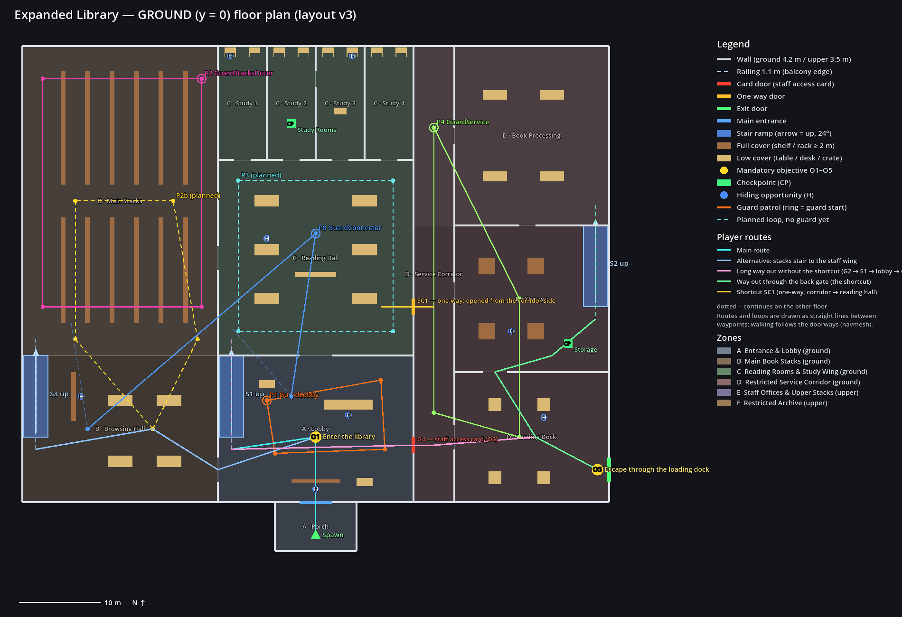
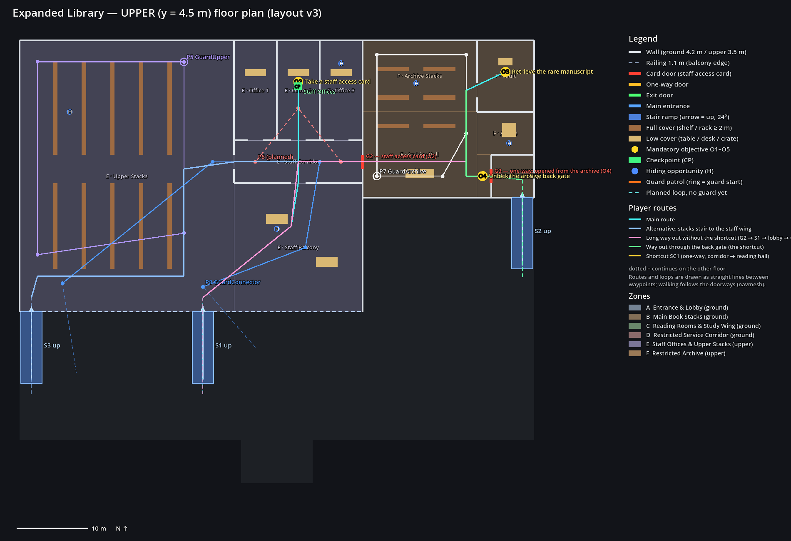
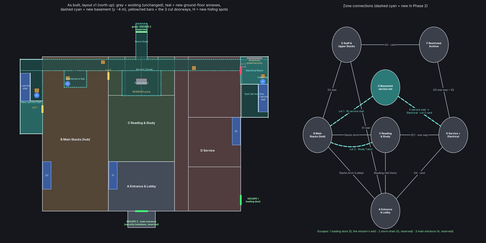
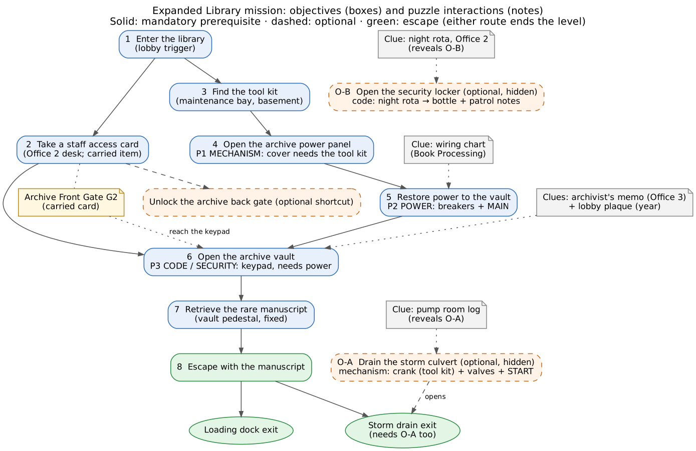

# Expanded Library — Layout Design (v4)

The design of the second, larger map: a two-floor university library with six major zones. It is a separate scene (`scenes/level/expanded_library.tscn`) next to the tutorial, which is unchanged.

**Status:** chosen from the main menu (Phase 2), with six guards (Phase 3) and the full five-objective mission (Phase 4): access doors, a one-way return shortcut, the exit, three checkpoints. Balanced in Phase 5 (v3: patrols, detection tuning, hiding spots, signs, an entrance screen; [`phase-5-balance.md`](phase-5-balance.md)). **Dressed in Phase 6 (v4):** the tutorial's low-poly library look on both floors (bookcases with books, desks and chairs, trims, wainscots, rugs, windows, ceilings and lights), with the same colliders, navmesh and stealth balance as v3 ([`phase-6-visual-polish.md`](phase-6-visual-polish.md), [Look and lighting](#look-and-lighting-v4) below). The unguarded loops (P2b, P3, P6) are still **planned** markers. **Expansion (2026), layout x1:** seven zones (a basement / service network G and an electrical room for D, in the Expansion sub-scene) and three new doorways; see [Expansion (2026)](#expansion-2026-layout-x1-seven-zones-and-the-basement-network) at the end. **Layout x2 (expansion Phase 3):** provisional carried items, two storage shelves and two clue documents in the new areas; see [Items, shelves and documents](#items-shelves-and-documents-layout-x2).

**Plans:** [`v3/layout_ground.png`](v3/layout_ground.png) and [`v3/layout_upper.png`](v3/layout_upper.png), drawn from the layout data (v4 changed no geometry, so they still apply). Screenshots of the dressed level are in [`v4/views/`](v4/views/) (before/after pairs in [`v4/compare/`](v4/compare/)), the mission with its HUD in [`v4/mission/`](v4/mission/), and coverage heat maps in [`v3/coverage/`](v3/coverage/). Earlier versions: [`v0/`](v0/), [`v1/`](v1/), [`v2/`](v2/), [`v3/`](v3/).

| | |
|---|---|
|  |  |

## Where the layout lives

| File | Role |
|---|---|
| `tools/expanded/expanded_layout.gd` | **The layout data**, the single source of truth: zones, floors, walls with openings, stairs, cover, objectives, gates, patrol loops, hiding spots, routes, probe points |
| `tools/expanded/draw_layout.gd` | draws the two floor plans from the data |
| `tools/expanded/build_expanded_graybox.gd` | builds the scene and bakes its navmesh from the data |
| `tools/expanded/capture_graybox.gd` | screenshots of the built scene (top views, navmesh, eye-height views) |
| `tools/expanded/capture_mission.gd` | screenshots of the mission with the HUD, one per step |
| `tools/expanded/capture_views.gd` | v4: the same 20 player views + 2 overviews on any build, for before/after comparisons |
| `tools/expanded/light_report.gd`, `profile_expanded.gd`, `collision_fingerprint.gd` | v4: lights against the renderer's limits and on the guards' routes; a rendering profile; a fingerprint of every collider, guard and patrol point (two builds compare with `diff`) |
| `scenes/level/expanded_library.tscn`, `expanded_library_navmesh.tres` | the built level (layout, guards, mission) |
| `tests/expanded_graybox_tests.gd`, `expanded_ai_tests.gd`, `expanded_mission_tests.gd` | the layout, guard and mission tests (part of the suite) |

**Change the data and rebuild; don't hand-edit the scene** (this still holds with the v4 dressing, which the builder makes from the same data):

```
godot --headless --path . --script res://tools/expanded/build_expanded_graybox.gd
godot --path . --script res://tools/expanded/draw_layout.gd -- --out=docs/expanded/vN
godot --path . --resolution 1600x1000 --script res://tools/expanded/capture_graybox.gd -- --out=docs/expanded/vN
```

The last two need a display. A virtual one works, for example `xvfb-run`.

## Coordinates and dimensions

x is east and z is south, so north (−z) is up on the plans. The ground floor stands on y = 0 and the upper floor on y = 4.5.

| Item | Size | Why |
|---|---|---|
| Ground-floor walls | 4.2 m (up to the underside of the upper slab) | |
| Upper slab | 0.3 m thick, top at 4.5 m | |
| Upper-floor walls | 3.5 m | |
| Balcony railings | 1.1 m | the player can't jump, so a railing is a hard edge |
| Wall thickness | 0.3 m | |
| Doors | 2.0 m wide, header at 2.6 m | navmesh agent radius 0.5 m → 1 m of navmesh through a door |
| Arches | 3–4 m | |
| Corridors | ≥ 3 m (service corridor 4.7 m) | |
| Shelf aisles | 2.4 m (upper stacks 3.4 m) | |
| Stairs | 3 m wide ramps, rise 4.5 m over 10 m (24°) | the player has no step-up; the navmesh accepts up to 45° |
| Space under a ramp | filled with ten stepped blocks | no crawl space and no unreachable navmesh island; it reads as steps from the side |
| Open side of a ramp | balustrade of five vertical panels, 1.0 m above the ramp, on the ramp's edge | vertical faces: the v0 panel, turned with the slope, leaned past the foot of the ramp and caught guards (v1) |

The player is a 0.35 m × 1.8 m capsule and walks at 3.5 m/s. Guards are 0.4 m × 1.8 m. The navmesh agent is 0.5 m in radius and 1.75 m tall. The navmesh uses the same settings as the tutorial's: static colliders on layer 1, cell 0.25 m, region minimum size 8.

## Zones

| Zone | Floor | Footprint (m) | Area | Rooms | Role |
|---|---|---|---|---|---|
| **A** Entrance & Lobby | ground | 24 × 18 + porch 10 × 6 | 492 m² | Porch (spawn), Lobby (circulation desk, **S1 main stair**) | start and **O1**; hub between B, C and D; overlooked by the staff balcony |
| **B** Main Book Stacks | ground | 24 × 56 | 1,344 m² | Main Stacks (six 2.2 m shelf rows, cross aisle), Browsing Hall (tables, **S3 stacks stair**) | quiet west flank; second way upstairs |
| **C** Reading Rooms & Study Wing | ground | 24 × 38 | 912 m² | Reading Hall (six tables, low bookcase), Study 1–4 (carrels; Study 2 and 3 linked) | the middle of the ground floor; checkpoint *Study Rooms* |
| **D** Restricted Service Corridor | ground | 24 × 56 | 1,344 m² | Service Corridor, Book Processing, Storage (**S2 staff stair**), Loading Dock (**exit**) | restricted (card door G4); return route and exit (**O5**) |
| **E** Staff Offices & Upper Stacks | upper | 48 × 38 | 1,824 m² | Upper Stacks (five shelf rows), Staff Balcony (over the reading hall, railing over lobby and browsing hall), Staff Corridor, Office 1–3 | **O2** (Office 2) |
| **F** Restricted Archive | upper | 24 × 22 | 528 m² | Archive Hall, Archive Stacks, Vault, Alcove, Staff Stair Landing | **O3** (Vault) behind the card gate G2; **O4** (back gate G3) |

The upper floor covers the north of B, all of C and the north of D. The lobby, the browsing hall, storage and the loading dock are single-height, open to the balcony railing or to the roof.

## Connections

| Between | Opening | Type |
|---|---|---|
| Porch → Lobby (A) | Main Entrance, 4 m | entrance |
| A ↔ B | Stacks Arch (Lobby), 3 m | arch |
| A ↔ C | Reading Hall Doors, 4 m | arch |
| A ↔ D | **Lobby Staff Door G4**, 2 m | card door (staff access card, O2) |
| B ↔ C | Stacks Arch (Reading Hall), 3 m | arch |
| D → C | **Service Shortcut SC1**, 2 m | one-way door, opened from the corridor side (optional) |
| C (hall) ↔ Study 1–4 | four 2 m doors; Study 2 ↔ 3 door | door |
| D (corridor) ↔ Processing / Storage / Dock | 2 m / 2 m / 3 m; Processing ↔ Storage, Storage ↔ Dock | door |
| D → outside | **Loading Dock Exit**, 3 m | the exit (ExitDoor): sealed until O4, then **O5** |
| A ↔ E | **S1 Main Stair** (lobby → upper stacks) | stair |
| B ↔ E | **S3 Stacks Stair** (browsing hall → upper stacks) | stair |
| D ↔ F | **S2 Staff Stair** (storage → staff stair landing) | stair |
| Upper stacks / balcony ↔ staff wing (E) | **Staff Door (Stacks) G1b**, **Staff Wing Door G1a** | open doors (v2; planned as gates in v0/v1) |
| Staff corridor (E) ↔ archive (F) | **Archive Front Gate G2** | card door (staff access card, O2): the only way in |
| Archive (F) → staff stair landing | **Archive Back Gate G3** | one-way door, opened from the archive side: **O4**, the return shortcut |
| Archive hall ↔ vault (F) | Vault Door | door |

Every zone connects to at least two others: A–B, A–C, A–D, A–E, B–C, B–E, C–D, D–F, E–F.

## Routes and approaches

**Main route** (cyan on the plans), 197 m along the navmesh:
1. Porch → lobby: **O1** (enter the library).
2. Lobby → **S1** up → balcony → **G1a** → staff corridor → Office 2: **O2** (staff access card; checkpoint *Staff Offices* at the back of the office).
3. Staff corridor → **G2** (opened with the card) → archive hall → vault: **O3** (rare manuscript).
4. Archive hall → **G3** (opened from inside): **O4**.
5. Staff stair landing → **S2** down → storage (checkpoint *Storage*) → loading dock → exit door: **O5**.

**Two approaches:**

| Toward | Approach 1 | Approach 2 | Also |
|---|---|---|---|
| the upper floor | S1 from the lobby (guarded, overlooked by the balcony) | S3 from the browsing hall (quiet back stair) | S2 from storage, once G4 is open (card) |
| the staff wing (O2) | G1a from the balcony | G1b from the upper stacks | |
| the restricted archive (O3) | G2 front gate from the staff corridor (card) | — G3 is locked from outside | |
| the exit, from the archive | **G3 → S2 → dock (the shortcut)** | G2 → staff wing → S1 → lobby → G4 → dock (the long way) | |

**The shortcut's benefit** (measured on the navmesh by `expanded_graybox_tests`): vault → exit is **66 m through G3** against **111 m** the long way (41% shorter), and the long way passes the archive guard, the staff corridor, the balcony, the lobby guard and the lobby again. A player who skips O4 can't escape at all: the exit stays sealed.

**SC1** (optional): a service door between the corridor and the reading hall that opens only from the corridor side. Once open, it is a quick way between the service corridor and the reading hall.

## Doors and progression

Access doors are `AccessDoor` nodes (`scripts/systems/objectives/access_door.gd`, an `Interactable` like the card and the exit). A closed door is a solid panel on the world layer that is **not baked** into the navmesh: guards have keys (collision exceptions) and keep their routes through the doorways; for the player and for sight and hearing it is a wall. Opening it removes the panel. Doors are part of the checkpoint snapshot.

| Door | Opens | When |
|---|---|---|
| G2 Archive Front Gate | with the staff access card (O2), from either side | stays open |
| G4 Lobby Staff Door | with the staff access card (O2), from either side | stays open |
| G3 Archive Back Gate | from the archive side only | completes **O4** (at once, or when O4 comes up if opened before the manuscript) |
| SC1 Service Shortcut | from the corridor side only | optional |
| Loading Dock Exit | the exit door: escape once O4 is done (O5 ACTIVE) | ends the level (WIN) |

The tests rebake the level with the closed doors as blockers to prove each stage:

| Stage | Closed | Reachable | Not reachable |
|---|---|---|---|
| Start | G2, G4, G3 (from outside), SC1 | A, B, C, the upper stacks, the staff wing and **O2** | service corridor and dock, the landing, the archive (O3, O4), the exit |
| With the card | G3 (from outside), SC1 | **O3**, **O4**, the dock and the exit (the long way) | — |
| Back gate open | SC1 | the shortcut out of the archive | — |

With G2 closed the archive cannot be entered at all; G3 is its only other door and opens from inside.

## Objectives

| # | Id | Objective | Zone, where | Stand at |
|---|---|---|---|---|
| O1 | `enter_library` | Enter the library | A, lobby (trigger over the room) | (0, 0, 20) |
| O2 | `take_card` | Take a staff access card | E, Office 2 desk | (3, 4.5, −22.2) |
| O3 | `take_manuscript` | Retrieve the rare manuscript | F, vault pedestal | (32, 4.5, −23.6) |
| O4 | `unlock_shortcut` | Unlock the archive back gate | F, G3 (archive side) | (28.8, 4.5, −9) |
| O5 | `escape` | Escape through the loading dock | D, east wall door | (34.6, 0, 24) |

The spawn is (0, 0.05, 32) on the porch, facing north.

## Checkpoints

| Checkpoint | Where | Why there |
|---|---|---|
| Study Rooms | C, Study 2 (−3, 0, −18.5) | a quiet pocket off the reading hall |
| Staff Offices | E, Office 2: pad in front of the card desk (3, 4.5, −21.6), respawn at the back (4.8, 4.5, −26.3) | taking the card always saves (v3); the respawn point is more than 14 m (guard sight range) from the staff corridor |
| Storage | D, storage near the S2 foot (31, 0, 8.5) | on the way out, after the shortcut |

No guard has a respawn point in view during the patrols (`expanded_ai_tests`, and the soak in `v2/soak/`).

## Guards and patrol loops (v3)

Six guards, using the existing guard scene and AI (PATROL / INVESTIGATE / CHASE), each walking a loop from the layout data. The tests and the soaks show every loop completes with no stuck events.

**This level's tuning (v3)** is stored as overrides on the guard instances; the tutorial keeps its defaults:
- detection meter rise of 20–80 per second (default 12–60; crouching still halves it);
- chase speed 5.6 m/s (default 4.2; the player sprints at 5.5).

The playtests showed a player sprinting through, ignoring the guards, finishing faster than careful play (`phase-5-balance.md`).

| Loop | Guard | Zone | Points | Length | Watches |
|---|---|---|---|---|---|
| P1 Lobby | GuardLobby | A | 4 | 43 m | the lobby, the S1 foot and the staff door G4. v3: the north leg moved off the main doors (z 25 → 21.5–22) |
| P2 Main Stacks | GuardStacksOuter | B | 4 | 99 m | the outer aisles of the main stacks |
| P4 Service Corridor | GuardService (v3) | D | 4 | 92 m | the service corridor, the dock and storage: the way out after the shortcut and the G4 route. v3: moved here from P2b (zone D was never watched; two guards in the optional stacks made the "quiet" route the noisier one) |
| P5 Upper Stacks | GuardUpper | E | 4 | 98 m | both stair tops (S1, S3) and the stacks door G1b. v3: the S1-top point moved from 3 m to 9 m from the stair, so it no longer waits facing the player coming up |
| P7 Archive | GuardArchive | F | 5 | 57 m | the archive hall, the stacks and the vault door. v3: the hall leg stops at x 23.2 and turns south-east, so it no longer walks straight at the open back gate |
| P8 Connector | GuardConnector | A → E → B → C | 8 | 180 m (v2: 184 m) | reading hall → lobby → **up S1** → balcony → staff corridor (G1a) → upper stacks (G1b) → **down S3** → browsing hall → main stacks → reading hall. v2: its staff-corridor point moved from x 3 to x 6, off the line through the Office 2 door |

Planned loops without a guard: P2b Stacks Inner (its guard moved to P4 in v3), P3 Reading Hall and P6 Staff Corridor. They stay as PatrolRoute nodes under `Layout/PlannedPatrols`. The guarded loops are under `Guards/` next to their guards, as in the tutorial. F3 shows all of them in a debug run.

## Cover and hiding

- **Full cover** (≥ 2 m): 34 pieces — B 13 shelves, D 4 storage racks, E 10 shelves, F 6 archive shelves, and (v3) the entrance screen, 2.4 m inside the main doors.
- **Low cover** (0.75–1.3 m): 31 pieces — tables, desks, crates, the circulation desk, planters.
- **Carrels:** 8 study carrels (desk and 1.5 m side panels) in Study 1–4.
- **Hiding spots** (v3: real `HidingSpot` areas under `Gameplay/HidingSpots`, with dark floor marks; the HUD shows HIDDEN when crouched there and unseen):
  - two study carrels, a reading table, the browsing-hall shelf, the circulation desk;
  - a storage rack, a dock crate;
  - an upper-stacks aisle, the Office 3 desk, the archive alcove;
  - (v3) the entrance screen, the archive stacks aisle, the balcony table.
- **Signs** (v3, `Dressing/Signs`, as the tutorial's): staff offices upstairs, the stacks back stair, red RESTRICTED · STAFF CARD at G2 and G4, STAFF ONLY at SC1, the vault, both sides of the back gate, staff stair → loading dock, loading dock.

## Design notes and open points for later phases

- **Cross-floor sight lines:** the balcony railing (1.1 m) lets upper-floor guards see into the lobby and browsing hall. That is intended (Phase 3 tests).
- **Hearing through the slab:** walls and floors halve hearing range (the existing rule); a sprint directly overhead is heard, a walk is not (Phase 3 tests).
- **Access doors** need no new physics layer: the panel is world geometry outside the navmesh region, and guards get collision exceptions with it (audit R8 resolved this way in Phase 4).
- **Target time:** the main route is 200 m along the navmesh (the tutorial's shortest route: 102 m). Automated playtests finish in 1:13–3:45 of active time. The 20–30 minute first completion is probably not reached; the reason and adjustment plan are in `phase-5-balance.md`, and human playtests are pending (`PLAYTEST_PROTOCOL.md`).

## Look and lighting (v4)

Phase 6 dressed the level in the tutorial's palette and props. Every piece is decoration only (meshes, MultiMeshes, lights; no collision) on the v3 colliders, which are unchanged: the navmesh file is byte-identical and `collision_fingerprint.gd` gives the same 263 collision objects, 6 guards and 41 patrol points. The builder merges the level's static boxes (about 1,700: tiles of floors, walls and ceilings, the furniture's boxes, box-shaped decoration) into about 220 `BatchedBoxes` (`scripts/level/batched_boxes.gd`: MultiMeshes of coloured unit boxes, built when the level loads, as `ShelfBooks` builds books), grouped by floor, 12 m cell, render layer, shadow setting and glowing material; a solid piece keeps its collider, only its visible box is batched.

| What | Where it comes from | Reads as |
|---|---|---|
| Plaster walls, wood wainscot; dark-red wainscot and red rail in D and F | tutorial wall, trim and restricted-trim colours | public vs restricted at a glance |
| Floors by room: stone (lobby, porch), wood (stacks, reading hall, balcony), carpet (studies, staff wing), blue-grey and concrete (service), dark red (archive) | tutorial floor colours | which kind of room you are in |
| Bookcases with books, low bookcase, display case | `ShelfBooks` (the tutorial's) on the shelf colliders | full cover |
| Tables with tops and chairs, desks with monitors and lamps, circulation desk with the globe, planters, crates, storage racks with boxes, the vault pedestal | `chair.tscn`, tutorial lamp, globe, crate colours | low cover stays visibly low (nothing tall on it) |
| Door posts and lintels; cream headers, red on card gates, amber on the shortcut, green on the exit | tutorial `Dressing/Doorways` | doors, locked gates, the shortcut, the exit |
| Stairs: wood ramp with light stripes, brass-capped balustrade, a light strip at both ends | — | floor transitions |
| Rugs (teal, public), red runner (archive hall), hazard stripes at the exit | tutorial rugs, runner, hazard colours | routes and the exit |
| Windows on the outer walls, clocks, posters, signs (tutorial sign boards) | tutorial dressing | orientation |
| Ceilings under the upper floor, a roof over everything, the outer walls above the double-height halls | tutorial ceiling colour | a closed building; all above or outside walkable space |
| 84 ceiling lights / pendants (the tutorial's `ceiling_light.tscn`), warm glows on the card and the manuscript, a green glow at the exit, red at the card gates | — | lit rooms; the mission's objects |

**Lighting rules** (the Compatibility renderer draws at most 32 lights in view and 8 per mesh, dropping the rest in no particular order): lights fade out by distance (16 + 5 m), each floor's lights reach only that floor's surfaces (render layers 4 and 8; characters, props and gameplay objects on layer 1 are lit by both), and batches cover at most a 12 m cell. Only walls, the upper slab, furniture, headers and stairs cast sun shadows (as in v3), within 40 m; books are drawn within 20 m of the camera (the bookcase box beyond). `light_report.gd` checks all of it: at most 25 lights in any of 43,104 player views, at most 8 on any mesh, and the light at a guard's chest between the ambient 0.50 and about 1.1 on every route. Report: [`v4/lighting.md`](v4/lighting.md).


## Expansion (2026), layout x1: seven zones and the basement network

Added in expansion Phase 2 (approved plan: [`expansion/phase-2-layout.md`](expansion/phase-2-layout.md)). Everything above this section is unchanged, except three doorways cut into existing walls. The new parts live in their own sub-scene, `scenes/level/expanded_library_expansion.tscn` (the level's child "Expansion"), built from `tools/expanded/expansion/expansion_layout.gd` by `tools/expanded/expansion/build_expansion.gd`. The v4 builder stays frozen.



**The seven zones:**

| Zone | Where | Status |
|---|---|---|
| A Entrance & Lobby | ground | existing |
| B Main Book Stacks | ground | existing, **now a hub with 5 routes**: Stacks Arch (Lobby), Stacks Arch (Reading Hall), S3, the west service door (new, cut 1), the Study 1 door (new, cut 3) |
| C Reading Rooms & Study Wing | ground | existing; Study 1 gains a door to the stacks |
| D Service and Electrical Rooms | ground | existing corridor, processing, storage, dock, **plus the new Electrical Room** (annex x 36…46, z −28…−18) behind a staff-card door from Book Processing (cut 2) |
| E Staff Offices & Upper Stacks | upper | existing |
| F Restricted Archive | upper | existing |
| **G Basement / Service Network** | **y −4 m** | **new**: see below |

**Zone G:**
- **West Service Stair:** an annex outside the stacks' west wall, entered from the stacks' cross aisle (cut 1, z −9). A 3.35 m ramp descends 4 m north to the tunnel. Beside the ramp, at the bottom, is the **basement alcove** (hiding spot).
- **Service Tunnel:** 4 m wide, x −44…46 along z −27…−23, under the north side of the building (stacks, study wing, service zone). Two crates break up the sightline.
- **Maintenance Bay** (x −28…−20, door x −25…−23; hiding spot) and **Pump Room** (x −7…7, door x −1…1; a full-height pump unit in the middle as cover; **reserved: pump puzzle**).
- **Storm Drain:** from the tunnel north to a sealed grate at z −37. **Reserved: escape 2.**
- **East Service Stair:** a 3.35 m ramp from the Electrical Room down to an east corridor (x 36.5…42) back to the tunnel, and the **cable bay** under the electrical room (hiding spot).

**Electrical Room (D):** reached from Book Processing only through the **staff-card door** (an `AccessDoor`, as G2 and G4), so zone D still needs the card even through the basement. Without the card, the basement and the electrical room itself can be reached (from the stacks), but not Book Processing. Cabinets along the north wall. **Reserved: the power / security puzzle.**

**Escape routes (reserved spaces, Phase 2):**
1. The loading dock, the mission's existing exit.
2. The storm drain (G), behind its grate.
3. The main entrance (A), for a later security lockdown.

They are marked under `Expansion/Layout` (F3).

**Connections and doorways:** the three cut doorways are 2.0 m wide and 2.6 m high, as the level's doors (tested). The cuts changed only those wall pieces and the decoration across them (`tools/expanded/expansion/cut_doorways.py`).

**Navigation:**
- The level's navmesh is baked from the group `expanded_navigation_source`, which holds the `NavigationRegion3D` and `Expansion/Geometry` (`tools/expanded/expansion/bake_navmesh.gd`). It has 1,020 polygons (898 before).
- Every walkable place of the v4 navmesh is still in it; the new walkable area inside the original building is only at the three doorways (`tools/expanded/expansion/compare_navmesh.gd`).
- One **seal**: an invisible collider on the east wall's top along S2. With geometry east of the building, the bake treated that wall top as walkable next to the stair top.

**Rendering:**
- Basement meshes use render layer 16 and its lamps the cull mask 1 | 16, so they light only the basement and the actors.
- The ground-floor annexes use layer 4 and mask 5, as the existing ground floor.
- The existing `ceiling_light.tscn` provides the lamps; the colours are the level's palette.
- **No final polish yet** (Phase 2 is playable geometry).

### Items, shelves and documents (layout x2)

Added in expansion Phase 3 (stamina and inventory; report [`expansion/phase-3-mechanics.md`](expansion/phase-3-mechanics.md)). **Provisional:** placed so the mechanics can be played; the Phase 4 puzzles may move them and give the documents their clues. No geometry, collision or navmesh changed: shelves are wall-mounted with no collision, items lie on existing crates.

| Thing | Where | Kind |
|---|---|---|
| Tool kit | maintenance bay, on the crate (−26.8, BF+1.2, −20.2) | reusable tool (for tool-kit mechanisms, Phase 4) |
| Glass bottle | service tunnel, west crate (−14, BF+1.2, −26.1) | single-use distraction (noise radius 14 m) |
| Heavy hardback | service tunnel, east crate (19, BF+1.2, −23.9) | single-use distraction (noise radius 10 m) |
| Glass bottle | cable bay crate (44, BF+1.2, −21) | single-use distraction |
| Maintenance shelf | maintenance bay, east wall (−20.36, BF+1, −20) | storage: leave, take back, swap (4 places) |
| Electrical room shelf | electrical room, south wall (39.5, 1, −18.36) | storage (4 places) |
| Pump room log | pump room, east wall (6.83, BF+1.4, −17) | clue document (journal) |
| Electrical room notice | electrical room, east wall (45.83, 1.4, −24) | clue document (journal) |

The staff access card in the staff offices is now also a carried item (it still completes "Take a staff access card"); the Lobby Staff Door, the Archive Front Gate and the electrical room door open while it is carried. The tutorial is unchanged.

### Mission and puzzles (layout x3)

Added in expansion Phase 4 (report [`expansion/phase-4-puzzles.md`](expansion/phase-4-puzzles.md), specifications [`expansion/phase-4/puzzle_specs.md`](expansion/phase-4/puzzle_specs.md)). Gameplay nodes only, under `Expansion/Gameplay` (`Mission`, `Documents`, `Items`, and the new `VaultDoor` in the existing vault doorway); no geometry, collision or navmesh change.



| Thing | Where |
|---|---|
| Electrical panel cover, breaker panel | electrical room, on the cabinets (41, 1.35, −27) |
| Vault keypad, Vault Door | archive stacks beside the vault doorway (27.8, 5.85, −19.3); door at (28, 4.5, −21) |
| Pump crank, valves, START | pump room, south wall (z −14.3) |
| Storm drain exit | in front of the grate (0, BF, −35.8) |
| Security locker (+ bottle, patrol notes) | Office 1, west wall (−5.8, 5.85, −21.4) |
| Wiring chart · archivist's memo · night rota · lobby plaque | Book Processing north wall · Office 3 east wall · Office 2 east wall · lobby west wall |

