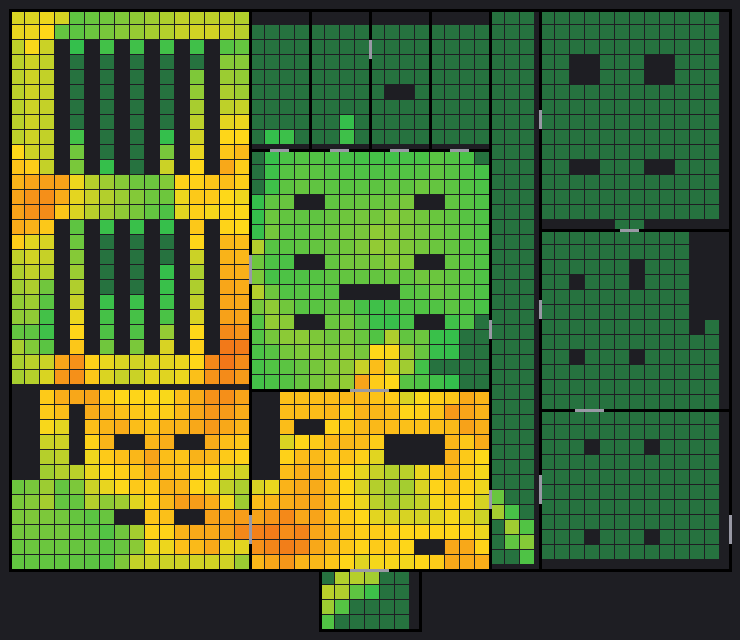
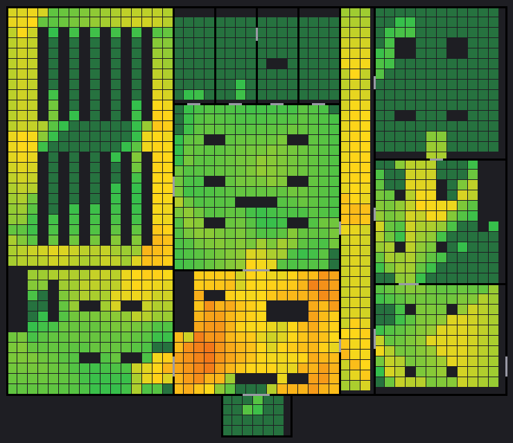

# Expanded Library — Phase 5: Stealth Balance and Playtesting

This phase balanced the Expanded Library's patrols, detection, hiding, route choices and recovery, based on measurements and recorded playtest runs rather than guesswork.

The playtests were run by an automated playtester that plays the real level with the real guards. **No human playtest was possible in this environment.** The pacing target (20–30 minutes for a first completion) therefore can't be confirmed; it is reported as a deviation, with the evidence and an adjustment plan. A protocol for human playtests is in [`PLAYTEST_PROTOCOL.md`](PLAYTEST_PROTOCOL.md).

Layout version **v3** ([`LEVEL_LOG.md`](LEVEL_LOG.md), [`LAYOUT.md`](LAYOUT.md)); evidence in [`v3/`](v3/).

| Before (v2) | After (v3) |
|---|---|
|  |  |

*Ground-floor coverage over 600 s of patrols: dark green = never watched, green → yellow = up to 15% of the time, yellow → red = 15–50%. Zone D (right) was never watched in v2.*

## How it was measured

Three tools were added (development only; not part of the game):

| Tool | What it measures |
|---|---|
| `tools/expanded/coverage_map.gd` | 600 s of patrols with no player: - every named area sampled on a 1.5 m grid (2,469 points), checked against each guard's real view cone and line of sight (standing and crouched head); - how long each spot is watched without a break, and its longest unwatched window; - where a sprint would be heard; - which doorways guards stand in, and for how long; - the exposure along each designed route. Writes heat maps and a report. |
| `tools/expanded/playtest_bot.gd` | Plays the mission through the real player: input actions to move, crouch and sprint, and the interact key through the PlayerInteractor. It knows only what a player can know: - the objective panel and hint; - guards it has line of sight to; - the detection UI. It records time, captures (where, by whom, at which objective), times noticed / investigated / chased, waiting, stalls (no progress for 8 min), and after every capture it checks the restored mission state. |
| `tools/expanded/summarize_playtests.py` | Groups the runs into the tables below. |

**Playtester profiles:**

| Profile | Plays like |
|---|---|
| `careful` | waits in cover until the path ahead is out of every guard it can see, backs off when noticed, crouches near guards |
| `learner` | sprints and only reacts once noticed, until it has been caught twice; then careful. A first-timer who learns from being caught |
| `reckless` | ignores the guards until one chases it |

**How the runs vary:**
- **`--explore`:** a player who doesn't know the map. It searches the rooms the objective hint names, in a seeded order, until it sees the item.
- **Routes:** main (S1 and the staff wing door), stacks (S3 and the stacks staff door), early_gate (the back gate opened before the manuscript).
- **Seeds:** each seed adds a 0–40 s pause at the start. The pause varies where the guards are on their loops when the player arrives.

All times are game time. "Active time" leaves out the start pause.

## Findings on v2 and what changed

Each change was retested with the full playtest matrix before the next one. The rounds are in [`v3/playtests/`](v3/playtests/):

| Round | Change | Runs |
|---|---|---|
| 1 | v2 baseline | 25 + 9 |
| 2 | first v3 changes | partial (14); stopped when a capture loop appeared |
| 3 | lobby guard moved | partial (11); the loop remained |
| 4 | entrance screen | 18 + 9 |
| 5 | chase speed (final) | 27 |

| # | Evidence (v2) | Problem | Change (v3) | Result |
|---|---|---|---|---|
| 1 | Zone D (service corridor, processing, storage, dock): watched **0%** of the time; a sprint there was heard 0–9% | No challenge at all after the shortcut, nor on the card route through G4 | P2b's guard moved to **P4 Service Corridor** (`GuardService`: corridor ↔ dock ↔ storage, 2.5 s waits) | Corridor 13.4%, storage 4.7%, dock 7.3%. The way out now has a guard to time |
| 2 | Two guards in zone B made the optional stacks the most watched area. The "quiet" stacks route was noticed **18×** per careful run, against 4× on the main route | The alternative route was the noisier one | Same move: zone B keeps one guard | Browsing hall 14.6% → 5.9%, main stacks 10.6% → 6.8%; stacks route noticed 10–11× |
| 3 | GuardUpper waited at (−13, 6), **3 m from the top of S1, facing it**. The learner and hasty runs were caught there repeatedly: 383 captures by GuardUpper in v2, most of them at the S1 top | The main route's stair exit was a face-to-face encounter with no warning | P5's point moved to (−13, −1): it still watches the S1 top, from 9 m | GuardUpper captures across all final runs: 6 |
| 4 | Both careful-profile captures in v2 were by GuardArchive at the **staff stair landing**, through the open back gate | The guard's hall leg walked straight at G3 to 3.5 m from it, so a player crossing the landing had no warning | P7's hall leg now stops at x 23.2 and turns south-east | Landing 8.0% → 5.6%. Careful captures on the landing: 2 → 0 (the archive guard still catches bad timing at the vault door and the inside of the gate: 3 in 18 careful runs) |
| 5 | A verbose v2 run (`v3/playtests/1_v2_baseline/verbose_early_gate_explore_seed1.txt`): a first-time player who never stepped on the Staff Offices pad (at the back of Office 2) was caught in the archive **5 times**, back to the porch each time | A missed checkpoint meant the whole mission was redone after any archive capture | The **pad covers the front of the card desk**, so taking the card saves; the respawn point stays at the back of the office | No reset-to-porch after the card in any final run |
| 6 | A player **sprinting through, ignoring the guards** (reckless) finished in **1:12–1:36** with 1 capture: faster than careful play. Chase speed 4.2 m/s < sprint 5.5 m/s, so every chase could be outrun | Stealth was optional | This level's guards fill their detection meter faster (20 / 80 per second instead of 12 / 60; crouching still halves it) and chase at 5.6 m/s (`GUARD_VISION`, `GUARD_TUNING` in the layout; the tutorial keeps its defaults) | Reckless never finishes (30 captures in ~9 min, 3 of 3 runs). Careful runs unchanged; learner 2–3 captures |
| 7 | Round 2 (after change 6's detection rates): runs whose start pause brought them to the lobby as the lobby guard reached the doors were caught at the **doorway 21–50 times in a row**. Every capture resets the guards to their starts, so the same encounter repeated | **Respawn trap:** a capture before the first checkpoint led straight into the next | Round 3: P1's north leg moved off the doors (z 25 → 21.5–22). That was not enough (a 113-capture loop in round 3). Round 4: an **entrance screen** (2.2 m, 2.4 m inside the doors) with a hiding spot behind it | Porch watched 2.6% → 0.3%; behind the screen the HUD shows HIDDEN. No capture loops in rounds 4–5 for careful and learner play |
| 8 | Hiding spots existed only as markers | The player couldn't tell where hiding works | **13 real HidingSpots** with dark floor marks, as the tutorial's carrels: the 10 planned ones plus the entrance screen, the archive stacks aisle and the balcony table | HUD "HIDDEN" (`v3/mission/01b_hidden_behind_entrance_screen.png`) |
| 9 | One-way doors were drawn green whenever they had no key requirement, so the back gate looked open from the landing, where it is locked | Misleading door state | Door panels are green only when the player could open them from where they stand (`AccessDoor`) | `v3/mission/05b_back_gate_from_landing.png`; mission test |
| 10 | No signs: route and restriction cues were only the coloured door headers | Readability | 14 signs, built like the tutorial's: - staff offices upstairs, the stacks back stair; - red RESTRICTED · STAFF CARD at G2 / G4, STAFF ONLY at SC1; - the vault; - the back gate on both sides ("OPENS FROM INSIDE" from the landing); - staff stair → loading dock, loading dock | `v3/mission/01c_lobby_signs.png`, `v3/views/` |

**Not changed, on purpose:**
- **The lobby** stays the most watched area (19.6%). It is the first challenge, and the screen now gives a safe place to watch it from.
- **The staff offices and the study rooms** stay quiet pockets (under 1%). They are a breather after the climb, and the checkpoints are there.
- **No guard parks in a doorway:** the longest stay is 1.0 s (S1 top, the staff doors, storage), so no required route is ever blocked.

## Results (final v3, 27 runs)

| Route | Profile | Knowledge | Done | Time median (range) | Active | Captures/run | Noticed | Waiting |
|---|---|---|---|---|---|---|---|---|
| main | careful | knows map | 3/3 | 1:40 (1:40–1:41) | 1:20 | 0.0 | 1 | 7 s |
| main | careful | explores | 3/3 | 2:24 (2:24–2:29) | 2:04 | 1.0 | 6 | 13 s |
| stacks | careful | knows map | 3/3 | 2:55 (2:09–2:57) | 2:35 | 0.0 | 10 | 25 s |
| stacks | careful | explores | 3/3 | 2:45 | 2:25 | 0.0 | 11 | 24 s |
| early_gate | careful | knows map | 3/3 | 1:41 (1:41–2:21) | 1:28 | 0.3 | 2 | 8 s |
| early_gate | careful | explores | 3/3 | 1:57 (1:57–2:03) | 1:37 | 0.0 | 4 | 11 s |
| main | learner | explores | 3/3 | 2:56 (2:51–3:10) | 2:38 | 2.0 | 14 | 18 s |
| stacks | learner | explores | 3/3 | 3:43 (3:35–4:13) | 3:23 | 2.3 | 20 | 28 s |
| main | reckless | explores | **0/3** | — (gives up after 30 captures, ~9 min) | — | 30 | 60 | 0 s |

**The same profiles on v2:**

| Profile | Done | Time | Captures/run |
|---|---|---|---|
| careful | 16/16 runs | medians 1:52–2:38 | up to 0.7 |
| learner | 6/6 | 4:12–7:02 (median 4:44 main, 5:13 stacks), mostly after early captures that went back to the porch | 2 |
| reckless | **3/3** | 1:12–1:36 | 1 |

**Route exposure** (`coverage_map.gd`; "exposed metres" = the expected number of watched metres on one pass):

| Route | v2 | v3 |
|---|---|---|
| Main route | 197 m, mean 8.5%, 20.1 exposed m | 200 m, mean 11.2%, 27.0 exposed m |
| Alternative: stacks stair to the staff wing | 106 m, 14.5%, 15.2 | 106 m, 12.5%, 13.3 |
| Way out through the back gate (shortcut) | — | **67 m, 10.2%, 7.9** |
| Long way out without it (G2 → S1 → lobby → G4) | 119 m, 9.7%, 13.7 | **119 m, 14.1%, 20.4** |

Per-area tables, sprint hearing and doorway occupancy: [`v3/coverage/v2_before/report.md`](v3/coverage/v2_before/report.md), [`v3/coverage/v3_after/report.md`](v3/coverage/v3_after/report.md).

### Challenging but fair

- **Challenge.**
  - Ignoring the guards no longer works (reckless: 0 of 3 finish).
  - The main route is more exposed than in v2 (27 against 20 exposed metres).
  - Every careful run is still noticed at least once.
- **Fairness.** A careful player who backs off when noticed finishes every route, with 0–1 captures.
  - The careful-profile captures on v3 (4 in 18 runs: 3 by the archive guard at the vault door or the inside of the back gate, 1 by the service guard in the dock) each followed a warning: the detection UI showed the guard noticing first.
  - None of them are respawn loops.

### Stealth readability

| The player needs to understand | Through (existing UI unless noted) | Evidence |
|---|---|---|
| Where guards can see them | The detection banner ("YOU ARE BEING SEEN", "A guard is investigating"), direction triangles, ? / ! above guards, the meter rising only in line of sight | In every final run the UI showed a guard noticing before any chase (noticed > chased) |
| Which areas give cover | Full cover ≥ 2 m (shelves, racks, the screen) against low cover ≤ 1.3 m (tables, desks, crates), as in the tutorial | coverage: crouched exposure is lower behind low cover |
| Where hiding is possible | **New:** 13 HidingSpots with floor marks; the HUD shows HIDDEN | `01b_hidden_behind_entrance_screen.png` |
| How to move between routes | **New:** signs at the lobby (staff offices upstairs, stacks back stair), the staff doors and the landing; objective hints name both stairs | `01c_lobby_signs.png`, `views/` |
| Which areas are restricted | Red headers, red / green door panels, prompts ("locked (staff access card needed)", "locked from this side"); **new:** red signs at G2, G4, SC1 and the landing side of G3; one-way doors red from the locked side | mission tests, `02_card_door_refused.png`, `05b_back_gate_from_landing.png` |
| How detection and investigation respond | Unchanged AI (PATROL / INVESTIGATE / CHASE); noise from sprints and door rattles; faster meter in this level | the playtester's noticed → investigated → chased counts; AI tests |

### Route choices

- **Toward restricted progression.**
  - Upstairs by S1 or S3.
  - Into the staff wing by G1a or G1b.
  - The two routes differ: S1 is faster and watched at the top; S3 is longer and passes the browsing hall.
- **The shortcut saves time and exposure:** 44% shorter (67 against 119 m) and 61% less exposure (7.9 against 20.4 exposed metres). The exit only opens after it anyway.
- **No alternative skips a prerequisite.** The rebake tests (`expanded_graybox_tests`: 23/23) and the mission tests (every bypass refused) are unchanged and pass.
- **No single forced encounter.** Each required area has more than one approach or a watchable rhythm:
  - lobby: even its worst spot has an unwatched window of 12 s;
  - landing: 50% of it never watched;
  - archive: two entry sides of the hall.

### Recovery

- **Checkpoints and respawn.**
  - After a capture the player respawns at the last pad, with the mission state restored.
  - The playtester checked the restored state after every capture: **107 checks, 0 violations** in the final matrix, and 0 in every round with the check (items, doors, objectives, the checkpoint snapshot).
  - Earlier rounds put the game through runs of 100–370 captures in a row with no crash or corruption. Those were the loops, and they are fixed.
- **Respawn traps fixed:**
  - the entrance (change 7);
  - the missed office checkpoint (change 5).
- **Softlocks:** none. No run with a player that adapts stalled. The only "stalls" are the reckless profile, which never changes its play.
- **Understanding the reset:** the caught screen names the checkpoint ("Back to …"), and the objective panel shows the restored step. Both existed already and are covered by the mission tests.

## Pacing: deviation from the 20–30 minute target

**Measured (automated, game time):**

| Player | Time |
|---|---|
| Careful player (all routes, knows the map or searches by the hints) | 1:13–2:44 active (group medians 1:20–2:35) |
| Learner (first-timer who learns from captures) | 2:36–3:45 active (medians 2:38 main, 3:23 stacks), 2–3 captures |

**Why it is short.** The mission is 200 m of walking, about 1 minute at walking speed. The five objectives are close together along one loop: lobby → upstairs → staff wing → archive → stair → dock.

**What the bot can't tell.** The bot reacts instantly, never hesitates, reads nothing and doesn't get lost. A human first-timer is certainly slower: they look around, read signs and hints, misjudge guards, and get caught more. But how much slower can't be measured here.
- To reach 20 minutes, a first-timer would need to be about 5–8 times slower than the learner bot.
- That is possible for a very cautious player, but it can't be assumed.

**Assessment:** the 20–30 minute first completion is **probably not reached**. That is a documented deviation, not a confirmed result.

**Adjustment plan:**
1. **Measure (cheap, no code).** Run `PLAYTEST_PROTOCOL.md` with three or more people who haven't seen the map, and record the times and capture places in the table below.
2. **If first completions are well under 20 minutes**, the levers are, in order of cost:
   - **(a) Relocate objectives** so the mission crosses more guarded ground. For example, the staff card into the study wing or the far west of the upper stacks, which adds a ground → upper crossing. This is a layout change.
   - **(b) Add mission content**, for example a code for the vault found elsewhere, or a second item. This is a scope increase and needs your approval.
   - **(c) Set the target** to what a level of this size supports (about 5–10 minutes for a first-timer, if the tests show that).
3. **What not to do.** Don't lengthen it by making guards unfair. The tuning above already makes careless play fail, and more pressure would add captures rather than tension.

### Human playtests

| Date | Tester | Played tutorial? | Completed / time | Captures | Confusion / unfair moments |
|---|---|---|---|---|---|
| — | none yet | | | | Use `PLAYTEST_PROTOCOL.md` |

## Files

**New**
- `tools/expanded/coverage_map.gd`, `tools/expanded/playtest_bot.gd` (+ `.uid`), `tools/expanded/summarize_playtests.py`.
- `docs/expanded/phase-5-balance.md` (this report), `docs/expanded/PLAYTEST_PROTOCOL.md`.
- `docs/expanded/v3/`:
  - plans, top and navmesh views, 18 eye-height views;
  - `mission/` (11 views);
  - `coverage/v2_before`, `coverage/v3_after`;
  - `playtests/` (rounds 1–5: `runs.jsonl` and `summary.md`, plus a verbose v2 run);
  - `test_run.txt`, `mutation_checks.txt`.

**Modified**
- **`tools/expanded/expanded_layout.gd` (v3):**
  - patrols P1, P2b (no guard), P4 (guard), P5, P7;
  - the Staff Offices pad and spawn;
  - `GUARD_VISION`, `GUARD_TUNING`, `SIGNS`;
  - 3 more hiding spots, the entrance screen;
  - the shortcut route.
- `tools/expanded/build_expanded_graybox.gd`: guard tuning overrides on the instances, the checkpoint spawn offset, HidingSpots, signs.
- `scenes/level/expanded_library.tscn`, `expanded_library_navmesh.tres`: rebuilt. The screen is new geometry: 898 polygons, saved = fresh bake.
- `scripts/systems/objectives/access_door.gd`: the panel colour follows the player's side.
- `tests/expanded_graybox_tests.gd`: hiding spots, signs, this level's tuning, and the tutorial's untouched defaults.
- `tests/expanded_mission_tests.gd`: caught after the card (on the pad / off the pad), 3 activations on the full run, the one-way door colour.
- `tools/expanded/capture_mission.gd`: the readability views.
- `README.md`, `docs/expanded/LAYOUT.md`, `docs/expanded/LEVEL_LOG.md` (v3), `docs/qa/REGRESSION_CHECKLIST.md`.

## Tests executed (Linux VM, Godot 4.7.2.stable.official.ed1daf0bf)

| Command | Result |
|---|---|
| `bash tools/ci/validate.sh` | `VALIDATION PASSED` |
| `bash tools/ci/run_tests.sh` (suite) | **3 failures, all in the tutorial's `tests/guard_tests.gd`:** "GuardMain waited 3.20s at point 1, expected 3.00s", and 2.20 vs 2.00 s for GuardRestricted and GuardEast. Every other suite passed: player, navigation, vision, AI, hearing, loop, objectives, game flow, level design, presentation, performance, QA, Expanded Library graybox / map selection / guards / mission. Only the 8 expected warnings |
| `tools/qa_flow.gd`, `tools/map_flow.gd` (run directly, since `run_tests.sh` stops after the suite) | `QA FLOW PASSED (15 checks, 4 levels loaded)`; `MAP FLOW PASSED (52 checks, 12 levels loaded, 3 cycles)`, no ERROR or WARNING lines |
| `bash tools/ci/export_windows.sh` | `EXPORT PASSED` |
| Playtest matrix, 5 rounds (about 110 runs) and coverage maps | as above |
| Mutation checks | door colour reverted → mission test fails; tuning removed → graybox test fails (`v3/mutation_checks.txt`) |

**The tutorial guard failures are the same as in Phase 4:**
- **Not caused by this phase.** They reproduce on the unmodified Phase 3 code and touch nothing changed here.
- **Cause.** The test switches to `Engine.time_scale = 6` and immediately starts counting 0.1 s per physics step. The physics steps already queued for that frame still run with the old delta, so the guard's first wait measures 2–4 steps long. How many steps are queued depends on the machine's frame timing.
- **Proposed fix (test only, one line):** wait one process frame after setting the time scale before measuring. It is a tutorial test, so I have not changed it without your approval.

## Acceptance criteria

| Criterion | Result | Evidence |
|---|---|---|
| The mission is challenging but fair | **PASS** (automated evidence) | reckless 0/3; careful 18/18 finish with 0–1 captures, each after a warning; no capture loops |
| The player can understand the stealth rules through gameplay | **PASS (partly verified)** | the UI mapping above, the new hiding spots, signs and door colours; screenshots. Needs the human playtest to confirm |
| Multiple routes provide meaningful choices | **PASS** | S1 / S3 and G1a / G1b differ in time and exposure; the shortcut is −44% length, −61% exposure |
| No required route is permanently blocked | **PASS** | doorway occupancy ≤ 1.0 s; rebake tests 23/23; tour through the closed doors |
| No known game-breaking softlocks remain | **PASS** | no stalls for adapting players; respawn traps fixed |
| Checkpoint recovery works reliably | **PASS** | mission tests; 107 restored-state checks with 0 violations; pad at the card desk |
| First-time completion about 20–30 min, or deviation documented | **Deviation documented** | measured 1:13–3:45 active (bot, careful and learner); reason and adjustment plan above; no human data |
| Relevant AI, objective and checkpoint regression tests pass | **FAIL (3 tutorial guard timing checks)** | Expanded AI / mission, objective, game-flow and checkpoint tests pass; `guard_tests.gd` fails 3 timing checks (pre-existing, fix awaiting approval) |

## Known issues and limitations

- **No human playtests.** Pacing and readability need people (protocol provided).
- **The 20–30 minute target is probably not met** (see the adjustment plan).
- **The tutorial guard timing test** (above).
- **The playtester is a model, not a person.**
  - Its "first-timer" profiles are proxies.
  - Its flee choice (back along the way it came) is simpler than a person's.
  - Its determinism made respawn loops easy to find, but exaggerates them.
- **The lobby is still the most watched area.** It is deliberate, and the screen makes it watchable.
- **The staff wing is a quiet pocket.** It is deliberate; a P6 staff-corridor guard is the lever if playtests find the card too easy.
- **Detection and chase tuning apply to this level only.** The tutorial plays as before (checked by a test).

## Recommended next phase

**Phase 6** (your next phase). The remaining required evidence is profiler measurements and the final exported build.
- Before or alongside it: the human playtests and, depending on their result, the pacing adjustment above (which needs your approval if it adds mission content).
