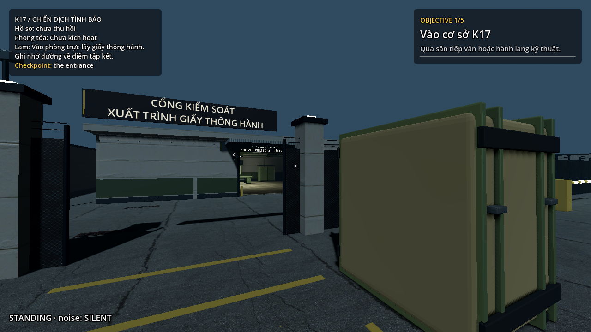
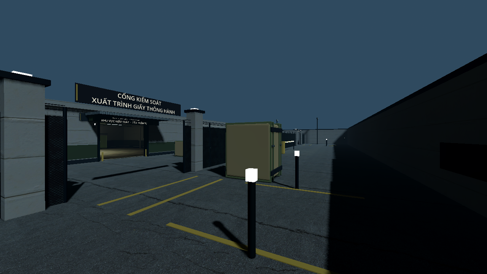
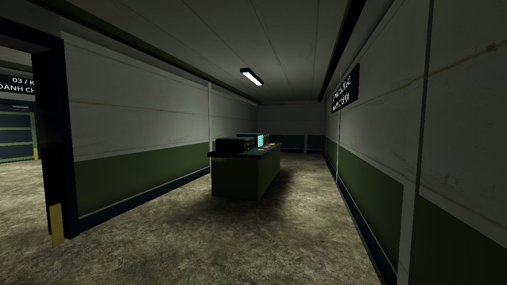
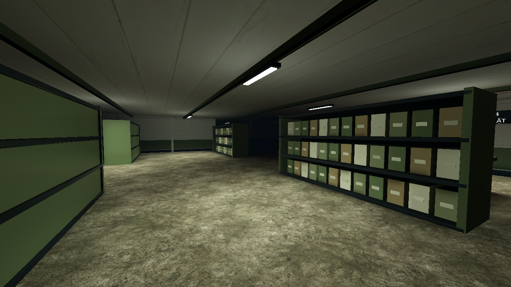
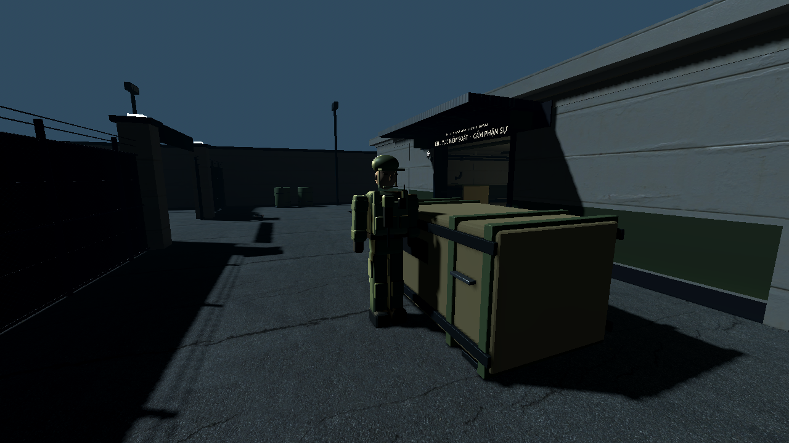
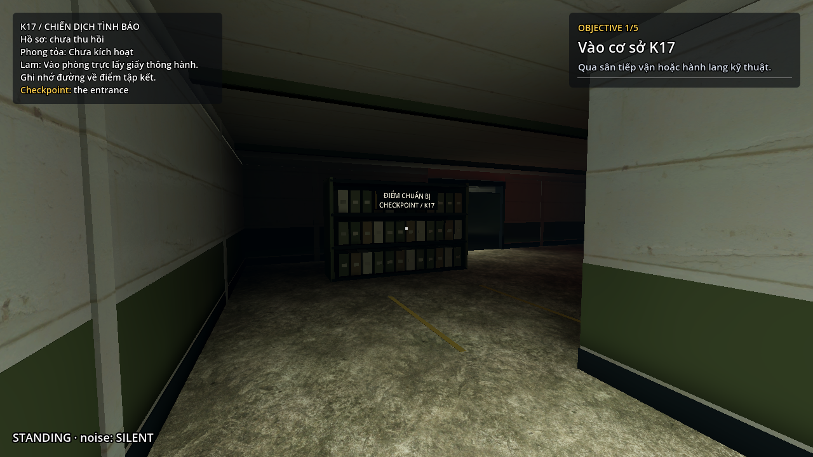
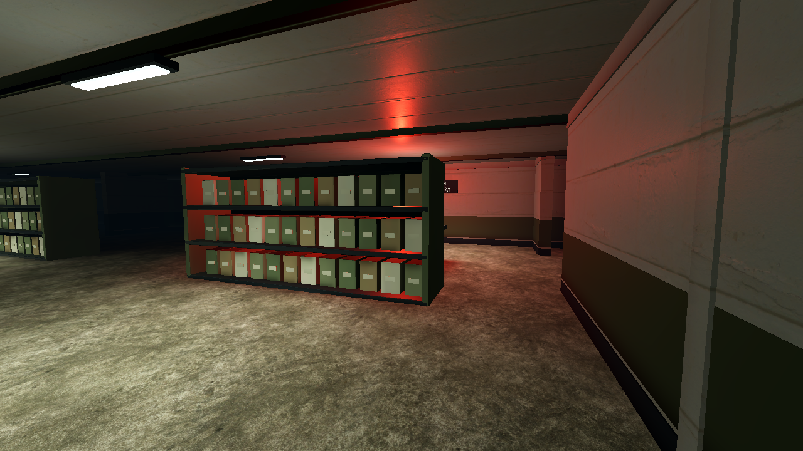
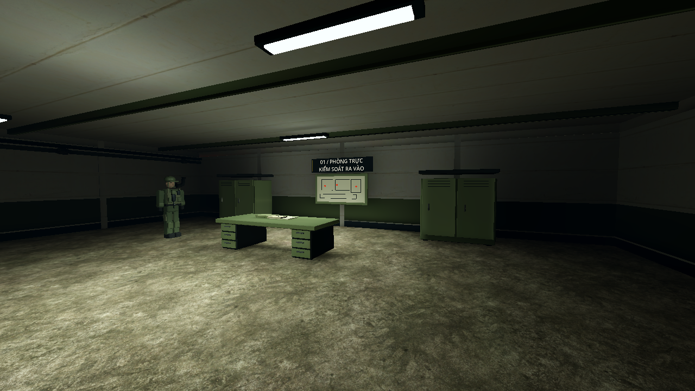

# Kiểm tra đợt nâng cấp mỹ thuật K17

Ngày hoàn thiện: 27/10/2026 (các lượt dựng và kiểm tra bắt đầu 26/10). Nhánh: `feature/twp`, nền mã nguồn trước đợt nâng cấp: `fc78a6b`. Godot `4.7.2.stable.official.ed1daf0bf`, Windows, Quadro P1000. Chi phí mua asset: **0 đồng**.

## Phạm vi đã triển khai

- Cổng kiểm soát, hàng rào lưới thép, trụ, mái che, barrier xe, đèn pha và vạch sơn sân tiếp vận.
- Bộ vật liệu PBR 1K; tường bê tông với dải olive, trần kín, khung cửa, đèn có chụp, ống/van và máng cáp.
- Phòng trực, khu thông tin, tủ hồ sơ, bàn tài liệu, cửa gia cường mở có bản lề; biển checkpoint và cột đèn tập kết là vật thể trong bối cảnh.
- Hình ảnh lính phân khớp tự dựng gắn vào animation của Guard dùng chung. Đây vẫn là nhân vật phong cách đơn giản, chưa phải nhân vật người hiện thực có skeleton/retarget mới.
- Ánh sáng tĩnh đã bake; đèn đỏ động chỉ bật trong trạng thái báo động. Project chơi vẫn dùng Compatibility. Không thay đổi renderer chung trong `project.godot`.
- HUD K17 giữ mục tiêu hiện tại, chỉ dẫn và lời radio, ẩn danh sách nhiệm vụ dài qua tùy chọn của `MapHudProvider`. Map khác mặc định giữ danh sách cũ.
- Scene môi trường có thể chỉnh trực tiếp. Dựng lại gameplay/navmesh bình thường không ghi đè mỹ thuật và lightmap; sinh lại mỹ thuật phải chủ động truyền `-- --rebuild-art` rồi bake lại.

Hai tuyến tiếp cận, hai điểm tập kết, tương tác, checkpoint và bốn NPC vẫn hoạt động. Lưới thép chặn di chuyển bằng layer riêng trong K17, trong khi ray nhìn dùng chung có thể nhìn qua lưới; tường/đạo cụ đặc tiếp tục che tầm nhìn. Navmesh sau bố trí mới có 314 polygon.

## Kiểm tra chức năng và đóng gói

| Hạng mục | Kết quả và bằng chứng |
|---|---|
| Biên dịch script | [166 script đạt](logs/scripts.log) |
| Đường dẫn runtime | [263 tham chiếu hợp lệ](logs/layout.log) |
| Hợp đồng giữa các map | [MAP CONTRACT PASSED](logs/map-contract.log) |
| Nhiệm vụ K17 và hồi quy chung | [108 kiểm tra K17 đạt; toàn bộ suite đạt](logs/full-suite.log) |
| Tích hợp mỹ thuật | [44/44](logs/art-integration.log): model lính thực sự hiển thị, lightmap, trần/biển, ray qua lưới, collider, HUD, cửa và khôi phục đèn báo động |
| Đi bộ/tương tác thật | [47 waypoint, cả hai tuyến đạt](logs/walking.log); còn 97,5 và 99,4 giây sau rút lui |
| Tuần tra thật | [90 giây, bốn NPC](logs/patrol.log); lần lượt đến 12/15/10/9 điểm, không bị kẹt |
| Luồng tutorial | [15 kiểm tra, bốn lượt nạp đạt](logs/qa-flow.log) |
| Chọn/restart/rời map | [76 kiểm tra, 18 lượt nạp, ba chu kỳ đạt](logs/map-flow.log); node/orphan không tăng |
| Xuất gói | [Xuất PCK thành công](logs/export.log), [nạp menu và ba map từ thư mục trống](logs/pack.log); có lightmap/model lính, loại test/tool/tài liệu khỏi gói |
| Nguồn tài nguyên | [39 file gốc xác minh MD5; 54 file phát hành xác minh SHA-256](logs/asset-verification.log); [nguồn và giấy phép](../../assets/CREDITS.md) |

Suite chung chạy headless với `--fixed-fps 60` để tăng tốc mô phỏng; không dùng kết quả đó làm phép đo FPS. Nó có tám cảnh báo chủ động từ fixture kiểm tra Guard thiếu tuyến/navmesh hoặc bị kẹt, không có lỗi script/resource. Các lượt mỹ thuật, đi bộ, tuần tra 90 giây, QA flow, map flow và đọc PCK chạy headless mặc định, kết thúc không có lỗi/cảnh báo runtime. Sau suite chung chỉ điều chỉnh trình bày, bố trí đạo cụ nhỏ và lời radio; các lượt kiểm tra scene thực tế phía sau dùng bản mỹ thuật cuối.

Lượt đi bộ tắt NPC để kiểm tra riêng va chạm/tương tác. Lượt tuần tra và benchmark giữ cả bốn NPC hoạt động. Các kết quả này chưa thay thế lượt chơi của con người để cân bằng độ khó.

## Hiệu năng render thực tế

Đo bằng `tools/benchmark_art.gd` trên Quadro P1000, OpenGL Compatibility, bốn NPC hoạt động, VSync tắt. Mỗi góc lấy frame time theo đồng hồ thực trong năm giây sau warm-up; camera đứng yên và tắt bắt người chơi để góc đo không đổi. Cột FPS là `1000 / frame_time_trung_vị`, không phải FPS trung bình của toàn lượt chơi. P95 là ngưỡng frame time mà 95% mẫu không vượt quá.

| Góc đo | FPS trung vị 1280×720 | P95 720p | FPS trung vị 1920×1080 | P95 1080p |
|---|---:|---:|---:|---:|
| Sân/cổng | 114.6 | 15.78 ms | 110.0 | 14.85 ms |
| Hành lang | 154.7 | 10.26 ms | 134.3 | 10.15 ms |
| Phòng hồ sơ | 256.8 | 5.71 ms | 178.3 | 8.66 ms |
| Phòng hồ sơ báo động | 260.8 | 5.68 ms | 175.2 | 7.81 ms |

Engine báo khoảng 335–355 MB bộ nhớ video ở các mẫu này; đây là chỉ số tài nguyên của engine, không phải toàn bộ VRAM do hệ điều hành/GPU cấp phát. [Dữ liệu 720p](logs/render-720.json) và [1080p](logs/render-1080.json) lưu cả độ phân giải thực, số mẫu, draw call và primitive. Chưa có phép đo baseline đồ họa trước nâng cấp ở cùng điều kiện nên không kết luận phần trăm tăng/giảm hiệu năng. Mẫu ngắn và góc cố định chưa bảo đảm 60 FPS ở mọi tình huống chơi.

## Ảnh từ game

Tám ảnh được render trực tiếp ở 1280×720 bằng scene đã lưu, không dùng ảnh concept hoặc ảnh preview của nguồn asset. Tool chụp chủ động đặt camera ở độ cao người chơi và tắt quyết định NPC để tái lập; các góc giới thiệu nội thất ẩn HUD, riêng điểm xuất phát/checkpoint giữ HUD. Trạng thái báo động được dàn sẵn bằng controller để xem ánh sáng, không phải bằng chứng hoàn tất nhiệm vụ. [Log render ảnh](logs/preview.log).










## Tái kiểm tra

Từ root project, thay `godot` bằng đường dẫn Godot 4.7.2 trên máy:

```text
godot --headless --path . --editor --quit
python tools/ci/check_layout.py
godot --headless --path . --script res://tools/ci/check_scripts.gd
godot --headless --path . --script res://tools/ci/check_map_contract.gd
godot --headless --fixed-fps 60 --path . res://tests/test_scene.tscn
godot --headless --path . --script res://maps/intelligence/tools/check_art.gd
godot --headless --path . --script res://maps/intelligence/tools/playthrough_k17.gd
godot --headless --path . --script res://maps/intelligence/tools/guard_soak_k17.gd
godot --headless --path . --script res://tools/qa_flow.gd
godot --headless --path . --script res://tools/map_flow.gd
godot --path . --resolution 1280x720 --script res://maps/intelligence/tools/preview_art.gd -- --out=res://ci-logs/k17-art
godot --path . --resolution 1920x1080 --script res://maps/intelligence/tools/benchmark_art.gd -- --viewport=1920x1080 --out=res://ci-logs/k17-live-1080.json
godot --headless --path . --export-pack "Windows Desktop" build/K17-ArtV2.pck
```

Không thêm `--headless` hoặc `--fixed-fps` vào lệnh benchmark đồ họa. Tham số `--viewport` đặt lại kích thước cửa sổ sau khởi động để tránh Windows thu chiều cao ban đầu theo vùng làm việc; JSON luôn ghi kích thước viewport thực.

Nguồn model có thể tái tạo qua Python và Blender 4.5+ theo [README của map](../../README.md). Bản gốc tải ngoài project; chỉ file đã chọn/tối ưu và thông tin nguồn được đưa vào repo. Lightmap đã có sẵn để chơi; chỉ cần GPU hỗ trợ RenderingDevice khi bake lại.

## Phần mở rộng sau đợt này

Nhân vật và một số đạo cụ vẫn theo phong cách đơn giản. Cảm biến theo chu kỳ, đèn quét ảnh hưởng phát hiện, giữ E/thanh tiến trình, radio tương tác, lịch phong tỏa và âm thanh quân sự chưa bổ sung trong đợt mỹ thuật này. Độ tối của renderer chưa thay đổi luật nhìn/nghe NPC. Đồng hồ 120 giây chưa phải độ khó cuối đã cân bằng bằng người chơi.
