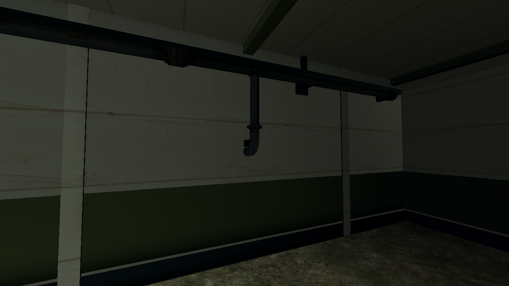
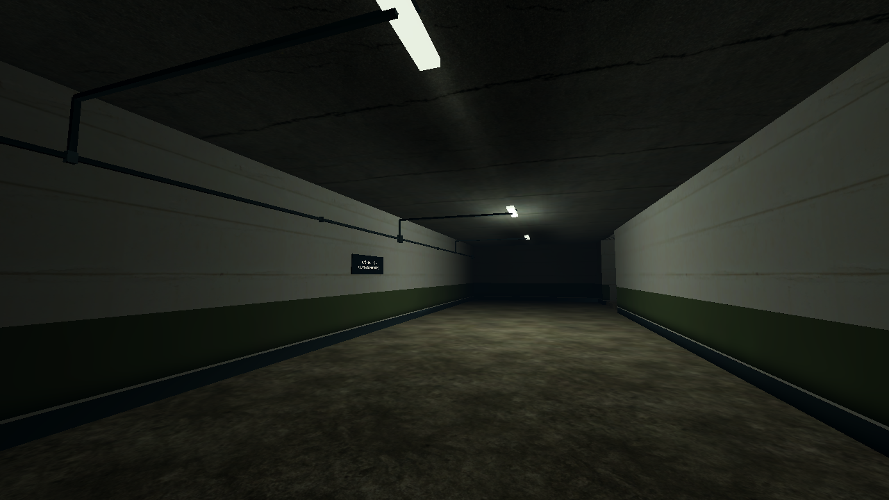
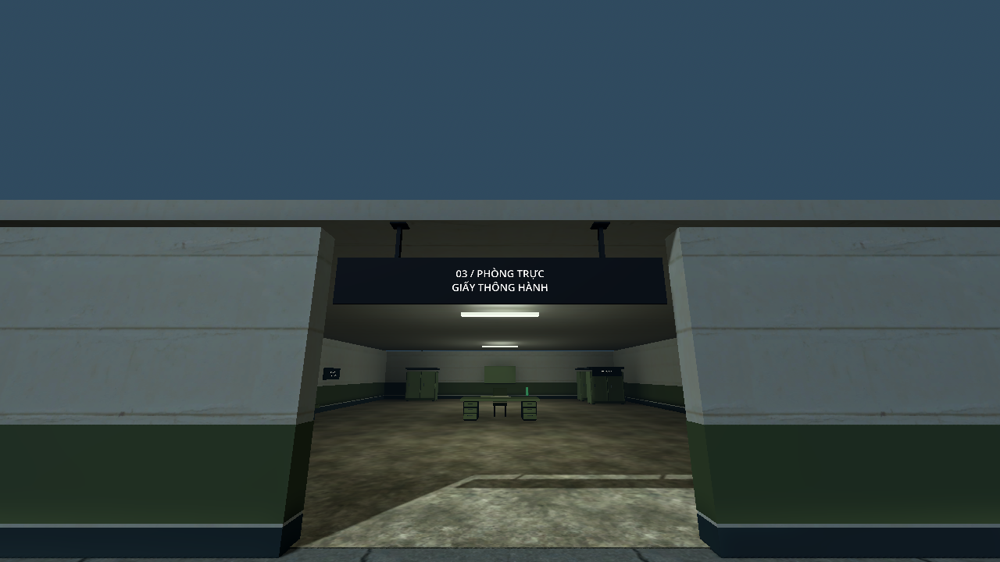
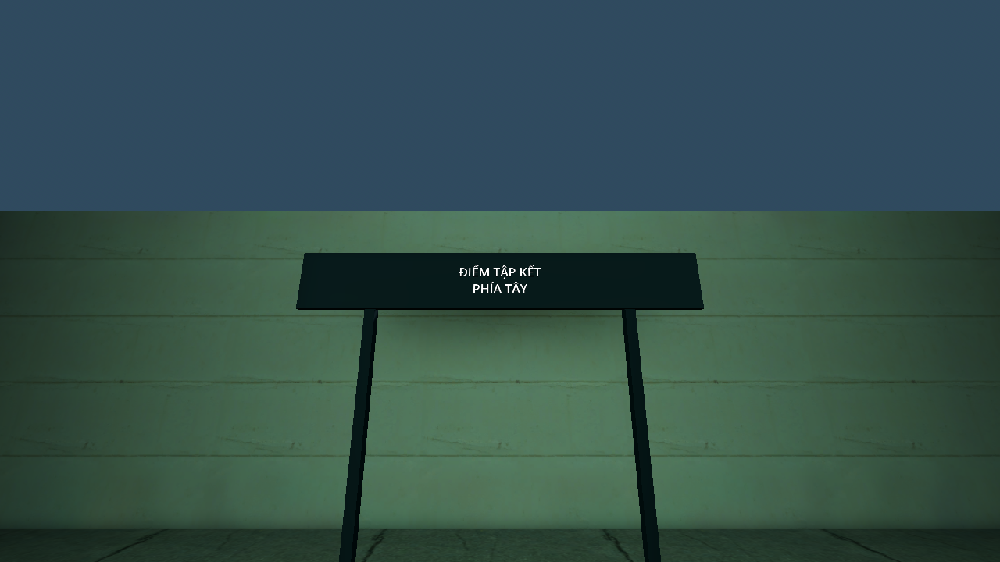
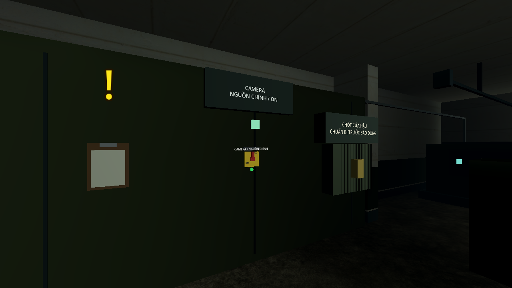
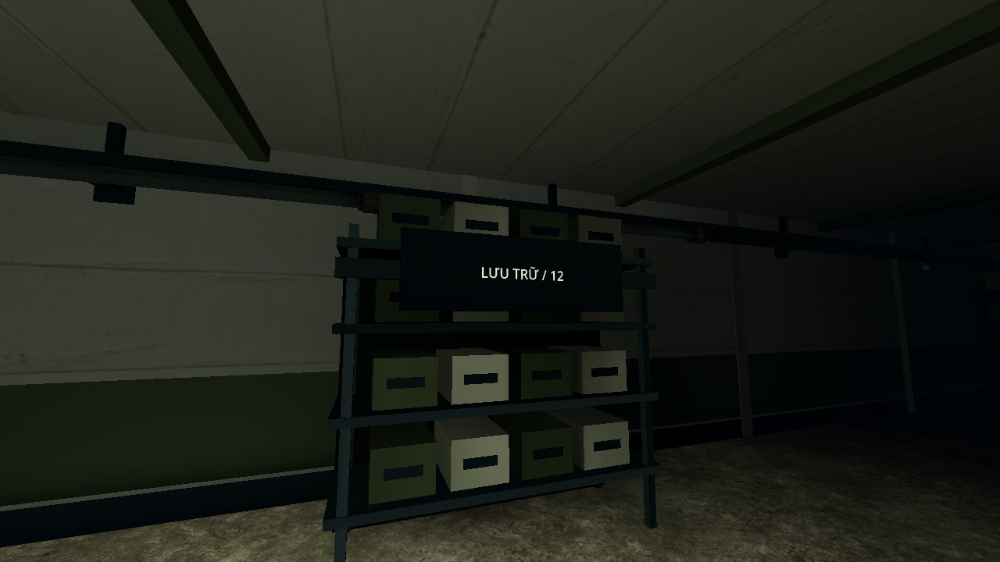

# K17 — sửa ống rời và bảng biển thiếu điểm tựa

Ngày 27/10/2026, nhánh `feature/twp`, tiếp sau `ee396da`. Godot 4.7.2 official, Windows, Compatibility.

## Các lỗi và cách sửa

- Model `pipe_valve.glb` thực ra là co 90°, có một miệng đứng và một miệng ngang. Đã đo tâm mặt bích trên mesh, xoay đúng hướng và nối nhánh từ ống trần qua co vào tường. Bỏ các đoạn đứng nối nhầm vào đáy hộp bao của co.
- Hai tuyến ống trần có đầu kết thúc vào tường, khớp tại chỗ đổi hướng và gá tường/ty treo cho máng phía trên.
- Tuyến máng dây B1 được nối liên tục, thêm hộp nối và kẹp tường; nhánh cấp tới từng đèn cũng nối vào tuyến. Đưa thân đèn xuống dưới mặt trần thay vì nằm trong lớp sàn phía trên.
- Tuyến dây vô tuyến, máy phát và dịch vụ có hộp kết thúc hoặc nhánh nối vào thiết bị; đoạn lên trần có điểm tựa.
- Biển trên cửa nhà xe, phòng trực, trạm điện, chốt phản ứng, cửa xuống B1 và mái cầu thang dịch vụ có ty treo. Biển tập kết/vành đai có cột và đế; biển cổng có thanh ngang nối hai trụ.
- Chuyển bảng sơ đồ nguồn khỏi khoảng cửa trạm điện; chuyển bảng chỉ hướng kho mật khỏi cửa thông khu phân loại. Bảng trên giá hồ sơ có thanh ngang liên kết với khung giá và kích thước vừa mặt giá.
- Tủ điều khiển trạm điện có thân tủ sát tường, giữ các vị trí tương tác hiện hành. Bảng radio/chốt/cổng có tấm nền; keypad có trụ và chân đế. Bảng phân khu phía đông được đặt sát tường.
- Giữ nguyên cơ chế keypad, nhiệm vụ, AI và các điểm tương tác. Navmesh dựng lại sau tủ điều khiển có **949 polygon**. Ánh sáng được bake lại cho hình học hiện hành.

## Kiểm tra

| Hạng mục | Kết quả | Bằng chứng |
|---|---|---|
| Điểm tựa/đầu nối trong hình học tác nghiệp | 62 biển, 26 đoạn ống thẳng, 4 co, 23 máng dây; 231 kiểm tra, không lỗi | [attachments.log](attachments.log) |
| Chức năng K17 | 401 kiểm tra, không lỗi | [k17-tests.log](k17-tests.log) |
| Mỹ thuật/lightmap bản được lưu | 62 kiểm tra, không lỗi | [art.log](art.log) |
| Đi bộ không lính, camera/cảm biến vẫn chạy | Thắng hai đường, 147 waypoint; không chạm cảm biến | [walking.log](walking.log) |
| Đi bộ có lính qua bảo trì | Thắng, 106 waypoint, đủ bốn tiếp viện, không bị bắt/chạm cảm biến; còn 41.9 giây | [walking-live.log](walking-live.log) |
| Biên dịch và tài nguyên bản đóng gói | 207 script hợp lệ; PCK bản thường/test, tiếp viện và restore chạy từ thư mục trống | [scripts.log](scripts.log), [pack.log](pack.log) |

`check_attachments.gd` dựng bản tác nghiệp bằng cùng builder rồi kiểm tra trước khi gom mesh: raycast vào **tam giác của vật đỡ**, loại chính tấm biển/gá của biển khỏi phép thử, kiểm tra hai vị trí gắn. Cột và ty treo phải chạm sàn/trần. Đầu ống, hai tâm mặt bích của từng co và đầu máng phải tiếp giáp hình học lân cận trong dung sai 3.5 cm. Kiểm tra hộp bao đầu nối được đối chiếu thêm bằng ảnh cận cảnh để nhận ra model co 90°; chỉ kiểm tra hộp bao chưa đủ bảo đảm đúng miệng nối.

Lượt đi nhiệm vụ dùng input, va chạm và E/giữ E thật, không dịch chuyển giữa waypoint; mô phỏng headless 60 Hz, không phải benchmark FPS. Ảnh dưới chụp từ bản chạy Compatibility ở các góc dàn sẵn, dùng kiểm tra mỹ thuật, không thay bằng chứng đi nhiệm vụ. Helper bake local không được đưa vào project runtime.

## Ảnh bản sửa

Sau khi cập nhật phải khởi động lại lượt K17 để tải scene mới. Báo cáo và ảnh của các đợt trước được giữ nguyên làm mốc lịch sử.
