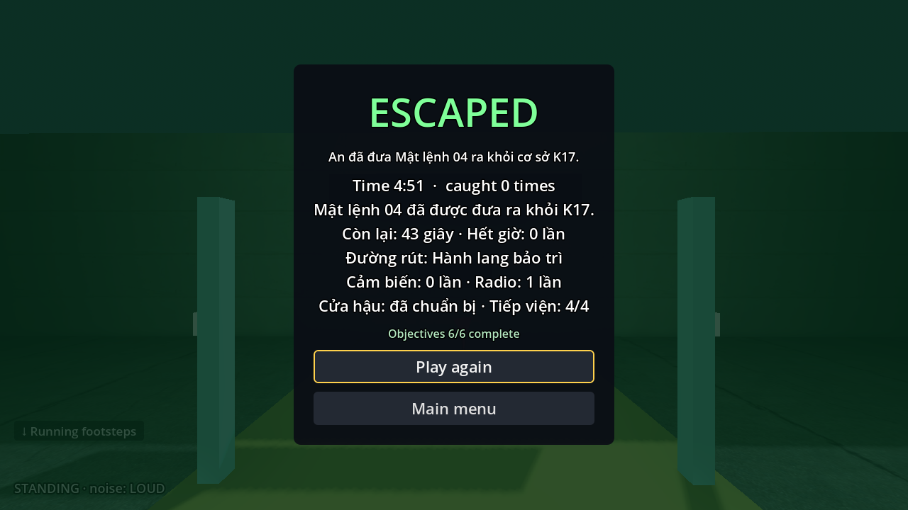
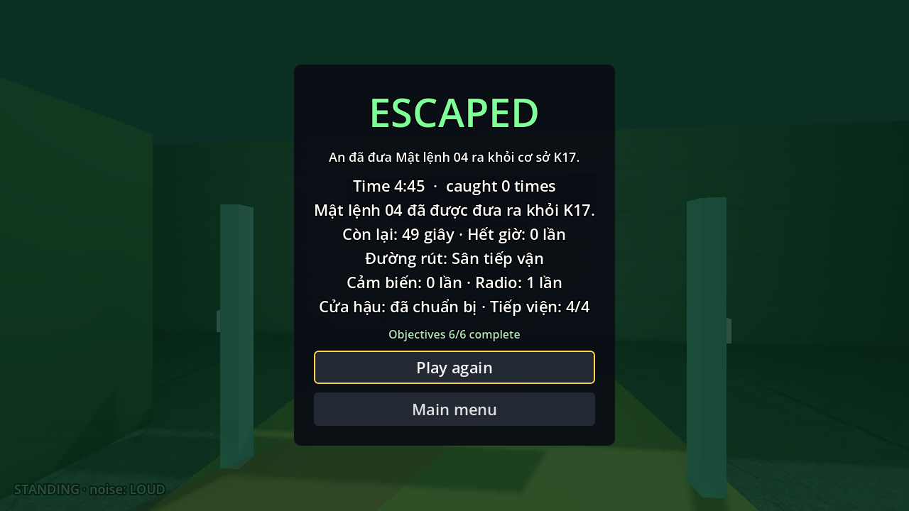
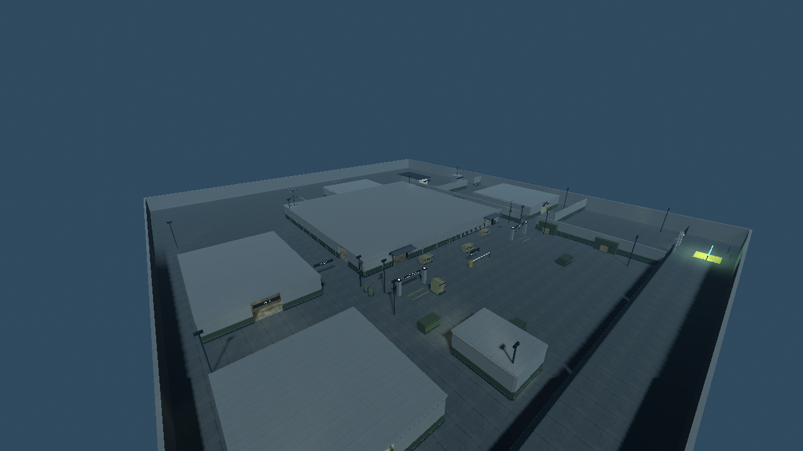
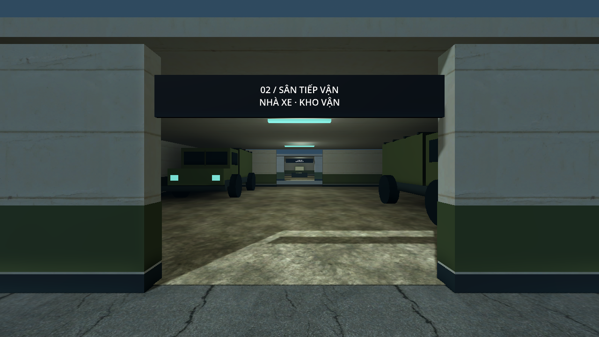
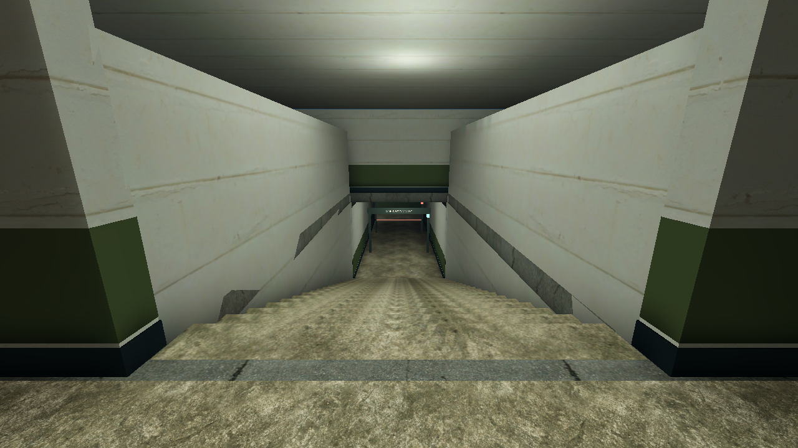
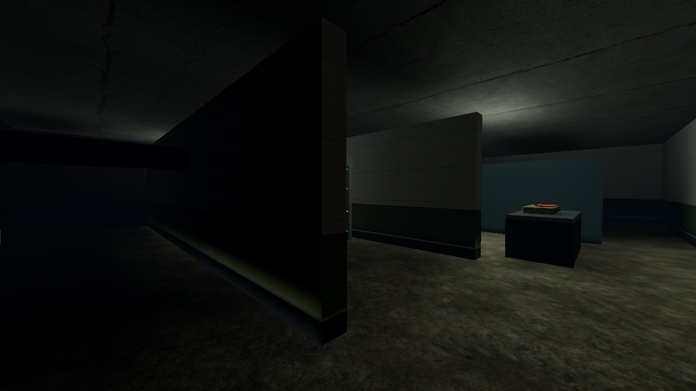
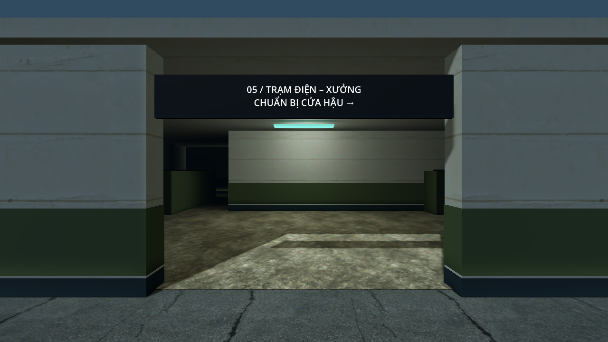

# Nghiệm thu K17 V3 — tổ hợp tình báo

Ngày kiểm tra: **27/10/2026**. Nhánh triển khai: **`feature/twp`**, phát triển từ `c9e0784`. Godot **4.7.2 official**, Windows, renderer **Compatibility**. Báo cáo ghi kết quả tự động và các lượt chơi có render; thời lượng, độ khó với người chơi mới còn cần nhóm chơi thử.

## Bản đã triển khai

- Khuôn viên **96 × 108 m**, gấp **3,6 lần diện tích bao ngoài** bản 48 × 60 m. Diện tích này gồm cả tường, nhà và vật cản, không phải toàn bộ diện tích đi được.
- Tám sector được instance thành scene riêng: vành đai, nhà xe, phòng trực, chỉ huy, trạm điện, phân loại hồ sơ, kho mật và tuyến dịch vụ.
- Kho mật **B1 ở cao độ −4 m**; phòng chính **20 × 16 m**, có hành lang ngầm phía đông và hai cầu thang đi bộ. Bản kế hoạch ước lượng 20 × 18 m; kích thước trên là hình học thực tế đã dựng.
- Sáu mục tiêu bắt buộc: vào K17, giấy thông hành, sơ đồ/mã kho, checkpoint khu mật, Mật lệnh 04 và tập kết. Có hai checkpoint trước hồ sơ; chuẩn bị chốt cửa hậu là tùy chọn.
- Sáu lính thường trực. Sau khi lấy hồ sơ: **T+10 thêm hai cảnh vệ**, **T+45 thêm hai**, tổng tối đa **mười**. Điểm vào không an toàn được hoãn tối đa tám giây; không chuyển lính sang vị trí người chơi.
- Lịch rút lui: cảnh báo T+70, cổng sân nhận lệnh đóng T+90, loa chốt đông T+100, thất bại T+120. Cửa hậu chưa chuẩn bị vẫn mở được bằng giữ E tám giây.
- Chế độ **không lính gác** dùng chung map/nhiệm vụ nhưng tắt cả sáu lính và hai đợt tiếp viện. Cảm biến, cửa, checkpoint và thời hạn vẫn hoạt động.
- Navmesh **861 polygon**; ánh sáng tĩnh bake lại cho toàn bộ tổ hợp. Lính, bản lề và lá cổng chuyển động không được ghi thành bóng tĩnh trong lightmap.

AI, điều khiển và tương tác dùng phần chung của nhóm. Phần điều phối tiếp viện, ngoại hình và nhiệm vụ mới nằm trong `maps/intelligence/`. Chỉ cập nhật mô tả catalog và điểm dò K17 trong bộ test chung. Không cần mua asset; xem [nguồn tài nguyên](../../assets/CREDITS.md).

## Kiểm tra chức năng

| Hạng mục | Kết quả | Bằng chứng |
|---|---|---|
| Toàn bộ kiểm thử hồi quy | `All tests passed` | [regression.log](regression.log) |
| Nhiệm vụ K17 | 136 kiểm tra, 0 lỗi | [k17-checks.log](k17-checks.log) |
| Giữ E/tương tác | 19 kiểm tra, 0 lỗi | cùng log trên |
| An ninh, cửa, cảm biến, radio | 45 kiểm tra, 0 lỗi | cùng log trên |
| Chế độ không lính | 38 kiểm tra, 0 lỗi | cùng log trên |
| Mở rộng/điều động tiếp viện | 40 kiểm tra, 0 lỗi | cùng log trên |
| Mỹ thuật, lightmap, mô hình động | 54 kiểm tra, 0 lỗi | [art.log](art.log) |
| Biên dịch GDScript | 185 script hợp lệ | [scripts.log](scripts.log) |
| Tham chiếu tài nguyên runtime | 339 tham chiếu hợp lệ | `python tools/ci/check_layout.py` |
| Menu, restart, đổi map | 100 kiểm tra, 24 lượt tải, 3 vòng; orphan 0 → 0 | [map-flow.log](map-flow.log) |
| Pause, bắt, thử lại, thắng | 15 kiểm tra, 4 lượt tải | [qa-flow.log](qa-flow.log) |
| PCK từ thư mục trống | Menu + bốn scene map/biến thể tải được; file phát triển bị loại | [pack-all.log](pack-all.log) |
| K17 trong PCK | Tám sector, B1, lightmap, 6 → 10 lính, ngoại hình lính mới, khôi phục và chế độ 0 lính đều đạt | [pack-k17.log](pack-k17.log) |

Các test tiếp viện kiểm tra hai mốc, không nhân đôi đợt, pause không điều động, giới hạn bốn lính, không xuất hiện trước hồ sơ, từ chối điểm gần người chơi, hết giờ và thử lại checkpoint dọn cả actor lẫn tuyến tạm. Test no-guard xác nhận không sinh lính sau các mốc điều động.

Log hồi quy chứa tám cảnh báo từ các fixture chủ động tạo tình huống Guard không có tuyến/ngoài navmesh. Chúng là tình huống kiểm thử dự kiến; bộ hồi quy kết thúc thành công. Không có `SCRIPT ERROR` trong các lượt kiểm tra đã đạt.

## Đi hết nhiệm vụ bằng điều khiển thật

Tool `playthrough_k17.gd` gửi input di chuyển, nhìn và giữ E; không dịch chuyển người chơi giữa các waypoint. Hai lượt có lính giữ đầy đủ nhìn/nghe/truy đuổi, dùng radio trước khi lấy hồ sơ và chuẩn bị cửa hậu. Đường sân đi vòng qua lối kỹ thuật và vật che thay vì chạy thẳng qua phòng trực.

| Lượt | Kết quả | Giây còn lại sau khi thắng | Bị bắt / chạm cảm biến | Tiếp viện |
|---|---|---:|---:|---:|
| Có lính, rút qua sân, mô phỏng 60 Hz | Thắng | 48,8 | 0 / 0 | 4/4 |
| Có lính, rút bảo trì, mô phỏng 60 Hz | Thắng | 42,7 | 0 / 0 | 4/4 |
| Có lính, rút qua sân, render thời gian thực | Thắng | 48,8 | 0 / 0 | 4/4 |
| Có lính, rút bảo trì, render thời gian thực | Thắng | 42,5 | 0 / 0 | 4/4 |
| Không lính, vào hậu cần, cửa hậu chưa chuẩn bị | Thắng | 34,7 | 0 / 0 | 0/4 |

Hai tuyến mô phỏng hoàn thành **145 waypoint**: [walking-live.log](walking-live.log). Lượt vào hậu cần và mở chốt tám giây: [walking-east-unprepared.log](walking-east-unprepared.log). Lượt native sân: **71 waypoint**, [walking-courtyard-native.log](walking-courtyard-native.log); lượt native bảo trì: **74 waypoint**, [walking-maintenance-native.log](walking-maintenance-native.log). Kết quả không có lần bị bắt không có nghĩa là lính không nhìn thấy/điều tra trong cả lượt.

Lượt native dùng cửa sổ 1280 × 720 và đồng hồ thực, không dùng `--fixed-fps`/`--max-fps` để tăng tốc. Tùy chọn QA `--background` tự tiếp tục khi cửa sổ mất focus; bản chơi thường vẫn pause khi mất focus. Lượt mô phỏng nhanh chỉ chứng minh đường đi và luật chơi, không phải số đo FPS.





## Tuần tra và cầu thang

Soak **90 giây mô phỏng**, sáu lính thường trực và bốn tiếp viện: mỗi NPC phải tới ít nhất bốn điểm, không phát tín hiệu kẹt. Log cuối: [patrol-ten.log](patrol-ten.log).

Soak này tạm dừng nhận thức nhìn để tách lỗi đường đi khỏi truy đuổi. Các lượt E2E có lính ở trên giữ nhận thức hoạt động. Tuyến tăng viện phía bắc đi được cầu thang chính xuống B1 rồi quay lại; hai cầu thang cũng được người chơi đi thật trong hai đường rút.

## Hiệu năng trên máy hiện tại

**Quadro P1000 4 GB**, Godot Compatibility, **1280 × 720**, tắt VSync. Ba giây đo cho mỗi góc sau thời gian ổn định, camera cố định, AI hoạt động, vô hiệu hóa bắt người chơi và cố định đồng hồ nhiệm vụ để so sánh sáu/mười NPC. Không chạy thêm Godot test trong lượt đo cuối; số đo lấy trên máy làm việc, chưa cô lập mọi tiến trình nền.

| Cấu hình | Góc sân | Khối giữa | B1 |
|---|---:|---:|---:|
| 6 NPC — FPS trung vị | 81,9 | 119,5 | 77,5 |
| 6 NPC — frame time p95 | 21,6 ms | 11,4 ms | 30,9 ms |
| 10 NPC + báo động — FPS trung vị | 63,8 | 107,6 | 73,4 |
| 10 NPC + báo động — frame time p95 | 23,3 ms | 13,1 ms | 17,6 ms |

Dữ liệu gốc: [render.json](render.json), [render.log](render.log). Engine báo khoảng 341 MB bộ nhớ hình ảnh; đây không phải toàn bộ VRAM của tiến trình. Khoảng 2.900–4.600 draw call mỗi frame còn tương đối cao. Các góc đã đo có FPS trung vị trên 60, nhưng p95 ở sân/B1 vượt 16,7 ms: **chưa thể kết luận giữ ổn định 60 FPS toàn lượt**. Chưa đo riêng cấu hình tám NPC. Cần profiler và thử máy khác trước khi chốt chuẩn hiệu năng.

## Xem bố cục và hình ảnh

Các ảnh dưới chụp bằng tool dàn góc camera, ẩn HUD trong scene không lính; dùng để xem bố cục/mỹ thuật, không thay ảnh thắng của E2E.











## Cách tái kiểm tra

Chạy từ thư mục repository, dùng executable Godot 4.7.2 của máy:

```text
godot --headless --path . --script res://maps/intelligence/tools/check_k17.gd
godot --headless --path . --script res://maps/intelligence/tools/check_art.gd
godot --headless --path . --fixed-fps 60 --max-fps 600 --script res://maps/intelligence/tools/playthrough_k17.gd -- --live-guards --crouch --prepare --radio --wait-radio --sprint-yard --settle-before-file --yard-flank
godot --headless --path . --fixed-fps 60 --max-fps 600 --script res://maps/intelligence/tools/guard_soak_k17.gd -- --reinforced
godot --path . --script res://maps/intelligence/tools/playthrough_k17.gd -- --live-guards --crouch --prepare --radio --wait-radio --sprint-yard --settle-before-file --yard-flank --route=maintenance --background
godot --path . --script res://maps/intelligence/tools/benchmark_expansion.gd
```

Tool benchmark mặc định ghi `ci-logs/k17-v3-render.json`. Tool chụp ảnh mặc định ghi `ci-logs/k17-v3-preview/`. Tool đi bộ hỗ trợ `--out=<thư mục>`; thêm `--entry=maintenance` để vào từ phía đông. Dựng/bake theo [README](../../README.md), không cần addon khi chạy game.

Kiểm tra PCK: export preset Windows Desktop ra PCK, sao chép `tools/ci/check_pack.gd` và `maps/intelligence/tools/check_pack.gd` sang thư mục trống, rồi chạy từng script ngoài dự án với `--headless --main-pack <đường dẫn PCK> --script <đường dẫn script>`. Không dùng bản sao các thư mục nguồn làm fallback.

## Phần cần nhóm chơi thử tiếp

- Thời lượng 10–15 phút lần đầu và 5–8 phút khi thuộc map là mục tiêu thiết kế; chưa có thử nghiệm với 3–5 người mới.
- Lượt có lính đã thắng bằng chiến thuật chọn trước. Chưa nghiệm thu đầy đủ trường hợp liên tục bị truy đuổi hoặc đổi từ sân sang cửa hậu sau cảnh báo đóng cổng; test chức năng cửa/thời hạn đã đạt. Cần ghi điểm lạc đường, thời gian chờ và mức dư khi rút với người chơi thật.
- Mỹ thuật vẫn theo phong cách đơn giản, dùng asset miễn phí và hình học tự dựng; chưa có chiến đấu, bắn súng, leo dây hoặc xe lái được.
- Helper editor tạm dùng để bake tự động đã lưu lightmap thành công, nhưng khi đóng editor có báo `Can't use get_node() with absolute paths from outside the active scene tree.` Helper đã được bỏ khỏi dự án; renderer cấu hình chính vẫn Compatibility. Kiểm tra art, runtime và PCK xác nhận lightmap hợp lệ và không ghi lính/cửa động thành bóng tĩnh. [Log bake helper](bake-helper.log) lưu riêng để không nhầm lỗi đóng editor với lỗi chơi game.
