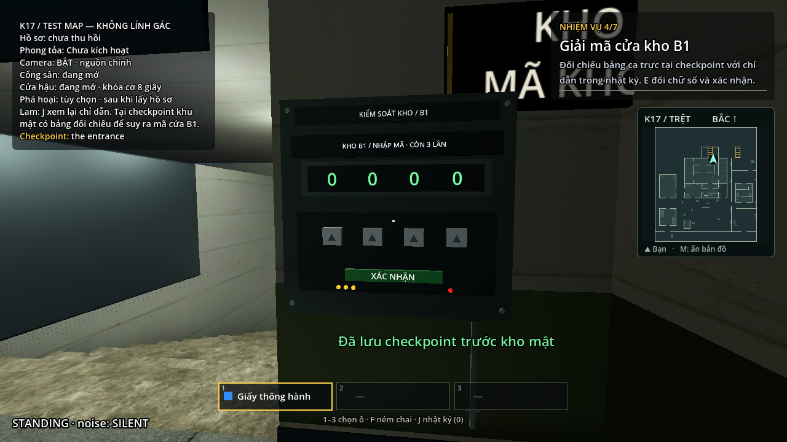
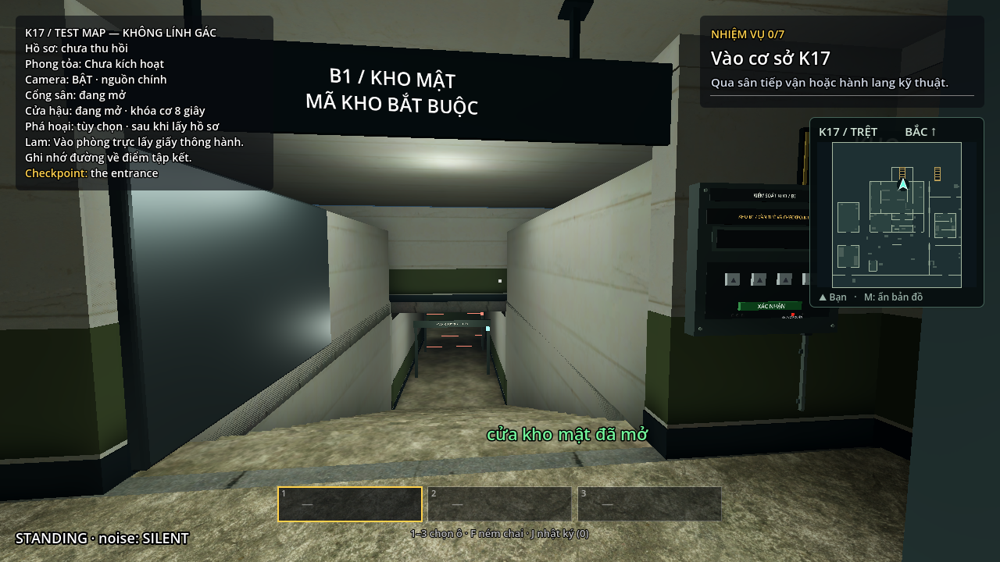
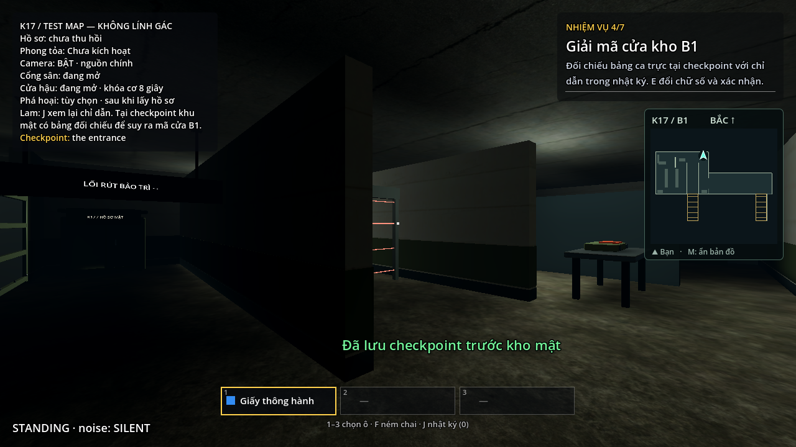
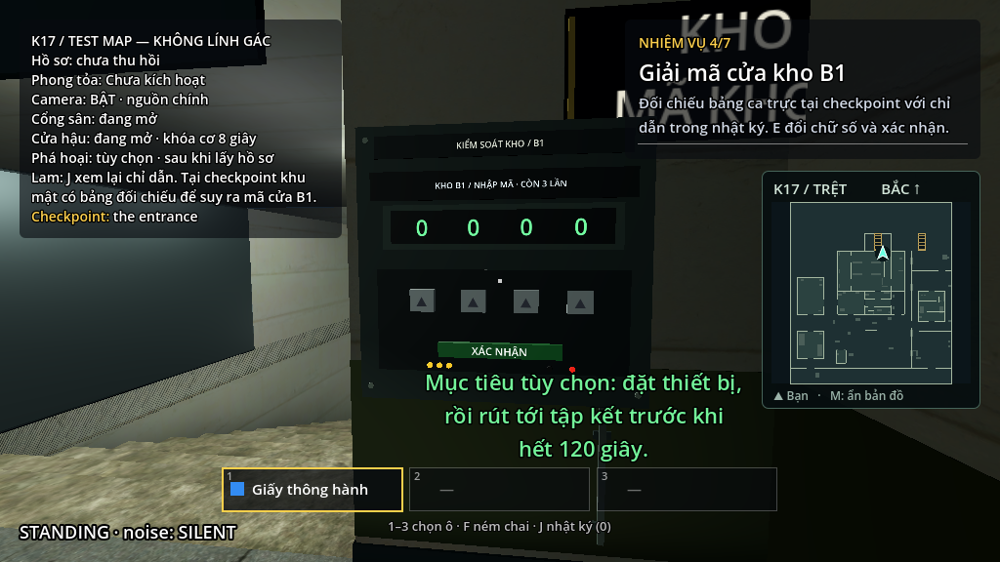

# K17 — Nghiệm thu keypad và minimap

Ngày kiểm tra: 28/10/2026. Godot **4.7.2**, nhánh `feature/twp`; tiếp nối V5 tại `db3818548f48e415d3c8cf5b9dcb9e7b64ef17ef`.

## Thay đổi đã hoàn thành

- Chuyển toàn bộ keypad sang tường cố định bên phải cửa B1, tại `(6.7, 1.3, -23.709)`. Vỏ, màn hình, phím, đèn, biển tên và ống dây cùng dùng một hệ tọa độ. Bỏ bảng và chân đế cũ giữa khoảng cửa.
- Mặt lưng vỏ ở Z≈−23,825, tiếp xúc tường `North1`. Cả bốn phím và nút xác nhận ngồi vào mặt đỡ khoảng **1,50 mm**, thay cho khoảng hở **4,85 cm** trước sửa. Có kiểm tra mặt đỡ khi nghỉ và khi nhấn.
- Đưa bản lề ra khỏi Panel bị ẩn của các cửa K17 dùng cùng cách dựng. Cánh cửa còn hiển thị lúc đang mở và mở hết 90°; Panel tiếp tục điều khiển va chạm như trước. Checkpoint đóng lại cả hình ảnh lẫn va chạm.
- Thêm minimap 2D bên dưới nhiệm vụ. Mũi tên đọc trực tiếp transform của Player, thể hiện vị trí/hướng thật; phía trên là hướng −Z của map. Tầng trệt và B1 có khung riêng, tự đổi tầng với độ trễ khi qua cầu thang.
- M bật/tắt minimap. Nhật ký, pause, bị bắt, thất bại, kết quả và đoạn kết phá hoại V5 đều ẩn minimap; khi tiếp tục chơi vẫn giữ lựa chọn bật/tắt của người chơi.
- Sinh mặt bằng từ collider sàn/vật cản và hình học phòng trước bước gộp mesh; không chiếu toàn bộ mái/navmesh xuống làm đường đi. Resource được đóng gói cùng game. Không thêm camera render 3D cho minimap.
- Giữ điều kiện thẻ/checkpoint, nhập mã bằng E, ba lần sai/khóa tạm, hai đường rút, đồng hồ 120 giây, lịch tiếp viện và nhiệm vụ phá hoại V5.

Số đo trước sửa: [INSPECTION.json](INSPECTION.json). Số đo và snapshot sau sửa: [AFTER.json](AFTER.json). Kiến trúc/collider và lightmap hiện có được giữ; navmesh vẫn **950 polygon**. Không bổ sung tài nguyên mua ngoài.

## Kiểm tra tự động

| Nhóm kiểm tra | Kết quả | Bằng chứng |
| --- | --- | --- |
| Toàn bộ hồi quy K17, bao gồm bộ mới | **612 kiểm tra, 0 lỗi** | [regression.log](regression.log) |
| Riêng keypad/minimap | **133 kiểm tra, 0 lỗi** | [navigation.log](navigation.log) |
| Script toàn project | **226 script hợp lệ** | [scripts.log](scripts.log) |
| Mỹ thuật, lightmap, cửa, HUD opt-in | **66 kiểm tra, 0 lỗi** | [art.log](art.log) |
| Gá biển và điểm nối ống/máng dây | **231 kiểm tra, 0 lỗi** | [attachments.log](attachments.log) |
| PCK chạy ngoài project | Bản thường và không lính: đủ vỏ keypad, dữ liệu minimap, marker thật, tiếp viện, V5 và restore | [pack.log](pack.log) |

Bộ mới dựng scene runtime để có đủ các phím sinh trong `_ready()`, đo mặt phím và kiểm tra mặt lưng vỏ bằng tia vào tường thật. Dùng tia tương tác và E thật để kiểm tra từng phím khi đứng/ngồi và nút xác nhận; kiểm tra cửa đang mở, mở hết, đi qua và restore.

Các fixture minimap kiểm tra điểm xuất phát, khu thông tin, checkpoint, keypad, B1, hành lang và hai đường ra; bốn hướng quay, nhìn lên, cầu thang, hysteresis, hồi sinh, map root dịch/xoay, phím M, nhật ký và các trạng thái GameFlow. Đoạn kết V5 được kích hoạt trong fixture để xác nhận minimap thực sự đi theo HUD khi ẩn/hiện. Fixture là kiểm tra tách lỗi, không thay thế lượt chơi từ đầu.

## Lượt chơi bằng điều khiển thật

Tool dùng bộ điều khiển nhân vật, tia tương tác, E/giữ E, cửa và cảm biến thật; không dịch chuyển giữa waypoint. Ở mỗi waypoint, tool còn đối chiếu vị trí/hướng/tầng của minimap với Player đang được điều khiển.

| Lượt | Kết quả | Thời gian còn lại | Bằng chứng |
| --- | --- | --- | --- |
| Nhiệm vụ gốc, không lính, cả hai tuyến | Thắng; 149 waypoint, 149 mẫu minimap, 0 cảm biến | Sân **52,0 giây**; bảo trì **41,2 giây** | [walking-original.log](walking-original.log) |
| Phá hoại V5, không lính, cả hai tuyến | Thắng; 156 waypoint, 156 mẫu minimap, 0 cảm biến | Sân **65,5 giây**; bảo trì **76,1 giây** | [walking-sabotage.log](walking-sabotage.log) |
| Phá hoại V5, đầy đủ AI, tuyến bảo trì đã chuẩn bị | Thắng; 109 waypoint, 109 mẫu minimap, 0 bị bắt/0 cảm biến, đủ bốn tiếp viện | **34,6 giây** | [walking-live.log](walking-live.log) |

Đợt này kiểm chứng lượt thắng với đầy đủ AI ở tuyến bảo trì. Hai lượt đi qua sân trong bảng là bản không lính. Các giới hạn về tuyến sân và người chơi mới của [nghiệm thu V5](../sabotage-v5/VALIDATION.md) vẫn áp dụng.

## Kiểm tra hình ảnh và bố cục

Ảnh dưới đây được chụp bằng renderer Compatibility thật, dàn trạng thái để rà hình học/HUD. Bằng chứng đi trọn nhiệm vụ là các log E2E phía trên.









Đã kiểm tra cửa sổ 1280×720, 1024×768 và 1920×1080, HUD 100%/125%. Game dùng chế độ stretch `canvas_items`; canvas logic lần lượt là 1280×720 hoặc 1024×576 theo cỡ HUD. [layouts.json](screens/layouts.json) lưu cả kích thước cửa sổ và canvas để tránh nhầm pixel cửa sổ với tọa độ giao diện.

Minimap lấy vị trí từ đáy thực tế của bảng nhiệm vụ. Thông báo được xuống dòng trong vùng trung tâm bên trái minimap, tránh phụ đề bên trái và hành trang bên dưới. Kiểm tra vùng giao diện và ảnh thực không thấy minimap chồng nhiệm vụ, trạng thái, hành trang, lời nhắc E hoặc thông báo trong các trường hợp đã thử. Ảnh chính diện/nhìn nghiêng đã được rà lại sau khi tách hai bề mặt đồng phẳng gây nhấp nháy.

## Hiệu năng

Máy đo: **NVIDIA Quadro P1000**, Compatibility, 1280×720, VSync tắt. So sánh cùng cảnh/cùng góc nhìn với minimap OFF/ON/ON/OFF; mỗi mẫu làm nóng một giây rồi đo bốn giây. Mười actor được giữ đứng yên và mô phỏng được đóng băng giống nhau để tách chi phí của minimap. Đây là phép đo renderer theo thời gian thực, không phải FPS của headless hoặc cam kết FPS cho toàn lượt chơi.

| Góc nhìn | Frame time trung vị, trung bình hai mẫu OFF | Trung bình hai mẫu ON | Chênh lệch |
| --- | --- | --- | --- |
| Sân | 12,234 ms | 11,971 ms | −2,15% |
| Keypad | 4,608 ms | 4,717 ms | **+2,37%** |
| B1 | 10,813 ms | 10,884 ms | **+0,66%** |

Số đo nằm trong mục tiêu tăng tối đa 5% ở cả ba góc đã thử. Số âm ở góc sân phản ánh dao động giữa các mẫu, không có nghĩa minimap làm game nhanh hơn. Minimap thêm khoảng 15 draw call trong phép đo; nền sơ đồ được giữ lại giữa các frame, chỉ marker cập nhật liên tục. Dữ liệu đầy đủ, gồm P95 và số frame: [performance.json](performance.json).

## Chạy lại

Từ thư mục project, dùng executable Godot 4.7.2 thay cho `godot` nếu máy chưa thêm PATH:

```text
godot --headless --path . --fixed-fps 60 --max-fps 600 --script res://maps/intelligence/tools/check_k17.gd
godot --headless --path . --fixed-fps 60 --max-fps 600 --script res://maps/intelligence/tools/check_navigation.gd
godot --headless --path . --script res://tools/ci/check_scripts.gd
godot --headless --path . --script res://maps/intelligence/tools/check_art.gd
godot --headless --path . --script res://maps/intelligence/tools/check_attachments.gd
godot --headless --path . --fixed-fps 60 --max-fps 600 --script res://maps/intelligence/tools/playthrough_k17.gd -- --crouch --sprint-yard --prepare
godot --headless --path . --fixed-fps 60 --max-fps 600 --script res://maps/intelligence/tools/playthrough_k17.gd -- --crouch --sprint-yard --prepare --sabotage --sprint-exfil
godot --headless --path . --fixed-fps 60 --max-fps 600 --script res://maps/intelligence/tools/playthrough_k17.gd -- --live-guards --crouch --prepare --radio --wait-radio --watch-patrol --sprint-yard --settle-before-file --yard-flank --route=maintenance --sabotage --camera-off --utilities-north
godot --path . --script res://maps/intelligence/tools/preview_navigation.gd
godot --path . --script res://maps/intelligence/tools/benchmark_navigation.gd
```

Chạy `build_k17.gd` sẽ sinh lại resource minimap trước khi gộp sector. Tệp cấu hình gá, script runtime, resource sinh ra và scene chính đều được lưu trong repo; không cần chạy công cụ dựng khi chỉ mở game để chơi.

Để xem thay đổi trên máy đang mở game cũ: **đóng cửa sổ game đó rồi mở lại map**. Bản standalone đã chạy giữ scene/script trong bộ nhớ; tải lại project bằng tiến trình mới bảo đảm dùng đúng phiên bản vừa sửa.
