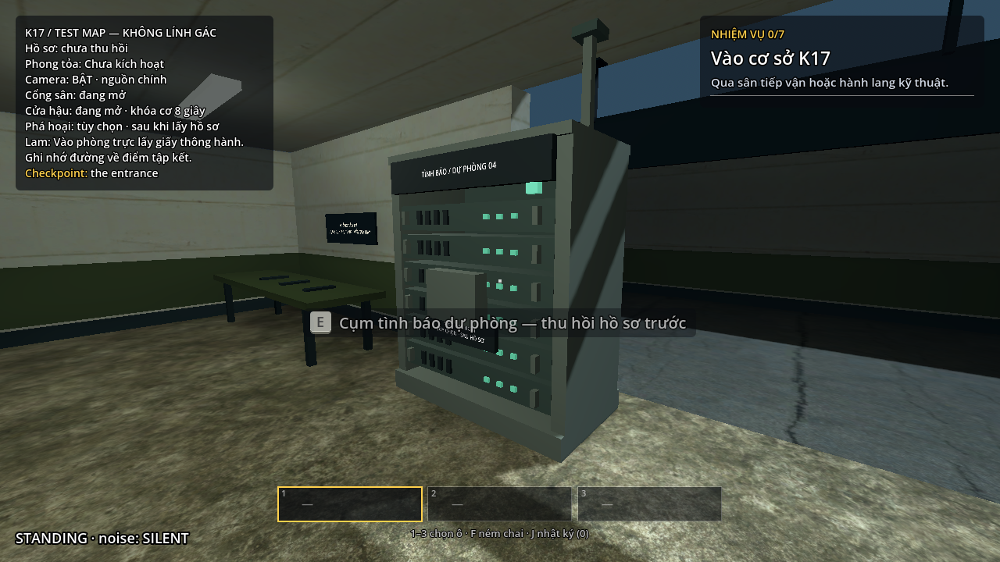
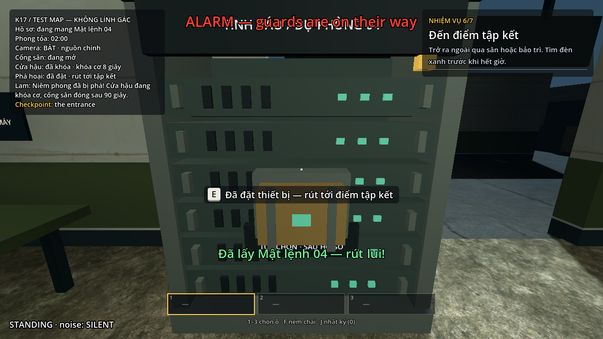
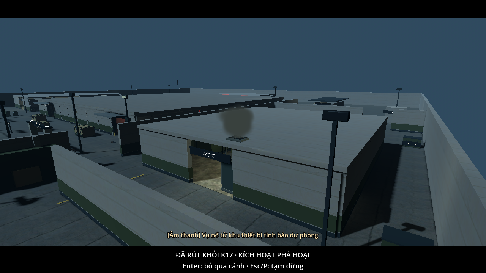
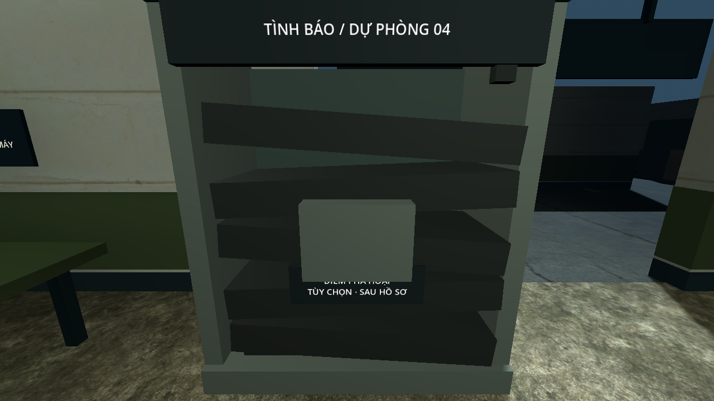

# K17 V5 — Phá hoại tùy chọn

Triển khai ngày 27/10/2026 trên `feature/twp`, tiếp sau `2b4c84b`. Godot 4.7.2 official, Windows, Compatibility. Phạm vi: bản đầu của [kế hoạch V5](PLAN.md).

## Bản đã làm

- Một tủ chuyển tiếp/lưu trữ tình báo ở xưởng phía đông, cạnh bàn dụng cụ: tâm `(37.6, 0, 17.15)`, quay mặt vào phòng. Điểm đứng kiểm tra `(37.6, .05, 15.25)` nối với đường bảo trì trên navmesh thật.
- Tủ có bệ sàn, khung, bảng gắn vào khung, mặt đỡ chỉ dẫn và thiết bị; dây đi tới trần, cửa thông gió đặt trên mái. Collider và vị trí tiếp cận không chắn cửa hoặc đường tuần tra hiện hành.
- Sau hồ sơ, giữ E năm giây bằng PlayerInteractor dùng chung. Hủy khi nhả, nhìn lệch, rời tầm hoặc pause; một thiết bị nhiệm vụ, không chiếm ô đồ và không tiêu hao khi hủy.
- Giữ 7 mục tiêu bắt buộc, thêm mục tiêu phụ thứ ba `sabotage_k17`. Đặt xong chỉ là ARMED; phá hủy sau khi thoát mới hoàn thành mục tiêu này.
- Giữ 120 giây, camera dự phòng T+15, hai đợt tiếp viện T+10/T+45, lịch cổng và AI. Tủ nằm trong xưởng mở; kiểm tra đường nhìn xác nhận lính có thể nhìn thấy điểm thao tác từ mặt hở.
- Tập kết hợp lệ chốt thời gian/tuyến rút, dừng đồng hồ, actor và sự kiện camera/radio/cổng/tiếp viện. Nhánh thường WIN ngay; nhánh đã đặt chờ cảnh phá hủy khoảng bốn giây rồi WIN.
- Finale có pause/mất focus, Enter bỏ qua, chốt sự kiện một lần, giới hạn chờ sáu giây và đường hoàn tất dự phòng nếu phần trình bày không chạy. Số liệu kết quả lấy tại tập kết, không cộng thời gian cảnh.
- Retry khôi phục tủ/thiết bị, xóa cờ thoát và vô hiệu mã lượt cũ. Restart/về menu không cho sự kiện cũ hoàn tất lượt đã bỏ.
- Tủ được gom mesh theo từng trạng thái độc lập, dùng ánh sáng động/probe. Giữ collider và navmesh mới **950 polygon**; không bake bóng của tủ nguyên vẹn vào phòng. Kiến trúc tĩnh và lightmap V4 được giữ, không sửa/bake lại hình học phòng.
- Hiệu ứng hạt CPU có giới hạn, texture gradient mềm và một đèn xung không shadow; không mô phỏng mảnh vỡ/sập tường. Âm thanh tự tổng hợp, không mua hoặc tải asset mới.

## Kiểm tra logic và tài nguyên

| Hạng mục | Kết quả | Bằng chứng |
|---|---|---|
| Toàn bộ nhiệm vụ/hồi quy K17, hold, an ninh, test mode, V3/V4 và V5 | 479 kiểm tra, không lỗi | [regression.log](regression.log) |
| Riêng V5, nằm trong tổng trên | 78 kiểm tra, không lỗi | [sabotage.log](sabotage.log) |
| Script toàn project | 217 script biên dịch hợp lệ | [scripts.log](scripts.log) |
| Gá đỡ/đầu nối của bản đồ hiện có | 231 kiểm tra, không lỗi | [attachments.log](attachments.log) |
| Mỹ thuật/lightmap và trạng thái thiết bị | 65 kiểm tra, không lỗi | [art.log](art.log) |
| PCK chạy từ thư mục trống | Bản thường/test, đủ tiếp viện, đặt/kích hoạt/restore hoạt động; file tác nghiệp được loại khỏi pack | [pack.log](pack.log) |

Kiểm tra V5 có dùng fixture để tách lỗi: trước/sau hồ sơ; hold thật/hủy/pause; giữ nguyên hành trang; bị bắt/hết giờ và checkpoint; cùng tick về 0 tại tập kết; hai tuyến; Enter không bấm nhầm Chơi lại; ngừng tiếp viện/nguồn sau tập kết; thiếu hoặc treo phần trình bày; callback lặp/lượt cũ; restart/menu; số liệu thời gian; kết quả ở HUD scale 1,25 với cửa sổ 1280×720 và 1024×768. Các fixture không được coi là bằng chứng đã đi trọn map.

## Lượt đi nhiệm vụ bằng input thật

Tool điều khiển người chơi, camera, cửa, keypad và E/giữ E thật; không dịch chuyển giữa waypoint. Camera/cảm biến vẫn hoạt động trong chế độ không lính.

| Lượt | Kết quả | Thời gian rút / còn lại | Bằng chứng |
|---|---|---|---|
| Nhiệm vụ gốc, không phá hoại, không lính, đi cúi/chạy sân | Thắng cả hai đường, 147 waypoint, 0 cảm biến | Sân 68,0 / 52,0 giây; bảo trì 78,8 / 41,2 giây | [walking-original.log](walking-original.log) |
| Phá hoại, không lính, chạy trong chặng rút | Thắng cả hai đường, 154 waypoint, 0 cảm biến | Sân 54,5 / 65,5 giây; bảo trì 43,9 / 76,1 giây | [walking-sabotage-fast.log](walking-sabotage-fast.log) |
| Phá hoại, đầy đủ AI, bảo trì đã chuẩn bị, headless 60 Hz — lượt 1 | Thắng, 108 waypoint, 0 bị bắt/0 cảm biến, đủ bốn tiếp viện | 84,3 / 35,7 giây | [walking-live-1.log](walking-live-1.log) |
| Cùng nhánh, headless 60 Hz — lượt 2 | Thắng, 108 waypoint, 0 bị bắt/0 cảm biến, đủ bốn tiếp viện | 85,4 / 34,6 giây | [walking-live-2.log](walking-live-2.log) |
| Phá hoại có renderer, thời gian thực | Thắng, 108 waypoint, 0 bị bắt/0 cảm biến, đủ bốn tiếp viện; toàn nhiệm vụ khoảng 6:59 | 85,8 / 34,2 giây | [native-live.log](native-live.log), [ảnh kết quả](live-demo/maintenance_03_victory.png) |
| Bản cuối sau gom mesh/warm-up, có lính, bảo trì | Thắng, 108 waypoint, 0 bị bắt/0 cảm biến, đủ bốn tiếp viện | 85,4 / 34,6 giây | [walking-final-live.log](walking-final-live.log) |

Lượt thứ hai/tool mới giảm tốc trước góc cua thay vì chạy quá đà; không thay luật di chuyển. Số đo bao gồm giữ E năm giây nhưng không bao gồm cảnh kết, vì đồng hồ chốt ngay tại tập kết. Số nguyên trên HUD làm tròn lên, log giữ một chữ số thập phân.

### Những lượt thất bại cũng được giữ lại

- [Chưa chuẩn bị cửa hậu](walking-unprepared.log): đặt được thiết bị nhưng bị Reinforcement3 bắt khi giữ khóa cơ tại cửa hậu. Đây là rủi ro thật của thao tác tám giây; không sửa AI hoặc cho miễn bị bắt để biến lượt này thành thắng.
- [Đi chậm rồi vòng ra sân](walking-slow-courtyard.log): cổng sân đã đóng T+90, tool cố đi tiếp nên hết giờ. Cùng file có lượt bảo trì thắng, còn 35,7 giây. Tuyến sân có hỗ trợ kết thúc phá hoại nếu tới kịp, không bảo đảm mọi đường vòng/tốc độ đều khả thi.
- [Chạy nhanh trong nhà khi rút qua sân](walking-courtyard-sprint-failed.log), không phá hoại: Guard5 truy đuổi và bắt ở khối giữa. Thắng chức năng trên bản không lính không đồng nghĩa tuyến input chạy nhanh này an toàn trước AI.
- [Đi cúi rồi chạy sân](walking-courtyard-crouch-failed.log), không phá hoại: bị Reinforcement1 bắt ở hành lang khối giữa. Đợt này chưa có lượt E2E thắng đường sân với đầy đủ AI; hai tuyến đã thắng trên bản không lính, còn bằng chứng thắng có lính tập trung ở tuyến bảo trì. Không điều chỉnh an ninh để ép các tuyến input thử này thắng.
- Lượt có lính đầu dùng lịch chờ từ bản cũ bị bắt trước khi lấy hồ sơ. Tool được sửa để quan sát tuần tra khi còn nấp sau cửa hồ sơ/checkpoint rồi mới băng qua, thay cho giả định thời gian chờ cố định. Không thay cấu hình lính hoặc tắt nhận thức trong các lượt thắng.

## Cân bằng so với kế hoạch

Kế hoạch ban đầu dự trù mục tiêu phụ tăng 15–25 giây. Vị trí thật nằm sát đường rút nên các lượt cúi/chạy sân hiện cho thấy tăng khoảng **6–7 giây** so với lượt bảo trì không phá hoại đã đo. Không kéo dài đường đi hoặc thêm thời gian chờ giả để đạt con số dự trù.

Đây là mục tiêu phụ ngắn, có năm giây đứng thao tác ở mặt hở và rủi ro do tuần tra/chốt cửa. Cả ba lượt có lính thành công đều đã biết đường và chuẩn bị cửa hậu; chưa phải số liệu của người chơi mới. Cần người chơi mới đánh giá thêm mức dễ hiểu và độ khó trước khi quyết định tăng rủi ro, đổi vị trí hoặc thêm mục tiêu thứ hai.

## Hiệu năng

Máy đo: Quadro P1000 4 GB, 1280×720, Compatibility, VSync tắt. So sánh cùng góc xưởng/dịch vụ, mười NPC hoạt động, camera bật, hai lượt tám giây mỗi góc sau hai giây làm nóng. Đồng hồ/điều phối được cố định để so cùng điều kiện; đây không phải benchmark trọn lượt chơi.

- [Baseline trước V5](render-before.json).
- [Bản tủ trước khi gom mesh](render-unbatched.json): góc xưởng tăng frame time hơi quá mục tiêu 10%, đã tối ưu trước khi bàn giao.
- [Bản sau tối ưu](render-after.json).
- [Ba lượt đo cảnh kết](render-finale.json): renderer thật, tính cả lần kích hoạt hiệu ứng đầu; mười actor đã được đóng băng theo luật tập kết.

| Góc | FPS trung vị trước | FPS trung vị sau gom mesh | Tăng frame time trung vị, tính trung bình hai lượt |
|---|---|---|---|
| Dịch vụ | 110,9–112,1 | 109,8–110,0 | Khoảng 1,4% |
| Xưởng | 183,5–187,9 | 180,2–182,1 | Khoảng 2,5% |

Draw call góc xưởng giảm từ 697 ở bản tủ chưa gom xuống 567; baseline 545–550. Góc dịch vụ sau tối ưu 2051, baseline 2021. Hai góc đều dưới ngân sách tăng 10% frame time của kế hoạch.

Finale ba lượt: frame time trung vị **9,36–10,04 ms**, P95 **12,30–21,21 ms**, P99 **14,67–29,66 ms**. Lượt đầu có khung chậm nhất **46,12 ms** lúc sang bảng kết quả; các lượt sau tối đa 25,96/19,23 ms. Có thể còn một nhịp khựng ngắn ở chuyển cảnh/menu đầu tiên; không khẳng định mọi khung hình đều dưới 16,7 ms.

Đã thêm warm-up offscreen trong tám frame đầu lúc vào map, cho đúng vật liệu particle và hai góc nhìn, rồi giải phóng viewport phụ. Trước warm-up có khung đầu 102,74 ms; giữ [số đo trước warm-up](render-finale-before-warmup.json) để đối chiếu. Không dùng tốc độ mô phỏng headless làm số FPS và không suy rộng hai góc máy thành bảo đảm FPS cho mọi tình huống.

## Ảnh kiểm tra

Các ảnh tủ/cảnh kết dưới đây là góc dàn trạng thái để rà mỹ thuật. Bằng chứng đi trọn nhiệm vụ có lính là log và ảnh trong `live-demo/`.

## Tự chơi V5

1. Khởi động lại lượt K17 để tải scene mới; F5 chọn K17 hoặc F6 tại scene chính. Có thể chọn bản **Test map không lính gác** trước để xem vị trí.
2. Trước hồ sơ, chuẩn bị chốt cửa hậu ở trạm điện. Đọc ghi chú nguồn điện để lưu hướng dẫn phá hoại trong J.
3. Lấy Mật lệnh 04; theo đường bảo trì qua B1 và trạm điện.
4. Trong xưởng phía nam trạm điện, tìm tủ **TÌNH BÁO / DỰ PHÒNG 04** cạnh bàn dụng cụ. Nhìn mặt đỡ thiết bị, giữ E đủ năm giây.
5. Tiếp tục tới đèn tập kết ngoài cửa hậu trước khi đồng hồ về 0. Enter bỏ qua cảnh kết; Esc/P hoặc mất focus vẫn tạm dừng.

Không cần chọn bom trong túi hoặc nhấn F. Muốn ưu tiên hồ sơ thì bỏ qua tủ; nhiệm vụ vẫn hoàn tất bình thường.
