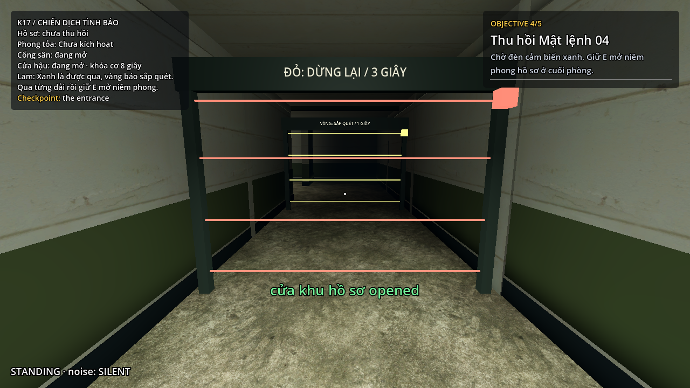
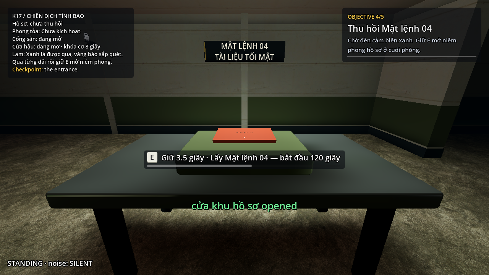
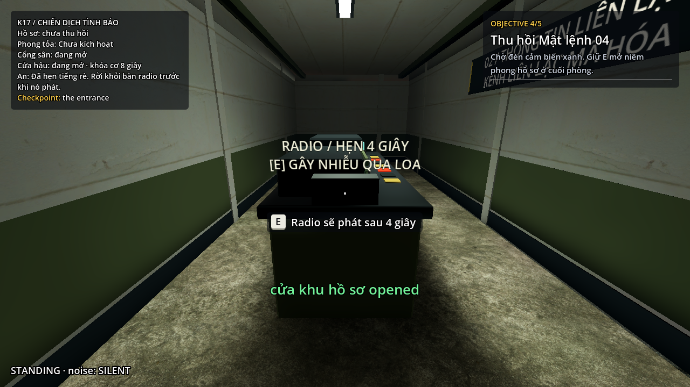
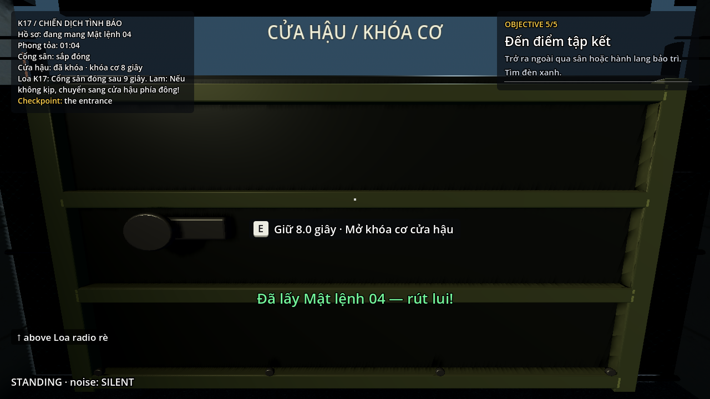
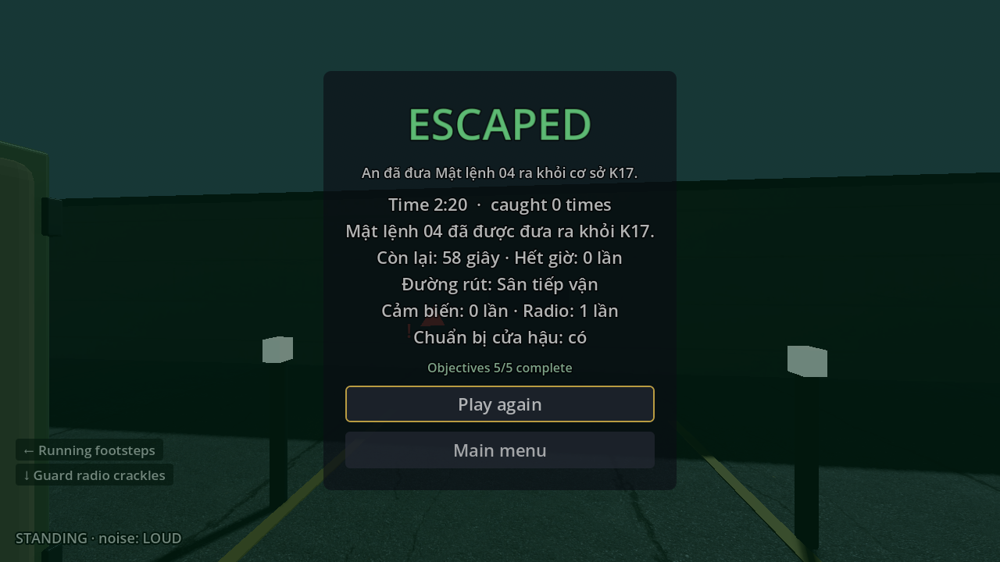
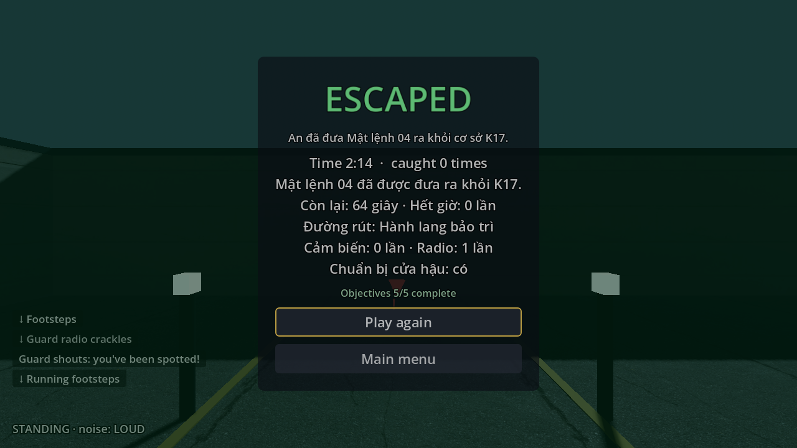

# Bản mở rộng cơ chế an ninh K17

Ngày hoàn thiện: 27/10/2026. Nhánh `feature/twp`, nền trước triển khai `132b777`. Godot `4.7.2.stable.official.ed1daf0bf`, Windows. Chi phí mua thêm asset: **0 đồng**.

## Cơ chế đã có

| Thành phần | Hành vi |
|---|---|
| Giữ E | Thời gian mặc định 0 cho đồ vật cũ. K17 mở niêm phong hồ sơ bằng 3,5 giây, có thanh tiến trình; hủy khi nhả E, mất mục tiêu/tầm/ray, thay đổi điều kiện, pause, bị bắt hoặc rời map. Giữ nút sau khi xong không tự lặp. |
| Cảm biến | Hai dải tại hành lang hồ sơ, chu kỳ tám giây: xanh bốn giây, vàng một giây, đỏ ba giây, lệch nhau bốn giây. Có biển đọc được từ hai phía. Chạm dải đang bật và không bị vật cản che sẽ phát báo động tại thiết bị, không giả lập lính bắt. |
| Radio | Bàn điều khiển hẹn bốn giây rồi hai loa PA phát tiếng rè; hồi 20 giây tính từ lúc hẹn. Loa ở hành lang và trên cột ngoài sân có vị trí âm thanh/noise thật; lính quyết định theo nghe và ước lượng nguồn hiện có. Truy đuổi không bị radio xóa trí nhớ. |
| Phong tỏa | Từ lúc thu hồi: khóa cơ cửa hậu; T+50 cảnh báo cổng sân; T+65 nhận lệnh đóng cổng sân; T+85 loa chốt đông phát lệnh kiểm soát. Mỗi mốc chạy một lần, kể cả khi một tick đi qua nhiều mốc. |
| Cổng và điều hướng | Collider và walking link chuyển cùng trạng thái. Navmesh cắt sẵn ở hai ngưỡng nên không còn đường nav ngầm qua cổng đã khóa. Kiểm tra vật cản ba giây, sau đó hủy lần đóng nếu còn người ở ngưỡng; lịch khác không chờ vô hạn. |
| Chuẩn bị cửa hậu | Trước khi lấy hồ sơ, giữ E 2,5 giây ở bảng chốt khu kỹ thuật. Có chuẩn bị: E mở nhanh; chưa chuẩn bị: giữ E tám giây tại cửa hậu. Cả hai cách đều tồn tại. |
| Checkpoint | Bổ sung tủ che bên hông để chắn hướng nhìn tuần tra từ phía tây. Snapshot gồm chuẩn bị, nhịp cảm biến, trạng thái cổng/link và lịch phong tỏa. Retry hủy hẹn radio, âm thanh cũ, tiến trình giữ E và lời thoại đang chờ. |
| Trình bày | Lời radio có ưu tiên/hàng đợi, trạng thái cửa thật trên HUD, tổng kết số lần chạm cảm biến/dùng radio/đã chuẩn bị. Ba cue relay, motor và radio tự tổng hợp; không thêm sample thương mại. |

Phần riêng nằm trong `maps/intelligence/`, lớp gameplay ở `scenes/k17_security.tscn`. Môi trường và lightmap được giữ nguyên. Navmesh hiện có 312 polygon và hai walking link. Imported mesh của lớp an ninh dùng GI động để nhận probe của môi trường; biển không quay theo camera.

## Kết quả kiểm tra

| Kiểm tra | Kết quả |
|---|---|
| [Biên dịch](logs/scripts.log) / [đường dẫn](logs/layout.log) | 175 script, 288 tham chiếu runtime hợp lệ |
| [Nhiệm vụ và cơ chế](logs/focused.log) | 108 kiểm tra nhiệm vụ + 19 giữ E + 45 an ninh, không thất bại |
| [Mỹ thuật](logs/art.log) / [hợp đồng map](logs/map-contract.log) | 44 kiểm tra mỹ thuật và map contract đạt |
| [E2E có render, bốn NPC](logs/live-rendered.log) | 63 waypoint, hai điểm tập kết thắng; mỗi lượt không bị bắt, không chạm cảm biến, dùng radio một lần và có chuẩn bị cửa hậu |
| [Tuần tra](logs/patrol.log) | 90 giây, bốn NPC đến 12/15/10/9 điểm, không bị kẹt |
| [QA flow](logs/qa-flow.log) | 15 kiểm tra, bốn lượt nạp đạt |
| [Map flow](logs/map-flow.log) | 76 kiểm tra, 18 lượt nạp, ba chu kỳ, node/orphan không tăng |
| [Hồi quy chung](logs/regression.log) | Tất cả suite đạt, gồm tutorial/library và giữ E mặc định tức thời |
| [Export](logs/export.log) / [PCK](logs/pack.log) | Menu và cả ba map nạp từ thư mục trống; giữ asset, âm thanh, cảm biến, thời gian giữ, cổng/link, lightmap và hình ảnh lính; loại test/tool/tài liệu |
| [Tài nguyên](logs/assets.log) | 58 file GLB/JPG/PNG/WAV có SHA-256; ba WAV đúng mono PCM16 22050 Hz; [nguồn](../../assets/CREDITS.md) |

Lượt E2E có render chạy nhịp mặc định ở 1280×720, OpenGL Compatibility trên Quadro P1000. Lượt này dùng bộ điều khiển và các tương tác thật, không dịch chuyển người chơi giữa các waypoint, không tắt NPC/cảm biến và không ép trạng thái AI. Tool cúi trong nhà, đợi đèn xanh, chuẩn bị chốt trước checkpoint, đợi trạng thái yên ba giây trước khi đi lấy hồ sơ, hẹn radio rồi đợi lính phản ứng, chạy ngoài sân. Cả hai bắt đầu qua lối sân; lượt thoát cổng tây đi vòng hành lang kỹ thuật rồi dọc vành đai sân. Đã xác nhận phương án này; chưa coi là mọi chiến thuật/tuyến đi thẳng đều đã cân bằng.

Kết quả còn 57,1 giây tại tập kết phía tây và 63,1 giây ở cửa hậu phía đông. Ở tuyến tây, đồng hồ đã chạy khoảng 62,9 giây nên chỉ còn khoảng hai giây trước lệnh đóng cổng T+65. Việc vào vùng tập kết sau khi đã qua cổng vẫn hợp lệ dù cổng sau lưng đóng. Cổng không được dùng làm điều kiện thắng trừu tượng để phủ nhận người đã ra ngoài.

Các lượt nhiệm vụ/cơ chế, patrol và map flow chạy headless nhịp mặc định; chỉ suite hồi quy chung dùng `--fixed-fps 60 --max-fps 600` để tăng tốc mô phỏng. Không dùng các lượt này làm số đo FPS. Hồi quy có tám cảnh báo chủ động của fixture Guard thiếu tuyến/navmesh hoặc bị kẹt; không có lỗi script/resource hoặc cảnh báo đối tượng rò lúc thoát. Các log tập trung và E2E kết thúc sạch.

Đã nhận diện cảnh báo playback WAV ở các lượt test tăng tốc trước đó. Bộ chạy test nay chờ ngắn theo thời gian thực và xử lý deferred free sau khi giải phóng scene để audio mixer thu hồi playback trước khi engine thoát. Không lọc/bỏ qua lỗi trong log và không đổi tốc độ game phát hành để xử lý cảnh báo. Thay đổi này chỉ nằm trong helper/harness kiểm tra.

## Giới hạn và cân bằng tiếp

Thông số 120 giây và các mốc 50/65/85 là cấu hình prototype. Một lượt có chiến thuật hoàn thành không chứng minh mọi người chơi sẽ hoàn thành hoặc map đạt thời lượng 10–15 phút. Lượt đi thẳng theo waypoint đã bị lính bắt, nhất là khi băng qua phòng trực hoặc đứng mở khóa cơ tám giây; cần quan sát, dùng vật che, radio và chuẩn bị đường rút. Chưa cân bằng bằng 3–5 người chưa biết map.

Độ tối vẫn không thay đổi luật nhìn/nghe của AI. Không có chiến đấu, dây đu, lồng tiếng, hồ sơ phụ hoặc nhiều mức khó trong đợt này. Nhạc và AI nền tiếp tục dùng hệ chung. Không đặt tên cửa sáng xanh là nơi bất tử; vùng checkpoint có vật che vật lý, không vô hiệu hóa nhận thức của NPC.

## Ảnh trạng thái

Bốn ảnh đầu được dàn vị trí/trạng thái bằng `capture_security.gd` trong scene thật, tắt quyết định NPC chỉ để nhìn rõ tính năng. Thanh giữ E trong ảnh đi qua input thật. [Log chụp](logs/capture.log). Hai ảnh cuối thuộc lượt E2E có đủ bốn NPC, không dùng capture-only.








## Tái kiểm tra

Từ root project, dùng Godot 4.7.2 official:

```text
godot --headless --path . --script res://maps/intelligence/tools/check_k17.gd
godot --headless --path . --script res://maps/intelligence/tools/check_art.gd
godot --headless --path . --script res://tools/qa_flow.gd
godot --headless --path . --script res://tools/map_flow.gd
godot --headless --path . --script res://maps/intelligence/tools/guard_soak_k17.gd
godot --headless --fixed-fps 60 --max-fps 600 --path . res://tests/test_scene.tscn
godot --path . --resolution 1280x720 --script res://maps/intelligence/tools/playthrough_k17.gd -- --live-guards --crouch --radio --wait-radio --prepare --sprint-yard --settle-before-file --yard-flank --entry=courtyard --out=res://ci-logs/k17-live
```

Để chơi bình thường: chạy project bằng F5, chọn K17; hoặc mở `scenes/intelligence_k17.tscn` và F6. Không truyền cờ QA khi chơi thường. Xem [hướng dẫn map](../../README.md) để biết vị trí radio/chốt và ý nghĩa các màu cảm biến.
