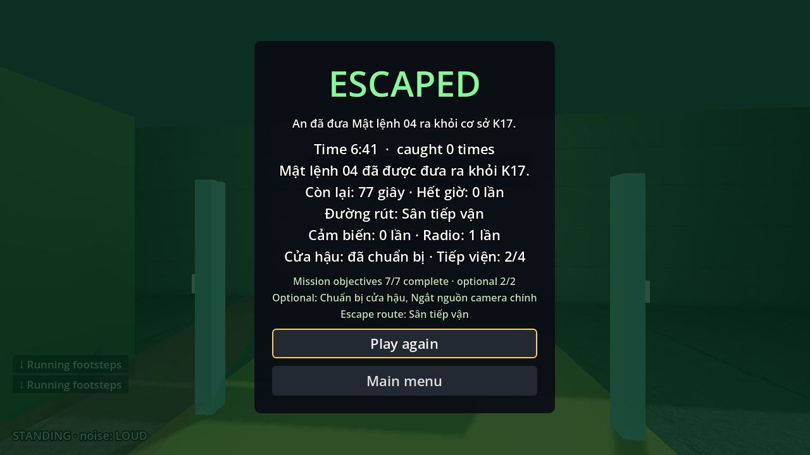
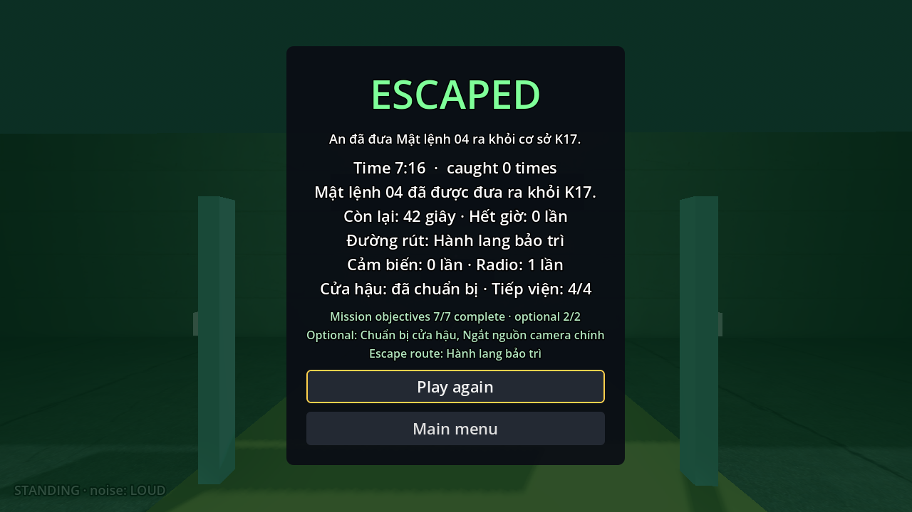
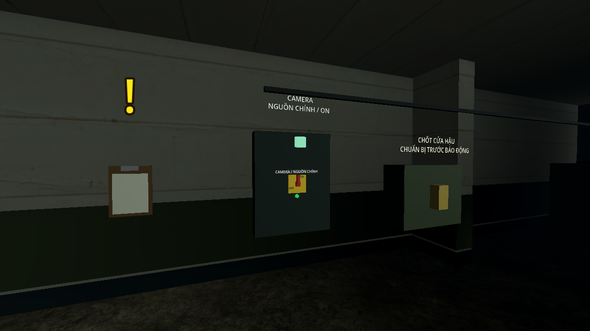
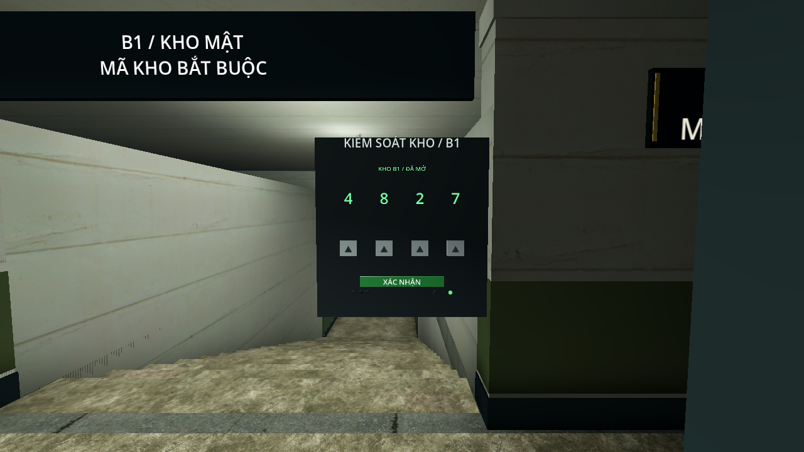

# Nghiệm thu kỹ thuật K17 V4 — thâm nhập và chuẩn bị

Ngày kiểm tra: **27/10/2026**. Nhánh **`feature/twp`**, phát triển từ V3 **`a7ad046`**; mã nguồn V4 **`97b0d02`**. Godot **4.7.2 official**, Windows, renderer **Compatibility**. Phần chính V4 đã triển khai; độ khó với người mới và stamina còn ở bước chơi thử.

## Nội dung chơi được

- Giữ khuôn viên 96 × 108 m, tám sector, B1, hai cầu thang, hai đường vào/rút và navmesh 861 polygon.
- **Bảy HidingSpot** gắn vật che. Cúi vào khi chưa bị thấy mới được che giấu; đứng lên, bị nhìn thấy khi vào hoặc lính tới kiểm tra vẫn có thể bị phát hiện.
- Toàn bộ sáu lính thường trực và bốn tiếp viện dùng luật an ninh mở rộng, tốc độ đuổi **5 m/s**. Báo động tăng tốc độ phát hiện ×1,35 và thời gian tìm kiếm ×1,5. Lúc rút duy trì cảnh giác nhưng không gửi liên tục tọa độ người chơi cho AI.
- **Ba camera**, công tắc nguồn chính tại trạm điện. Nguồn dự phòng cấp lại camera ở **T+15** sau lấy hồ sơ; công tắc nguồn chính không cắt được nguồn dự phòng.
- **Bảy mục tiêu bắt buộc và hai mục tiêu tùy chọn**. Thẻ và chỉ dẫn được tìm theo hai thứ tự; chuẩn bị cửa hậu/tắt camera không chặn thắng.
- Ba tài liệu trong nhật ký, câu đố bốn chữ số dựa trên chỉ dẫn và bảng ca trực; sai ba lần khóa tạm 20 giây, hết thời gian được thử lại. Cửa B1 không mở thủ công để bỏ qua khóa.
- Túi ba ô dùng chung: giấy thông hành và tối đa hai chai rỗng trong lượt. Hồ sơ/ghi chú không chiếm ô; ném không hợp lệ không mất chai. Các lượt thắng bên dưới không dùng chai.
- Thiết bị, biển, đèn báo nguồn và keypad có phản hồi trạng thái. Gom mesh tĩnh, tạo UV2 và bake ánh sáng V4. Không mua thêm asset.

Giữ lịch 120 giây, tiếp viện T+10/T+45, cảnh báo cổng T+70, đóng cổng sân T+90, loa T+100. Chế độ không lính vẫn giữ camera, câu đố, cảm biến, checkpoint và đồng hồ; cả NPC thường trực lẫn tiếp viện bằng không.

## Kiểm tra chức năng

| Hạng mục | Kết quả | Bằng chứng |
|---|---|---|
| Hồi quy toàn repository, gồm tutorial/Library | Tất cả đạt | [regression.log](regression.log) |
| Nhiệm vụ K17 | 131 kiểm tra, 0 lỗi | [k17-checks.log](k17-checks.log) |
| Giữ E/tương tác | 19 kiểm tra, 0 lỗi | Cùng log trên |
| Cảm biến, cửa, radio, báo động | 45 kiểm tra, 0 lỗi | Cùng log trên |
| Chế độ không lính | 36 kiểm tra, 0 lỗi | Cùng log trên |
| Mở rộng/điều động tiếp viện | 40 kiểm tra, 0 lỗi | Cùng log trên |
| Tính năng V4 | 108 kiểm tra, 0 lỗi | Cùng log trên |
| Mỹ thuật/lightmap | 54 kiểm tra, 0 lỗi | [art.log](art.log) |
| Biên dịch GDScript | 202 script hợp lệ | [scripts.log](scripts.log) |
| Tham chiếu runtime | 378 tham chiếu hợp lệ | [layout.log](layout.log) |
| Menu/restart/đổi map | 100 kiểm tra, 24 lần tải, 3 vòng; orphan 0 → 0 | [map-flow.log](map-flow.log) |
| PCK chạy từ thư mục trống | Menu + 4 scene/biến thể tải được, loại file phát triển | [pack-all.log](pack-all.log) |
| K17 trong PCK | 7 mục tiêu, inventory, 3 camera, 7 chỗ nấp, keypad, backup, 6 → 10 lính, thử lại và 0 lính đều đạt | [pack-k17.log](pack-k17.log) |

Tổng bộ kiểm tra K17 là **379**. Số lượng test nhiệm vụ/không lính khác V3 vì graph mới có nhiều mục tiêu cùng hoạt động; đã thay các giả định thứ tự tuyến tính bằng kiểm tra trạng thái phụ thuộc.

108 kiểm tra V4 bao gồm đường tới chỗ nấp; **22 waypoint tiếp viện** tới được chính xác; camera thấy mục tiêu thật, bị tường chặn, cúi giảm tốc độ phát hiện; nguồn chính/dự phòng, pause và thử lại; hai thứ tự thẻ–chỉ dẫn; nhật ký giữ kiến thức, không nhân đôi và không kẹt graph; mã sai/khóa tạm, không mở cửa sớm; inventory/tiêu hao/âm thanh ném/checkpoint; HUD ở sáu tổ hợp độ phân giải và tỷ lệ giao diện. Thử riêng hệ thống được phép cô lập AI/đặt trạng thái fixture; kết quả này tách với E2E chơi thật.

Hồi quy có tám cảnh báo dự kiến từ fixture cố ý tạo lính kẹt/không tuyến/ngoài navmesh; kết thúc `All tests passed`, không có `SCRIPT ERROR`. Helper bake đã lưu ánh sáng thành công nhưng phát thông báo engine khi đóng editor (`get_node()` ngoài cây scene); helper nằm ngoài project, không phải lỗi runtime trong bản chơi/PCK đã kiểm tra.

## Đi hết nhiệm vụ bằng input thật

`playthrough_k17.gd` dùng player chung, va chạm, nhìn và E/giữ E. Không dịch chuyển giữa waypoint; các lượt có lính giữ nhận thức và truy đuổi hoạt động. Tool biết trước tuyến/mã và thời điểm chờ, nên đây là nghiệm thu đường chơi, chưa đo trải nghiệm người mới.

| Lượt cuối | Waypoint | Kết quả | Thời gian rút / còn lại | Bị bắt / cảm biến | Tiếp viện |
|---|---:|---|---:|---:|---:|
| Có render, qua sân, chuẩn bị cửa hậu/tắt nguồn chính, chạy chặng rút | 99 | Thắng | 43,1 / 76,9 giây | 0 / 0 | 2/4 |
| Có render, bảo trì, chuẩn bị cửa hậu/tắt nguồn chính | 103 | Thắng | 78,3 / 41,7 giây | 0 / 0 | 4/4 |
| Mô phỏng 60 Hz, bảo trì, camera bật và cửa hậu chưa chuẩn bị | 59 | Thắng | 86,2 / 33,8 giây | 0 / 0 | 4/4 |
| Mô phỏng 60 Hz, không lính, vào hậu cần, cửa hậu chưa chuẩn bị | 60 | Thắng | 86,2 / 33,8 giây | 0 / 0 | 0/4 |

Log: [sân có render](walking-courtyard-native.log), [bảo trì có render](walking-maintenance-native.log), [camera bật/không chuẩn bị](walking-camera-on.log), [vào hậu cần không lính](walking-east-noguards.log).

Hai lượt native dùng cửa sổ 1280 × 720, thời gian thực, không `--fixed-fps`/`--max-fps`; chạy song song để kiểm tra chức năng, **không lấy FPS của chúng làm benchmark**. Chặng chuẩn bị gồm giải keypad bằng từng lần nhấn E. Cờ QA `--background` tiếp tục khi mất focus; bản chơi thường vẫn pause. Lượt 60 Hz dùng `--fixed-fps 60 --max-fps 600`; nó kiểm tra mô phỏng, không phải hiệu năng renderer.

Kiểm tra đổi đường riêng `redirect_v4.gd`: từ điểm quyết định `(4, 0, 7)`, **cửa hậu đã chuẩn bị**, camera bật và đủ mười NPC. Chuyển sang bảo trì ở **T+70** thắng còn 37,3 giây; ở **T+90**, cổng sân đã đóng, thắng còn 17,3 giây: [redirect-prepared.log](redirect-prepared.log). Fixture đặt hồ sơ/đồng hồ/trạng thái chuẩn bị ban đầu; từ đó AI, input, va chạm, cổng và đồng hồ chạy thật. Đây là kiểm tra đoạn rút, không thay lượt E2E từ đầu. Cùng điểm xuất phát nhưng cửa hậu chưa chuẩn bị bị bắt khi giữ khóa tám giây: [lượt đối chứng thất bại](redirect-unprepared-observation.log). Chuẩn bị tạo lợi thế cụ thể; không bảo đảm mọi vị trí/thời điểm đều đổi tuyến kịp.

Tuyến sân thắng trước T+45 nên đợt hai không cần sinh sau khi đã thắng. Bản chạy chậm qua cùng nút giao có thể bị tiếp viện bắt; đứng chờ ngoài sân để ép đủ hai đợt không phải chiến thuật an toàn. Một lượt camera bật ở nhịp thời gian thực khác cũng bị Guard3 bắt trước kho; chuỗi input định giờ không đại diện mọi nhịp tuần tra. Không thay AI hoặc tắt nhìn để làm các lượt thắng.

## Truy đuổi và đường tuần tra

Bốn tình huống `encounters_v4.gd` đều ghi nhận Guard thật phát hiện tới CHASE, sau đó mất dấu sang INVESTIGATE và không bắt được người chơi: [encounters.log](encounters.log). Hai lượt phản ứng sớm bắt đầu khoảng **13 m**. Hai lượt dùng vật che gồm phòng vô tuyến, bắt đầu **6 m**, vòng tủ rồi cúi nấp; và B1, bắt đầu **12 m**, vòng vách bên bàn hồ sơ. Khi ghi nhận mất tầm nhìn, khoảng cách vẫn trong tầm phát hiện 14 m. Lượt B1 đã bị thấy khi vào nên không được che giấu bởi HidingSpot; nó phải dựa vào vách vật lý, có cả lần bị nhìn lại rồi cắt đuôi lần nữa.

Các NPC/camera khác tắt trong fixture để tách hành vi truy đuổi; không thay E2E toàn nhiệm vụ. Tool kết thúc khi xác nhận cắt đuôi, không hứa được ở mãi trong chỗ nấp: lính vẫn có thể tới lục soát. Các thử phản ứng gần trên khoảng trống còn dễ bị bắt; tốc độ 5 m/s cần nhóm chơi thử thêm.

Soak 90 giây mô phỏng với mười NPC: mỗi người tới 7–18 waypoint, **kẹt 0, báo tới sai điểm 0**: [patrol-ten.log](patrol-ten.log). Soak tạm dừng nhận thức nhìn để tách lỗi đường; E2E ở trên giữ đầy đủ nhận thức.

Đã sửa tuyến tiếp viện phía bắc: điểm cũ `(14, 0, -22)` nằm trong khoang kín. Tuyến mới vòng qua các cửa hợp lệ ở phía đông rồi xuống B1. Kiểm tra cũ chỉ dựa vào tín hiệu tới cuối navpath có thể bỏ lọt điểm đích không tới được; V4 bổ sung kiểm tra khoảng cách thật đến waypoint trong soak và khoảng cách cuối path cho mọi điểm điều động.

## Hiệu năng và ánh sáng

Máy đo: **Quadro P1000 4 GB**, Compatibility, **1280 × 720**, VSync tắt. Mỗi góc ổn định hai giây rồi đo **30 giây thời gian thực**; bốn góc, 6/8/10 NPC, camera ON/OFF. Hai góc nặng với mười NPC/camera ON được đo thêm hai lượt, tổng ba lượt/góc. AI/camera vẫn hoạt động; tắt bắt, cố định đồng hồ và lịch nguồn để giữ cấu hình đo. Đây là góc cố định, không phải cam kết FPS toàn lượt.

Các lượt đo cuối không chạy thêm Godot test. Máy vẫn là desktop làm việc, có cửa sổ game cũ đang pause và tiến trình nền, chưa cô lập toàn máy. Ghi riêng median FPS, frame time p95/p99; không suy từ FPS trung vị rằng mọi frame đều đạt 60 FPS.

Mỗi ô dưới ghi **FPS trung vị / p95 ms / p99 ms**.

| NPC | Camera | Sân | Chỉ huy | B1 | Dịch vụ |
|---:|---|---:|---:|---:|---:|
| 6 | Bật | 102,0 / 14,3 / 18,6 | 145,6 / 9,2 / 10,9 | 104,3 / 12,9 / 16,0 | 159,4 / 8,6 / 10,2 |
| 6 | Tắt | 100,7 / 13,5 / 16,9 | 144,1 / 9,3 / 11,5 | 102,8 / 12,8 / 16,1 | 158,6 / 8,9 / 10,9 |
| 8 | Bật | 86,7 / 15,4 / 19,0 | 128,7 / 10,8 / 13,3 | 88,0 / 15,1 / 18,1 | 144,5 / 9,5 / 11,4 |
| 8 | Tắt | 86,2 / 15,5 / 19,5 | 128,1 / 10,6 / 12,9 | 86,7 / 15,8 / 19,9 | 146,2 / 9,4 / 11,5 |
| 10 | Bật | 82,0 / 16,4 / 20,6 | 121,7 / 11,1 / 13,9 | 84,2 / 15,9 / 19,8 | 130,3 / 10,7 / 13,5 |
| 10 | Tắt | 79,4 / 17,1 / 20,6 | 120,0 / 11,4 / 14,2 | 82,5 / 16,0 / 19,6 | 128,6 / 10,9 / 13,1 |

| 10 NPC, camera bật | Lượt chính | Lặp thêm 1 | Lặp thêm 2 |
|---|---:|---:|---:|
| Sân | 82,0 / 16,4 / 20,6 | 84,6 / 16,8 / 21,1 | 82,7 / 16,6 / 21,2 |
| B1 | 84,2 / 15,9 / 19,8 | 87,8 / 15,8 / 19,3 | 86,0 / 16,0 / 20,3 |

**28/28 mẫu đạt ngưỡng đề xuất**: trung vị thấp nhất 79,4 FPS; p95 cao nhất 17,1 ms; p99 cao nhất 21,2 ms. Khoảng 1.590–3.943 draw call/frame. Engine báo khoảng 325,7 MiB bộ nhớ hình ảnh, không phải tổng VRAM tiến trình.

Dữ liệu: [render.json](render.json), [render.log](render.log), [render-repeat.json](render-repeat.json), [render-repeat.log](render-repeat.log).

Log ma trận có hai lần Guard1 kích hoạt fallback bỏ qua điểm tuần tra sau nhiều góc đứng yên và dịch chuyển camera khi tắt bắt. Một [lượt mô phỏng headless](return-audit.log) theo cùng bốn góc chưa tái hiện được. Vì vậy không coi benchmark là bằng chứng mọi tình huống AI đều không kẹt; đây là trường hợp cần theo dõi khi chơi thử. Soak tuyến và hai E2E native cuối không có cảnh báo kẹt.

Gom **443 BoxMesh → 77 batch** theo vật liệu/ô 12 m, cao độ 5 m: lõi 271 → 42, các sector 172 → 35. Collider/navmesh giữ riêng; mesh GLB nhập sẵn và phần chuyển động không gom. Lightmap V4 bake lại UV2, camera quay/phím khóa/cửa/lính không ghi thành bóng tĩnh. Draw call vẫn gồm model nhập, bóng và chữ 3D; 77 batch không có nghĩa cả map chỉ có 77 draw call.

Benchmark V3 cũ đo ba giây/góc; baseline trước tối ưu trong lượt triển khai đã có một phần mã V4 nên cũng không phải bản V3 nguyên trạng. Không dùng các số này để tuyên bố phần trăm tăng FPS do riêng thao tác gom mesh. Báo cáo V4 đo đầy đủ hơn và ghi mục tiêu của bản hiện tại.

## Ảnh thiết bị và phạm vi còn lại

Ảnh dàn sẵn để xem mỹ thuật, không phải bằng chứng hoàn thành nhiệm vụ:

- **Chưa có kết quả 3–5 người chơi mới**. Nhóm cần ghi thời gian học đường, lỗi suy luận, số lần bị bắt, lý do lạc và thời gian rút. Chưa chốt giả thuyết lượt đầu 10–15 phút.
- Khoảng rút đề xuất 75–95 giây qua sân và 85–105 giây qua bảo trì **chưa đạt đồng đều**: người biết tuyến có thể chạy sân trong 43,1 giây, bảo trì chuẩn bị trong 78,3 giây. Không thêm chờ cưỡng bức để khớp số dự kiến; dùng playtest để quyết định vật che, tuần tra và tốc độ.
- Hai lượt truy đuổi chứng minh phản ứng sớm có đường thoát; cần người chơi đánh giá thêm truy đuổi gần và chiến thuật ném chai. Kiểm tra chai hiện xác nhận ném/tiêu hao/tiếng động/AI điều tra, chưa thay cho dữ liệu lợi thế của từng khu với người mới.
- **Stamina chưa bật**, đúng phạm vi bổ sung sau khi bản chính được chơi thử. Chưa có chiến đấu, bắn súng, khói, leo dây hoặc xe điều khiển.

Cách tự chơi, cấu trúc và lệnh kiểm thử: [README K17](../../README.md). Nguồn asset: [CREDITS](../../assets/CREDITS.md).
