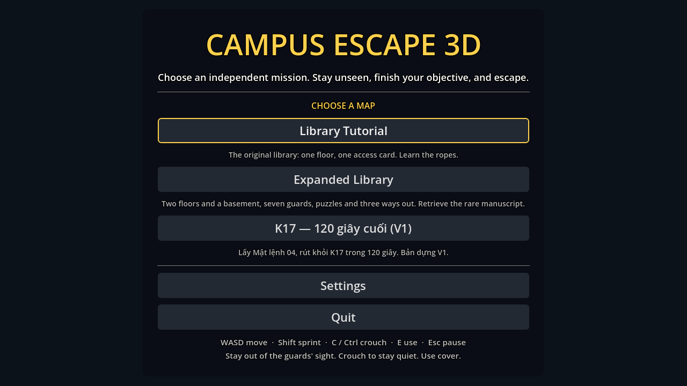
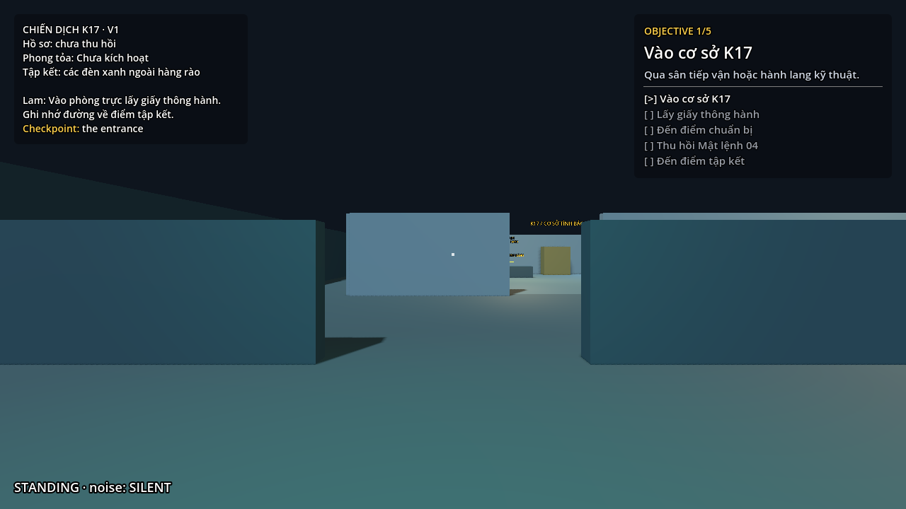
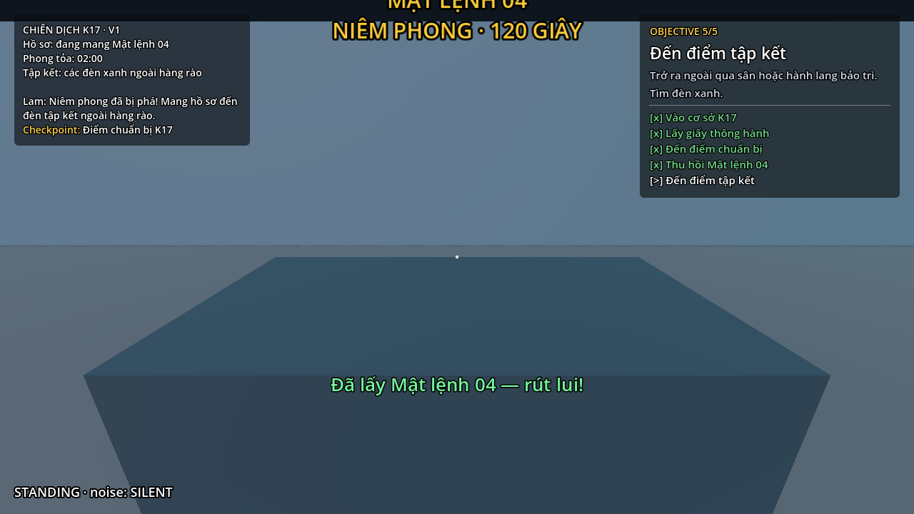
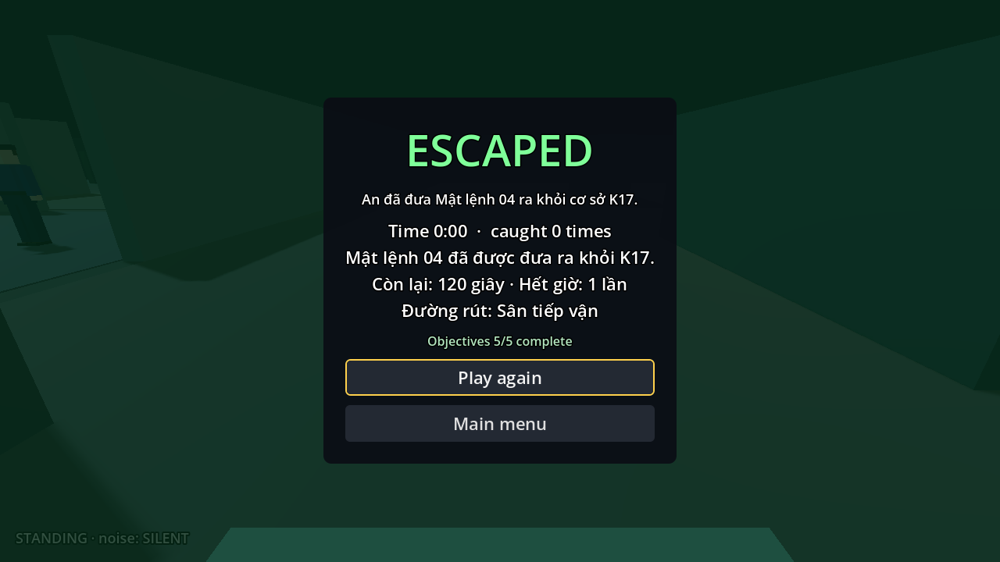
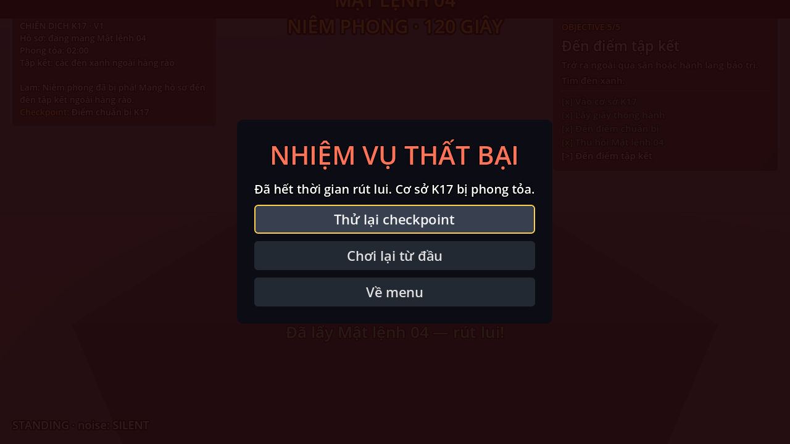
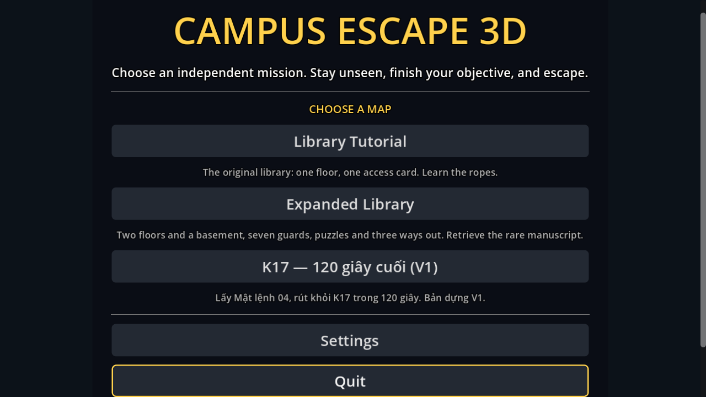

# Kiểm tra bản V1 — K17: 120 giây cuối

Ngày kiểm tra: 26/10/2026. Nền mã nguồn: `Development` tại `6cac8f5`; Godot `4.7.2.stable.official.ed1daf0bf`, Windows. Đây là bản dựng V1 của một map, chưa phải đợt phát hành mới của toàn project.

## Kết quả

| Hạng mục | Kết quả |
|---|---|
| Import và biên dịch | Không có lỗi; 160 script biên dịch được |
| Cấu trúc và tài nguyên | 229 tham chiếu runtime hợp lệ; giữ UID đi cùng script |
| Giao diện HUD giữa các map | `MAP CONTRACT PASSED` |
| Nhiệm vụ K17 | 108 kiểm tra đạt: điều kiện nhiệm vụ, tương tác qua ray, checkpoint, pause, hết giờ, hai điểm tập kết và kết quả |
| Đi bộ bằng bộ điều khiển thật | 47 waypoint, cả hai tuyến thành công; dùng WASD/E thật, không dịch chuyển nhân vật trong lượt kiểm tra này |
| Tuần tra NPC | 90 giây với bốn NPC thật; lần lượt đến 12/15/14/9 điểm; không NPC nào bị kẹt |
| Bộ kiểm thử chung | `All tests passed`, gồm tutorial, library và suite K17 |
| Menu và GameFlow sau chỉnh sửa giao diện cuối | Catalog ba map, 3.000 yêu cầu trạng thái; mọi nút truy cập được tại 1280×720 / 1024×768 và bốn cỡ giao diện 90/100/110/125%, kể cả đổi cỡ khi Quit đang có focus |
| Luồng tutorial | 15 kiểm tra đạt, nạp level bốn lần |
| Đổi map | 76 kiểm tra đạt, 18 lượt nạp, ba chu kỳ; không tăng node tồn dư hoặc orphan |
| Xuất PCK | Tải được menu và ba map từ thư mục trống; loại test, tool và helper/log CI khỏi gói |

Lượt kiểm thử chung hoàn tất trước lần chỉnh phần cuộn menu cuối cùng. Sau chỉnh sửa đó đã chạy lại kiểm tra catalog/GameFlow, luồng đổi ba map, biên dịch, kiểm tra đường dẫn và xuất/đọc PCK. CI của PR sẽ chạy lại toàn bộ trên mã đã commit.

Bộ kiểm thử chung có tám cảnh báo chủ động từ các fixture kiểm tra kẹt/thiếu tuyến hoặc thiếu navmesh (`StuckGuard`, `NoRouteGuard`, `VisionTestGuard`, `GuardA`, `GuardB`), không có lỗi script/resource. Những lượt kiểm tra K17, catalog/GameFlow, đổi map và đọc PCK kết thúc không có cảnh báo hoặc lỗi.

## Cách hiểu kết quả chơi thử

Lượt đi bộ tự động chủ động tắt NPC để kiểm tra hình học va chạm và tương tác. Nó không chứng minh độ khó khi tránh lính. Scene chơi thật có đủ bốn NPC hoạt động; lượt tuần tra riêng kiểm tra cấu hình NPC của scene đó.

Hai lượt đi bộ hoàn thành rút lui khi còn khoảng 97,3 và 99,4 giây. Vì vậy 120 giây hiện là thông số khởi đầu của V1, còn rộng khi chỉ xét di chuyển. Chưa xác nhận độ khó cuối, thời lượng 10–15 phút hoặc mục tiêu FPS bằng người chơi. Cảm biến, giữ E, radio tương tác và cửa phong tỏa theo lịch thuộc các feature tiếp theo.

## Bằng chứng

- [Toàn bộ suite](logs/k17-full-suite.log)
- [108 kiểm tra nhiệm vụ](logs/k17-tests.log)
- [Đi bộ qua hai tuyến](logs/k17-walking.log)
- [NPC tuần tra 90 giây](logs/k17-patrol.log)
- [Luồng đổi map](logs/k17-map-flow.log)
- [Catalog, cỡ giao diện và GameFlow](logs/k17-catalog-and-flow.log)
- [Đọc PCK từ thư mục trống](logs/k17-pack-check.log)
- [Biên dịch script](logs/k17-scripts.log) và [đường dẫn](logs/k17-layout.log)

Ảnh bên dưới kiểm tra bố cục giao diện; các trạng thái nhiệm vụ trong ảnh được dàn sẵn bằng chế độ `--capture-only` của tool, tách biệt với lượt đi bộ tự động có log ở trên. Ảnh render 1280×720 bằng OpenGL Compatibility trên Quadro P1000, không phải phép đo FPS.

