# Rà soát bố cục, thiết bị và chỗ nấp K17

Ngày 27/10/2026, nhánh `feature/twp`, Godot 4.7.2 official trên Windows, renderer Compatibility. Đợt sửa tiếp sau `7561584`, tập trung các vấn đề người chơi gặp khi xem map V4. Báo cáo V4 trước đây giữ nguyên để đối chiếu lịch sử.

## Vấn đề đã sửa

| Vấn đề | Thay đổi |
|---|---|
| Camera treo giữa không gian, nhãn và nón xanh xuyên kiến trúc | Hai camera trong nhà có bản mã/giá nối trần; camera tuyến dịch vụ có cột và chân đế. Bỏ nhãn CAM và nón xanh trong bản chơi, giữ góc quét, tầm nhìn, đèn nguồn và phát hiện thật. |
| Các ô phòng có tường nhưng thiếu công năng | Thêm bàn tác chiến/ghế/bản đồ, bàn điện tín, tủ trang bị, ghế chờ, giá hồ sơ, bàn phân loại, tủ phân phối điện, chi tiết máy phát, bàn sửa chữa, dụng cụ, bình chữa cháy và thiết bị chốt điều động. |
| Khu phân loại phía đông bị bịt kín | Mở cửa thông nội bộ từ hành lang hồ sơ, bổ sung khung cửa, đèn và tủ/giá. Vẫn nằm sau cửa kiểm soát bằng thẻ. |
| Khối placeholder che mất hình bàn/tủ chi tiết | Giữ collider, ẩn mesh khối phủ ngoài bàn lấy thẻ, tủ phòng trực và bàn hồ sơ B1. |
| Biển phòng trực lặp/đánh số không thống nhất | Phòng lõi phía tây dùng chức năng tác chiến; thống nhất khối chỉ huy 04 và khu hồ sơ 06. |
| Vùng nấp nằm trên lối trống, che giấu cả khi còn đường nhìn | Đặt lại bảy vùng theo vật che thật, thu vùng vào hốc, kiểm tra occlusion riêng cho từng người quan sát. HUD không báo HIDDEN khi camera còn nhìn thấy người chơi. |

Đồ lớn có va chạm; đồ trên mặt bàn, biển và dây dẫn là chi tiết mỹ thuật. Giữ đường tương tác công tắc/chốt, hành lang giữa, lối qua bàn hồ sơ và cả hai đường rút. Navmesh dựng lại có **951 polygon**; ánh sáng được bake lại sau bố cục cuối. Không thêm asset trả phí.

## Bảy vị trí nấp

| Khu | Vị trí chân người chơi (x, y, z), mét | Vật che và mặt còn hở |
|---|---|---|
| Nhà xe | (-41, 0, 24.9) | Khoảng giữa đầu xe, bàn sửa chữa và tường. Hướng vào từ lối nhà xe vẫn hở. |
| Phòng trực | (-43, 0, -6.3) | Hốc cạnh tủ sát góc tường phía tây. Lính đi vòng tới miệng hốc vẫn thấy. |
| Vô tuyến | (0, 0, 13) | Sau vách cao và vách phụ cạnh tường sau; vào từ phía tây. Vách phụ chừa khoảng đi cạnh bàn vô tuyến cho lính/người chơi. |
| Trạm điện | (41.2, 0, 5) | Giữa vách tủ điện và kiện phụ tùng cách điện. Lối tiếp cận chốt/công tắc vẫn mở. |
| Khu hồ sơ | (8, 0, -20) | Sau vách checkpoint và vách bên; cửa hốc phía hành lang bên phải vẫn hở. |
| B1 | (-7.5, -4, -47.2) | Sau kiện niêm phong dạng chữ L ở góc tây, thay vị trí cũ giữa lối qua bàn hồ sơ. |
| Tuyến dịch vụ | (25.8, 0, 37.3) | Hốc giữa khối che cũ và hàng xếp chữ L sát tường, thay vị trí cũ ngoài sân trống. |

Vùng nấp chỉ được tính khi tâm người chơi nằm trong hốc, đang cúi, vào lúc chưa bị thấy và có vật rắn ở ít nhất hai phía gần đó. **Điều quyết định tránh phát hiện vẫn là đường nhìn thật**: chỉ cần lính/camera thấy một điểm cơ thể qua miệng hốc thì người chơi vẫn lộ. Bóng tối chưa ảnh hưởng tầm nhìn AI. Không có vùng an toàn tuyệt đối hoặc thao tác chui vào tủ đóng cửa trong đợt này.

Chỉ bổ sung lớp riêng K17 kế thừa HidingSpot, SecurityCamera và StealthDirector. AI và HUD dùng chung của các thành viên khác giữ nguyên. Lớp HUD bổ sung tính camera đang có điện và nhìn rõ là đang bị thấy; luật camera tích thanh rồi báo động vẫn giữ.

## Bằng chứng kiểm tra

| Kiểm tra | Kết quả | Log |
|---|---|---|
| Chức năng K17 và tương tác giữ E | 401 kiểm tra, 0 lỗi | [k17-tests.log](k17-tests.log) |
| Mỹ thuật, giá camera, lightmap và collider | 64 kiểm tra, 0 lỗi; mọi đường dẫn mesh trong lightmap còn tồn tại | [art.log](art.log) |
| Hồi quy repository, gồm Tutorial/Expanded Library | All tests passed | [regression.log](regression.log) |
| Biên dịch mã GDScript | 205 script hợp lệ | [scripts.log](scripts.log) |
| Tuần tra và tiếp viện trên bố cục cuối | 10 NPC, 90 giây mô phỏng, không kẹt/không bỏ waypoint | [patrol.log](patrol.log) |
| Truy đuổi với vật che | 4 tình huống CHASE → mất dấu, 0 lần bị bắt | [encounters.log](encounters.log) |
| Đi cả hai đường không lính, camera/cảm biến vẫn hoạt động | 147 waypoint, thắng cả hai; còn 52.7 / 41.9 giây | [walking-no-guards.log](walking-no-guards.log) |
| Có lính, đường sân, mô phỏng 60 Hz | 101 waypoint, thắng; 0 bị bắt, 0 cảm biến; 2 tiếp viện; còn 77.4 giây | [walking-courtyard.log](walking-courtyard.log) |
| Có lính, đường bảo trì, mô phỏng 60 Hz | 106 waypoint, thắng; 0 bị bắt, 0 cảm biến; đủ 4 tiếp viện; còn 41.9 giây | [walking-maintenance.log](walking-maintenance.log) |
| Có lính và render, đường bảo trì, thời gian thực | 106 waypoint, thắng; 0 bị bắt, 0 cảm biến; đủ 4 tiếp viện; còn 41.7 giây | [walking-maintenance-native.log](walking-maintenance-native.log) |
| Luồng menu, pause, restart và đổi map | 15 kiểm tra game flow; 100 kiểm tra qua 24 lượt tải scene/3 chu kỳ; contract HUD/exit hợp lệ | [qa-flow.log](qa-flow.log), [map-flow.log](map-flow.log), [map-contract.log](map-contract.log) |
| PCK chạy từ thư mục trống | 5 scene tải được; bản thường/test và lịch tiếp viện/restore K17 hợp lệ | [pack-all.log](pack-all.log), [pack-k17.log](pack-k17.log) |

Kiểm tra nấp bao gồm: đi được tới từng hốc; tâm cả bảy hốc nằm cạnh vật rắn; đặt lính tại sáu hướng quanh từng hốc để kiểm tra các hướng có đường nhìn; camera nhìn vào mặt hở không bị vùng nấp làm mù; HUD bỏ HIDDEN khi camera thấy; đặt thử một vùng nấp giữa đường trống không tạo che giấu. Fixture nhận thức dùng player/Guard/camera và raycast thật nhưng có đặt vị trí, tắt xử lý tự động để kiểm tra riêng từng điều kiện.

Tool đi nhiệm vụ dùng input di chuyển/E/giữ E, va chạm và đồng hồ thật, không dịch chuyển giữa waypoint. Lượt headless dùng `--fixed-fps 60 --max-fps 600` chỉ chứng minh mô phỏng/đường chơi, không đo FPS. Các tình huống truy đuổi tắt NPC/camera khác để cô lập một Guard. Soak tiếp viện tắt nhận thức nhìn để kiểm tra đường đi; lượt nhiệm vụ có lính giữ nhận thức đầy đủ.

Lượt có render chạy Compatibility 1280 × 720, không `--fixed-fps`/`--max-fps`, giữ sáu lính thường trực và lịch bốn tiếp viện. Dùng `--background` trong tool QA để tiếp tục khi mất focus; bản chơi thường vẫn pause. Tool biết trước đường/mã, đây chưa phải kết quả của người chơi mới.

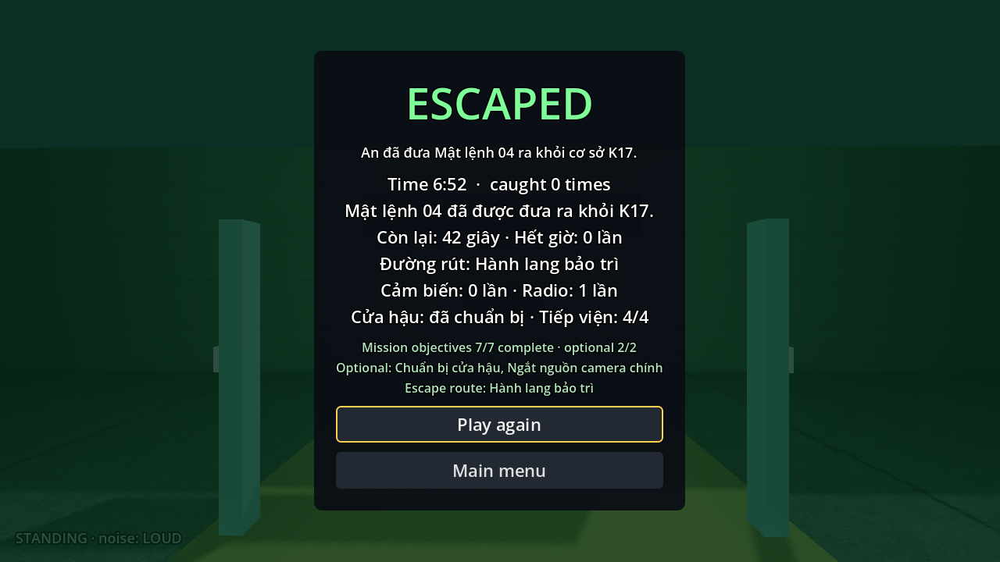

Hồi quy có tám cảnh báo dự kiến từ fixture cố ý tạo lính kẹt/thiếu tuyến/ngoài navmesh; không có lỗi script/runtime. Contract HUD chạy ở nhịp mặc định để tránh cảnh báo giải phóng audio khi cố tăng tốc tool này. Helper bake đã lưu lightmap thành công; thông báo engine lúc đóng editor thuộc helper tác nghiệp local, không nằm trong bản runtime/PCK.

Các lần thử tuyến sân trước khi cập nhật đường đi đã bị bắt; có một lần đi chạm tường chốt phản ứng. Tool được chỉnh để vòng phía nam chốt và tránh va chạm với vách mới. Không giảm sức nhìn/tốc độ lính để ép lượt test thắng. Bản đồ sau thay đổi vật che cần tiếp tục được nhóm chơi thử về độ khó; thắng một chuỗi input không bảo đảm các nhịp tuần tra khác đều an toàn.

## Ảnh kiểm tra bố cục

Ảnh dưới là các góc camera dàn sẵn từ bản chạy Compatibility 1280 × 720; dùng xem hình học/mỹ thuật, không thay bằng chứng đi hết nhiệm vụ. Tool tạo tổng cộng 32 góc, gồm riêng bảy hốc nấp. Không chỉnh sáng hoặc sửa nội dung ảnh.

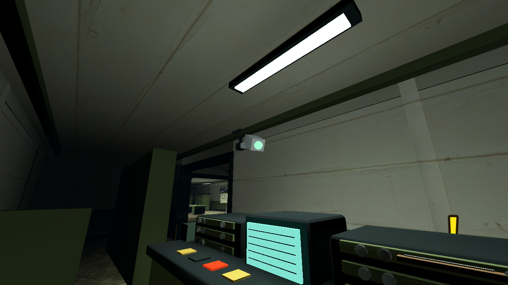

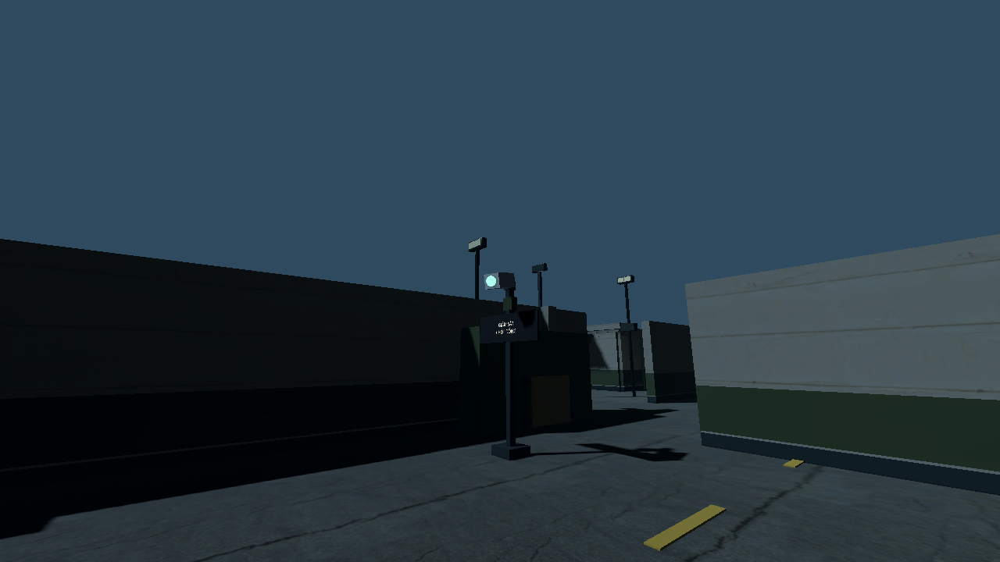

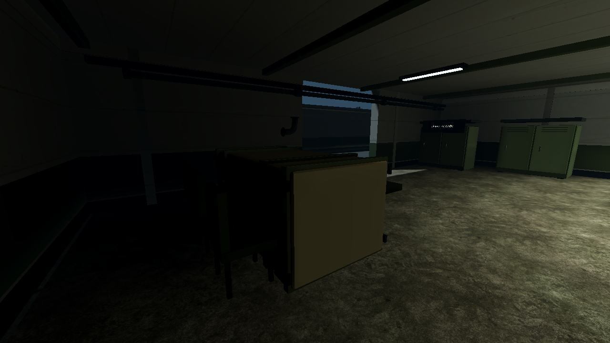

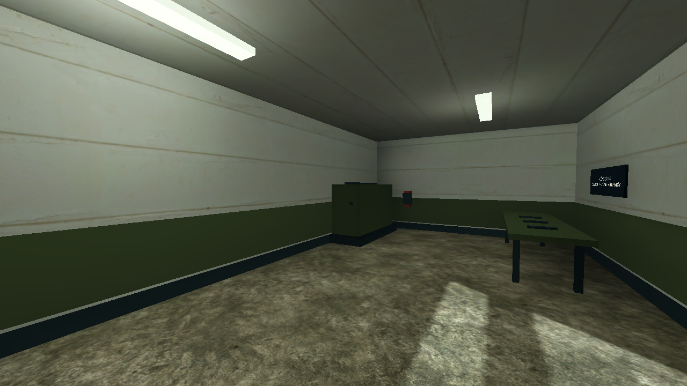

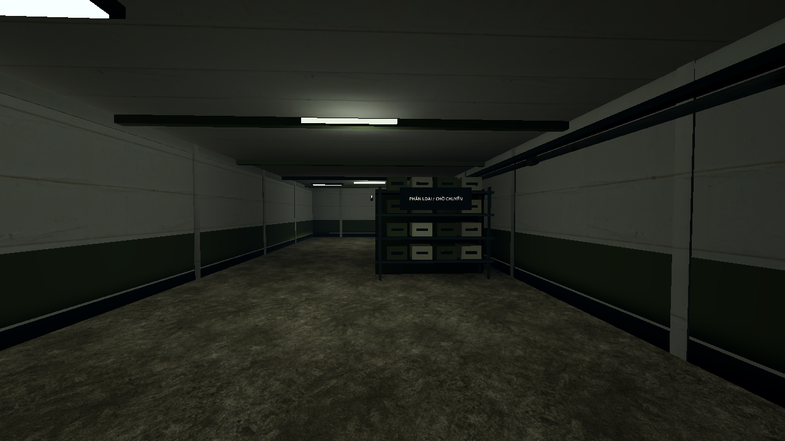

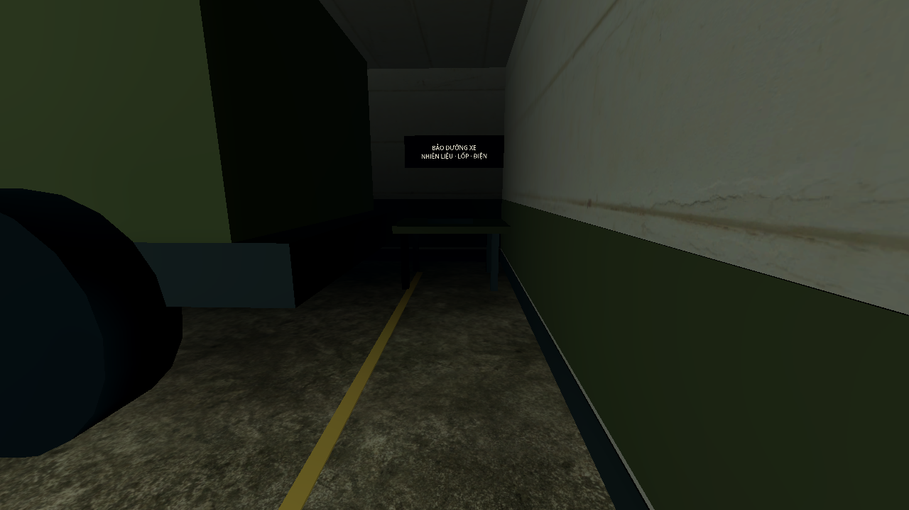

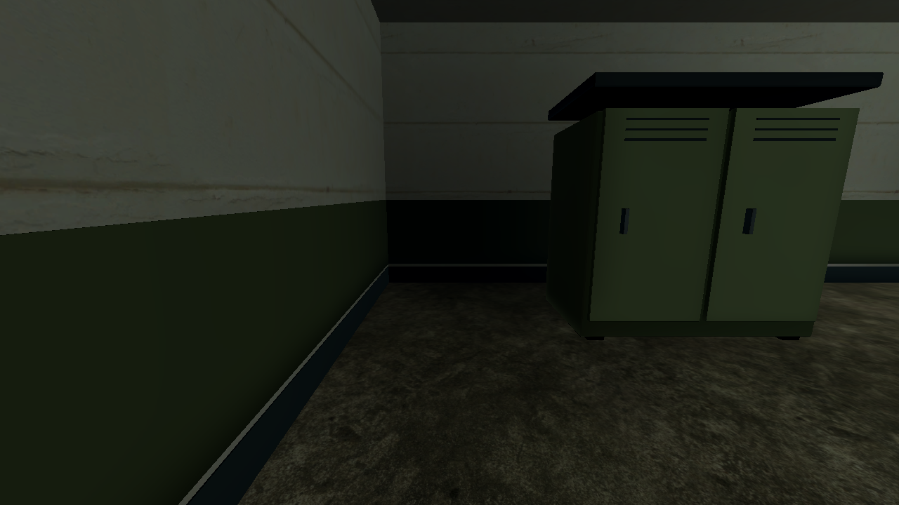

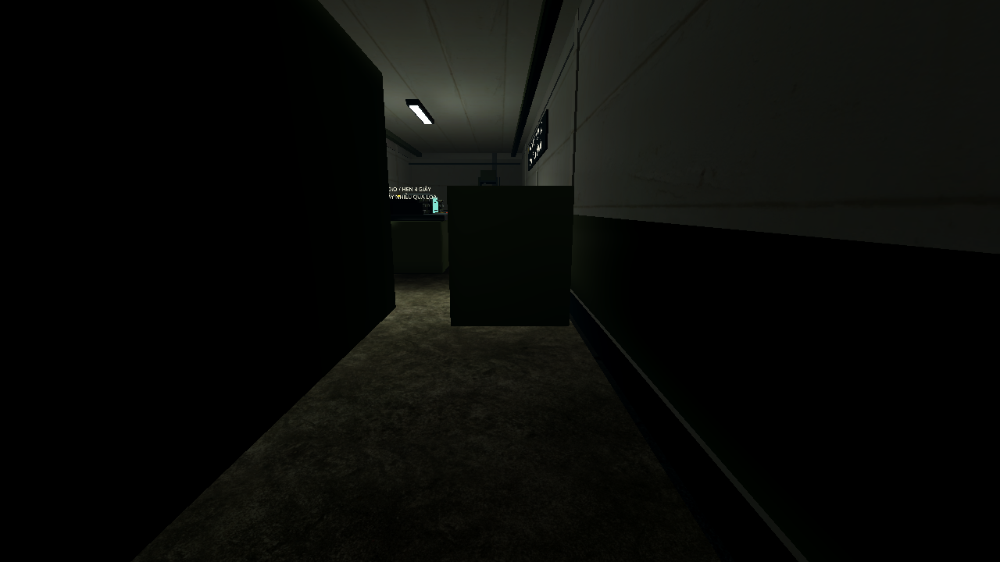

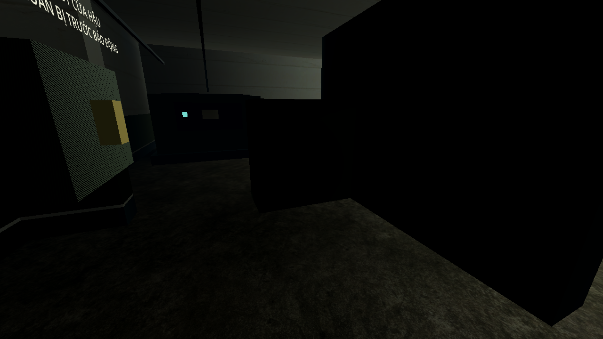

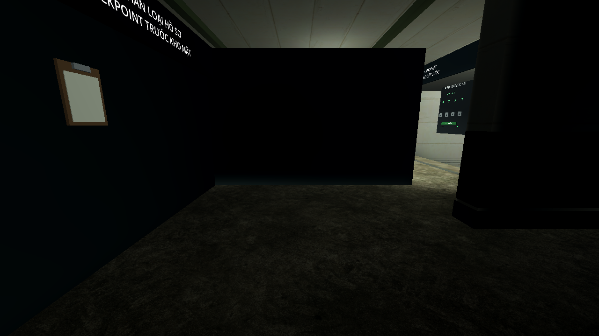

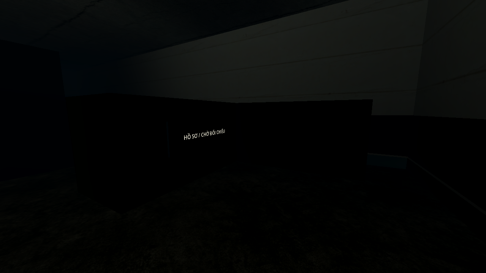

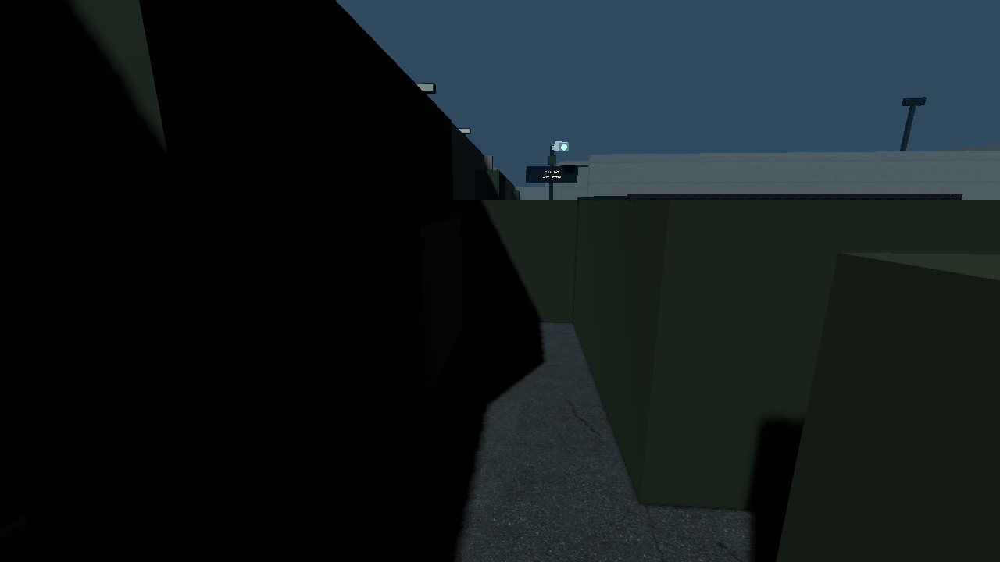

## Tự kiểm tra nhanh

1. Dừng bản game cũ rồi chạy lại map K17 từ checkout này; cửa sổ game đang chạy không tự tải scene đã sửa.
2. Dùng bản test không lính để xem đồ đạc/giá camera, cửa thông khu phân loại và đường đi quanh các hốc.
3. Vào bản thường, cúi sau vật che rồi quan sát HUD. Rời hốc, đứng lên hoặc để lính vòng tới mặt hở để kiểm tra bị phát hiện.
4. Ở camera đang có điện, đứng tại mặt hở trong góc quét: vùng nấp không được giữ HIDDEN, thanh camera vẫn tăng.

Đồ họa vẫn dùng bộ model hình khối hiện có; đợt này sửa tính hợp lý, sự trống trải và luật che khuất, chưa thay toàn bộ bằng bộ asset tả thực. Số đo FPS trong báo cáo V4 trước đây thuộc bố cục cũ, không dùng làm benchmark cho đợt sửa này.
