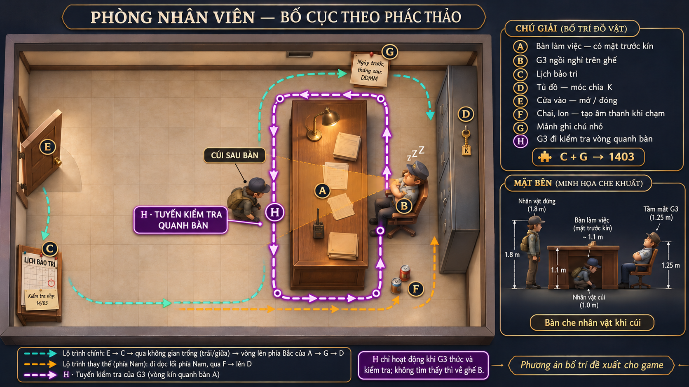
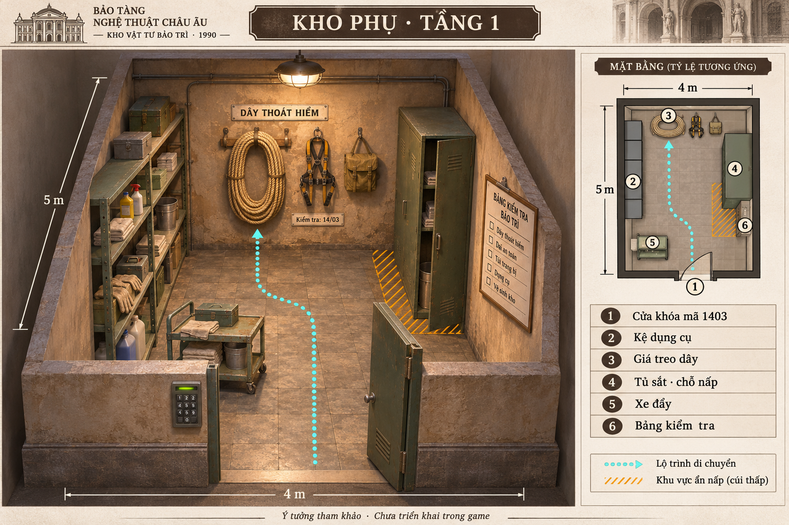

# Concept v3 — Phòng nhân viên và kho phụ

**Bản thiết kế phòng nhân viên duy nhất hiện tại:** [staff-room-floorplan.png](staff-room-floorplan.png).
Hai phương án trước đã được thay bằng bản này theo phác thảo của người thiết kế.

| Ký hiệu | Nội dung |
|---|---|
| A | Bàn làm việc dài theo hướng bắc–nam ở nửa phải phòng, mặt trước phía tây kín; cúi sau bàn để nấp và rút lui |
| B | Ghế G3 phía đông bàn A, nhìn về bàn; ngồi ngủ khi bình thường |
| C | Lịch bảo trì trên tường phía tây, góc dưới bên trái |
| D | Tủ đồ sát tường đông; chìa K treo ngoài tủ, phía bắc ghế B |
| E | Cửa vào duy nhất trên tường phía tây, mở/đóng bằng E |
| F | Chai/lon phía nam ghế B; va vào tạo tiếng động |
| G | Mảnh ghi chú trên tường phía bắc, trên đầu bàn A; gợi ý cách đọc mã kho |
| H | Tuyến kiểm tra vòng kín quanh cả bốn cạnh bàn A, xuất phát và trở về ghế B |

H là tuyến đi của G3 khi thức và kiểm tra, không phải vật cản hoặc tuyến đi khi ngủ.
Tuyến phải nằm trên sàn trống, tránh bàn, ghế, tủ D và chai/lon F.
Không tìm thấy người chơi thì G3 trở về B và ngủ.

Đường xanh ngọc là lộ trình tham khảo của người chơi: E → C → vòng qua đầu bắc
bàn A → G → D. Đường cam đi phía nam, gần F, có rủi ro gây tiếng.
Hình quạt vàng minh họa hướng quan sát lúc thức; khi ngủ phải ẩn.

Cung cấp mặt trước bàn kín, cao khoảng 1.1 m: nhân vật đứng có thể lộ đầu,
cúi mới được che. Chừa khoảng đi rõ ràng quanh hai đầu bàn và tới móc chìa D;
căn kích thước theo capsule và collision khi triển khai, không suy tọa độ từ pixel ảnh.

Lịch C ghi ngày kiểm tra dây 14/03, ghi chú G hướng dẫn DDMM: mã suy ra **1403**.

**Đã áp dụng bố trí A–H vào Godot**, xem [bước 14](../step-14-staff-ah.md)
để biết tọa độ, cách chơi và ảnh chụp bản dựng thực tế.
Các ảnh chụp bản dựng trước được giữ tại thư mục docs và tham chiếu trong
[bước 13](../step-13-staff-room.md), không phải phương án concept-v3 hiện tại.

Cập nhật sau bản vẽ: G đã chuyển thành mảnh giấy nhỏ trên bàn A; lịch C cập nhật
ngày giờ máy tính. Xem [bước 15](../step-15-paper-calendar.md).
Ảnh phòng nhân viên duy nhất được giữ để tham chiếu bố cục A–H.

## Kho phụ tầng 1

Ảnh kho phụ được duyệt: [aux-storage-concept.png](aux-storage-concept.png).
Đây là thiết kế cho phòng khác, bổ sung cho bản phòng nhân viên A–H.

Đã triển khai vào map: cửa mã 1403, kệ dụng cụ, xe đẩy, tủ che tầm nhìn,
giá treo dây và bảng kiểm tra. Phòng có sẵn trong map rộng 9 × 6 m, cửa tây;
bố cục ảnh 4 × 5 m được xoay và điều chỉnh để giữ nguyên mặt bằng bảo tàng.
Chi tiết và ảnh Godot: [bước 16](../step-16-aux-storage.md).

## Vòng chơi hợp đồng

[floorplans-contract-missions.png](floorplans-contract-missions.png) là ảnh ý tưởng
hai tầng với N0, quầy dịch vụ, vé V và cơ chế hiện vật riêng cho từng phòng.
Bản chơi được đã triển khai theo [bước 17](../step-17-contract-gameplay.md), giữ
mặt bằng hiện có; dùng một tranh phụ mỗi phòng A/B/C và hợp đồng đầu cố định S1/H1/T1.
Ảnh concept minh họa hướng phát triển, không phải ảnh chụp scene hay tọa độ thi công.

Phản hồi chơi thử mới nhất đã áp dụng ở [bước 18](../step-18-contract-revision.md):
bốn hợp đồng ngẫu nhiên, giấy ngắn gọn, bảng tên trên bàn, vé đọc được và N0 bên phải cửa.
