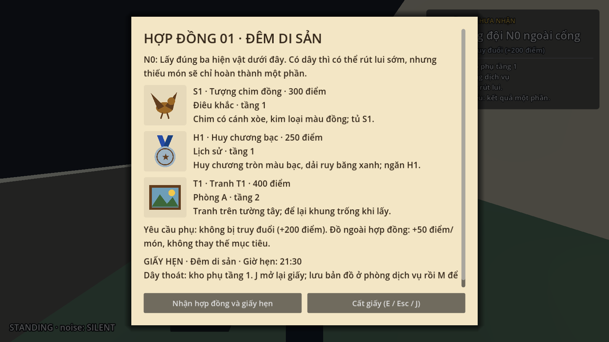
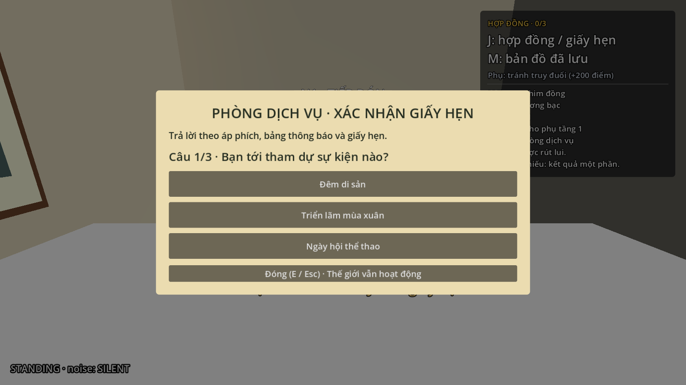
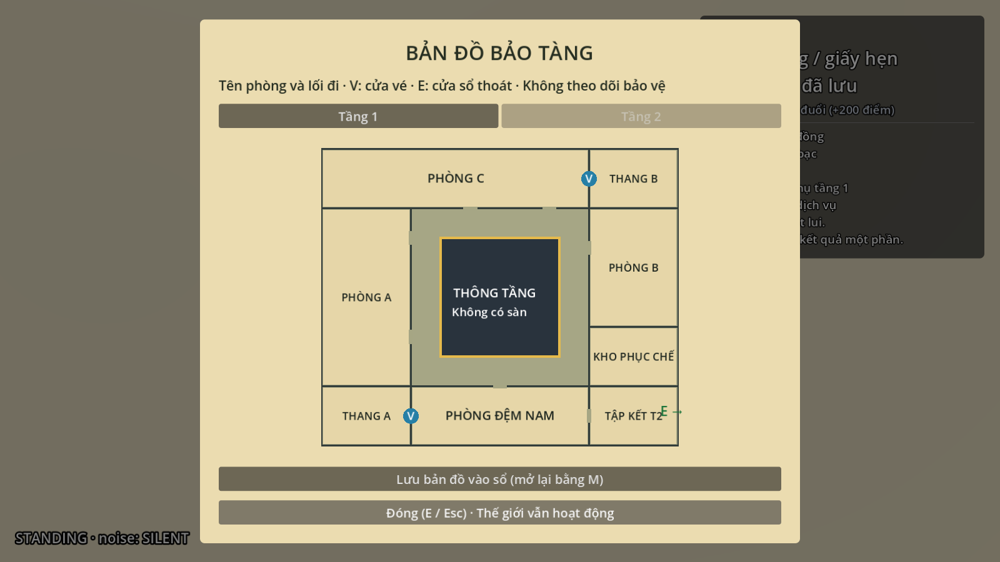
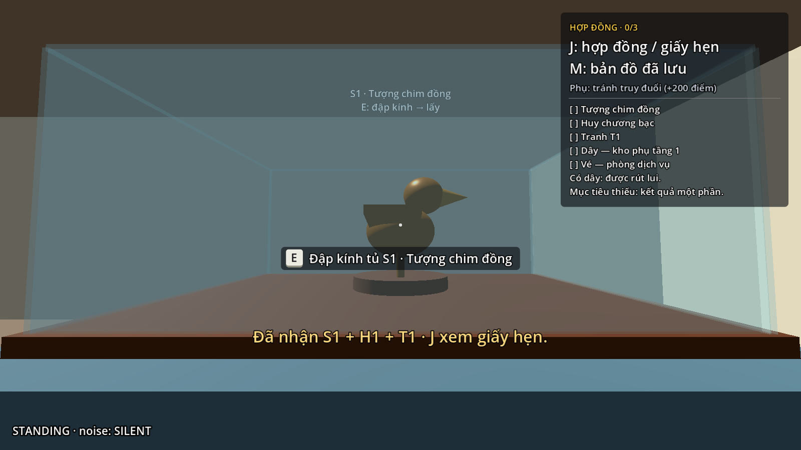
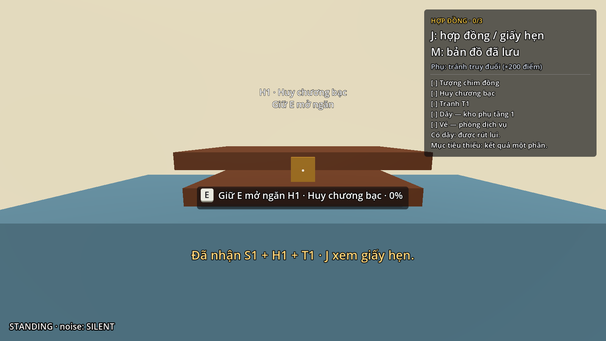
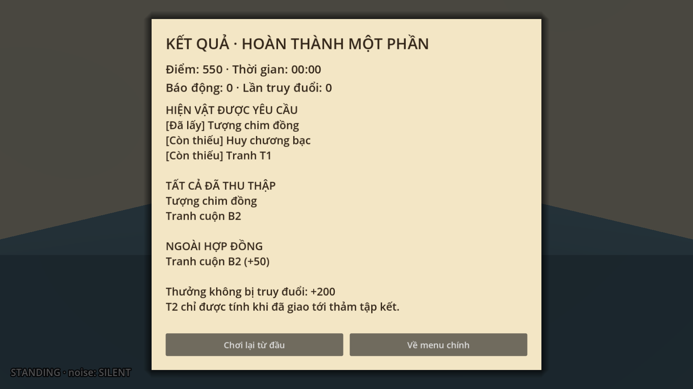

# Bước 17 — Hợp đồng, vé tầng 2 và hiện vật theo phòng

Mở `res://maps/isg_museum/scenes/museum.tscn`, nhấn **F6** để chạy.
Bản này thay đổi điều kiện kết thúc: **có dây và đã cắt đuôi thì được rút lui**;
không còn bắt buộc lấy đủ T1/T2/T3. Hợp đồng được đánh giá riêng khi rút lui.

## Một lượt chơi tham khảo

1. Đi từ điểm xuất phát tới N0 cạnh ghế ngoài sân, gần `(14.3,0,35.3)`, nhấn **E**.
   Giấy hợp đồng có hình minh họa, tên, phòng, dấu hiệu và điểm của ba món:
   **S1 — tượng chim đồng**, **H1 — huy chương bạc**, **T1 — tranh phòng A**.
   Bấm **Nhận hợp đồng và giấy hẹn**. **J** mở lại giấy khi chơi; E/Esc/J cất giấy.
2. Đọc áp phích sảnh: sự kiện **Đêm di sản**. Trong phòng dịch vụ, đọc bảng thông báo:
   người phụ trách **Lê An**. Giấy hẹn N0 ghi **21:30**.
3. E nói chuyện với nhân viên dịch vụ ở sau quầy, trả lời ba câu hỏi để nhận vé **V**.
   Sai có gợi ý; sai ba lần phải chờ 10 giây rồi được thử lại. Nhân viên nhìn theo
   người đứng gần trong lúc kiểm tra giấy hẹn; không tham gia truy đuổi.
4. E đọc bản đồ treo tường dịch vụ; chọn tầng 1/2. Bấm **Lưu bản đồ vào sổ** để
   mở lại bằng **M** ở nơi khác. Bản đồ không hiện vị trí bảo vệ.
5. Dùng vé tại cửa chiếu nghỉ trên cùng của thang A hoặc B. Quét một lần xác nhận
   quyền sử dụng cả hai cửa; E đóng/mở cửa sau đó. Cửa phòng B vẫn cần chìa K riêng.
6. Tới các phòng lấy hiện vật; mở kho phụ bằng mã 1403 và lấy dây R như bước 16.
7. Có thể tiếp tục thu thập hoặc tới cửa sổ kho phục chế tầng 2 để rút lui.
   Đang bị nhìn thấy/truy đuổi thì chưa dùng được lối thoát.

## Hiện vật và cơ chế

| ID | Phòng | Cách lấy | Điểm khi là mục tiêu |
|---|---|---|---|
| S1 | Điêu khắc | E đập kính, E lần nữa lấy tượng chim đồng | 300 |
| S2 | Điêu khắc | Tủ kính khác, tượng bán thân đá sáng | 200 |
| H1 | Lịch sử | Giữ E 2.5 giây mở ngăn, thả rồi E lấy huy chương bạc | 250 |
| H2 | Lịch sử | Ngăn riêng, đồng hồ bỏ túi | 200 |
| T1 | A | Lấy tranh để lại khung; G6 có thể phát hiện khi nhìn thấy | 400 |
| A2 | A | Tranh nhỏ bổ sung, để lại khung; chưa có kiểm tra riêng của G6 | 180 |
| T2 | B | Mang tay, đi chậm, Q đặt xuống; chỉ tính sau khi giao tại thảm | 600 |
| B2 | B | Tranh cuộn nhỏ lấy ngay, không cần mang tay | 180 |
| T3 | C | Lấy khi niêm phong còn bật sẽ báo động phòng C | 250 |
| C2 | C | Tranh bổ sung cùng hệ thống niêm phong với T3 | 200 |

Kính vỡ và ngăn mở giữ dấu vết cho tới khi chơi lại. Tiếng kính phát qua NoiseSystem
để bảo vệ nghe và kiểm tra vị trí ước lượng; không tự cho bảo vệ biết người chơi ở đâu.
Nhả E khi mở ngăn sẽ **tạm dừng**, không mất phần tiến trình đã mở; đổi hướng nhìn
hoặc mở một giao diện khác cũng không tiếp tục mở ngăn.

Công tắc phòng C nằm gần `(25.7,5.95,5.7)`, tiếp cận từ trong phòng C.
E tắt niêm phong trước khi lấy T3/C2 để tránh báo động. Bản đầu là công tắc đơn giản,
không tự bật lại theo thời gian.

## Kết quả và điểm

- Đủ đúng S1/H1/T1 và rút lui: **Hoàn thành hợp đồng**.
- Có một hoặc hai món mục tiêu: **Hoàn thành một phần**.
- Không có món mục tiêu: **Rút lui tay trắng**; đồ ngoài danh sách vẫn được liệt kê.
- Chưa nhận hợp đồng từ N0: kết quả ghi rõ **Chưa nhận hợp đồng**.
- Bị bảo vệ bắt: **Bị bắt**, điểm nhận được bằng 0.

Đồ đúng hợp đồng nhận điểm trong bảng; đồ ngoài hợp đồng +50/món và không thay
thế mục tiêu. Yêu cầu phụ của hợp đồng đầu là không bị truy đuổi: +200 nếu rút lui
và chưa có bảo vệ chuyển sang CHASE. Số lần truy đuổi tính mỗi lần một bảo vệ chuyển
sang CHASE, không cộng từng frame. Tiếng vỡ kính, cảnh báo khóa kho, báo động phòng C
được ghi vào số lần báo động của lượt chơi.

Màn tổng kết ghi đồ được yêu cầu, đã lấy, còn thiếu, ngoài hợp đồng, điểm, thời gian,
báo động và truy đuổi. T2 đang cầm hoặc để dưới đất **không được tính** trước khi giao.
Khi bị bắt, màn kết quả chờ chọn **Chơi lại**, thay cho việc tự tải lại sau 2.5 giây.
Chơi lại tải mới toàn scene: nhiệm vụ, đồ, kính, ngăn, vé, cửa và dây đều khôi phục.

## Dữ liệu và phạm vi bản đầu

`museum_contract.gd` quản lý danh mục theo ID và hợp đồng cố định `s1,h1,t1`.
Các món lấy được theo dõi qua ObjectiveManager; chỉ `escape` là nhiệm vụ bắt buộc,
điều kiện dây/tầm nhìn được kiểm tra tại lối thoát. Nhặt đồ trước khi nhận hợp đồng
vẫn được ghi nhận đúng sau khi nhận.

Các scene mới dưới NavigationRegion3D: `Teammate`, `ServiceExpansion`,
`ExhibitsExpansion`. Builder riêng `build_contract_teammate.gd`, `build_service.gd`,
`build_exhibits.gd` cho phép dựng lại từng phần. Sau khi đổi collision, bake bằng
`tools/bake_navigation.gd`. Bản này đã bake 449 polygon.

Đồ họa là bản dựng thử bằng mesh/vật liệu đơn giản. Các ID phục vụ logic đã đủ để
thay model sau. Hợp đồng ngẫu nhiên, chọn dụng cụ gây nhiễu và bản tranh thay thế
dùng một lần vẫn thuộc giai đoạn sau như đề xuất ban đầu.

## Kiểm tra

Các suite map chạy bằng Godot `--headless --fixed-fps 60 --path . --script res://maps/isg_museum/tools/<tên>.gd`.
Đã qua **504 kiểm tra**:

| Suite | Số kiểm tra |
|---|---:|
| verify_contract | 42 |
| verify_service | 31 |
| verify_exhibits | 32 |
| verify_demo | 73 |
| verify_carry | 84 |
| verify_blockout | 106 |
| verify_staff_room | 54 |
| verify_empty_frame | 48 |
| verify_storage | 34 |

Các kiểm tra cũ đã được chỉnh theo việc rút lui chỉ cần dây và kết quả bị bắt chờ
nút chơi lại. Giữ các kiểm tra vật lý thật: ray E, giữ/thả E, cửa, dốc, đường navigation,
tuần tra, nghe tiếng, tầm nhìn, mang/giao T2 và khôi phục scene.
