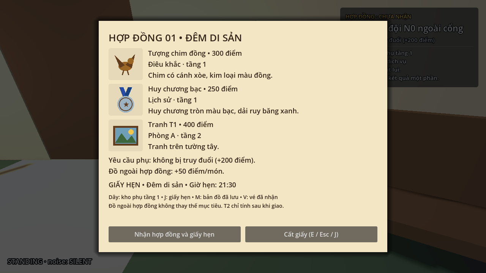
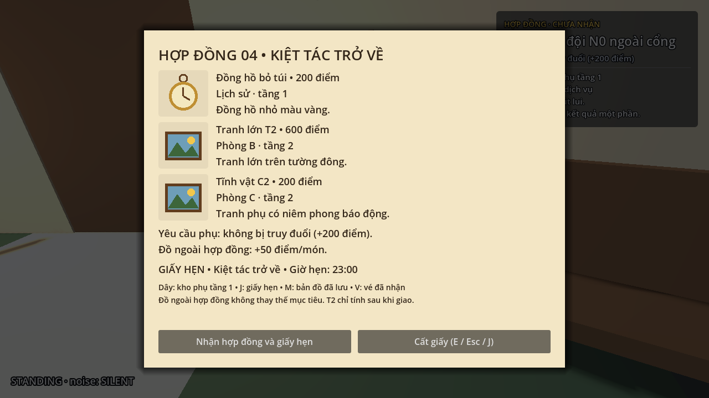
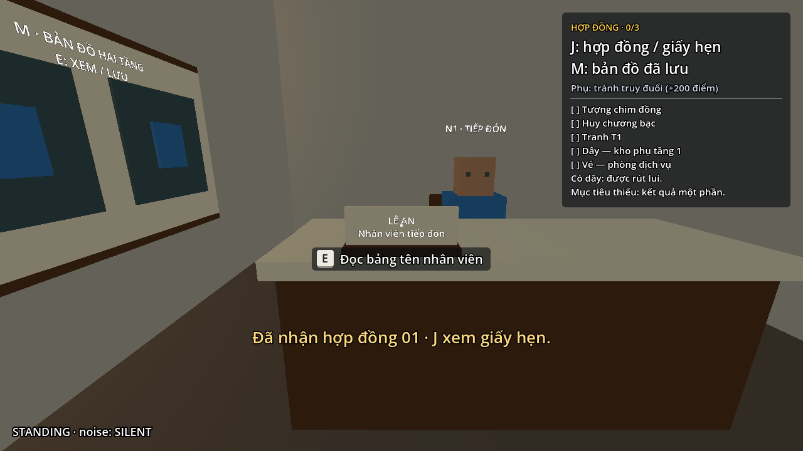
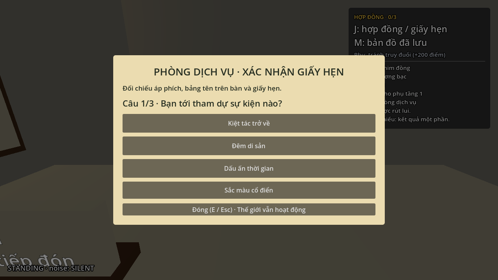
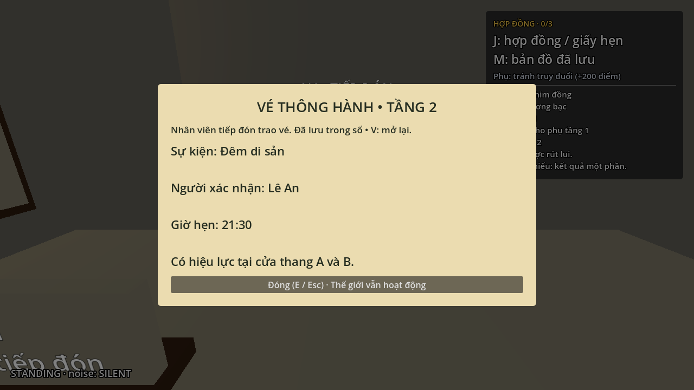
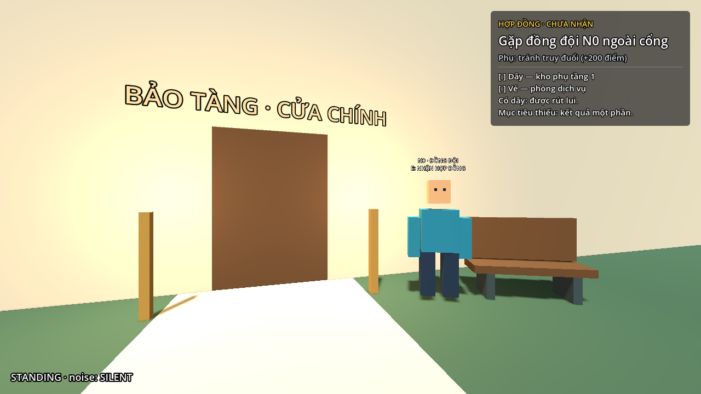

# Bước 18 — Hợp đồng ngẫu nhiên, bảng tên và vé

Đã áp dụng các yêu cầu sau lượt chơi thử vào scene
`res://maps/isg_museum/scenes/museum.tscn`. Dừng lượt đang chạy và nhấn **F6** lại để thử.

## Bốn hợp đồng

Mỗi lượt bắt đầu mới chọn độc lập một trong bốn mẫu với xác suất **25%**.
Sau khi bị bắt hoặc chọn chơi lại, scene mới chọn lại; hợp đồng cũ vẫn có thể
xuất hiện tiếp. Không có cơ chế loại trừ lượt trước hoặc xoay vòng bắt buộc.
Trong một lượt, nói chuyện lại với N0 hoặc mở giấy bằng J không đổi hợp đồng.

| Hợp đồng / sự kiện | Mục tiêu | Giờ hẹn | Người tiếp đón |
|---|---|---|---|
| 01 — Đêm di sản | S1, H1, T1 | 21:30 | Lê An |
| 02 — Dấu ấn thời gian | S2, H2, T3 | 20:45 | Trần Minh |
| 03 — Sắc màu cổ điển | H1, A2, B2 | 22:15 | Mai Lan |
| 04 — Kiệt tác trở về | H2, T2, C2 | 23:00 | Hoàng Nam |

Giấy chỉ giữ tên hợp đồng, ba mục tiêu với hình minh họa / điểm / phòng / mô tả
nhận biết ngắn, yêu cầu phụ và giấy hẹn. Bỏ đoạn giới thiệu dài của N0 và mã nội bộ
S1/H1 khỏi tên hiển thị. Các hướng dẫn J/M/V, dây và giao T2 có chữ nhỏ ở cuối.
Đã kiểm tra bố cục 1280 × 720: thấy nội dung và nút nhận/cất giấy mà không cần cuộn.

## Tiếp đón và vé

Áp phích ở sảnh tự hiện sự kiện của lượt đó. Bảng treo tường giới thiệu nhân viên
được thay bằng **bảng tên nhỏ có chân đế trên mặt bàn**, quay về phía khách.
Bảng chỉ ghi tên người và chức danh; E để đọc rõ hơn. Không còn thông tin vé trên bảng tên.

Ba câu hỏi đối chiếu tên sự kiện, người tiếp đón và giờ hẹn theo cùng một hợp đồng.
Mỗi câu có bốn lựa chọn lấy từ bốn bộ thông tin; vị trí đáp án được đảo khi mở
cuộc hội thoại. Sai ba lần vẫn chỉ tạm chờ 10 giây như trước.

Sau đáp án đúng thứ ba, nhân viên mới trao **vé thông hành tầng 2**: giao diện vé
hiện giữa màn hình, ghi sự kiện, người xác nhận, giờ hẹn và hiệu lực tại thang A/B.
E/Esc cất vé; **V** xem lại vé đã lưu. Có thể hỏi lại nhân viên để đọc vé.
Vé không được cấp sớm khi mới đúng một hoặc hai câu.

## Đồng đội ngoài cửa

N0 chuyển tới `(20.5,1,31.5)` — phía phải cửa chính khi nhìn từ sân vào.
Nhân vật quay về phía người chơi tiến tới, ghế đặt bên cạnh và chừa lối cửa.
Vị trí này thay cho vị trí cũ gần phía trái sân.

## Nguồn và kiểm tra

- `museum_contract.gd`: danh mục bốn hợp đồng và lựa chọn ngẫu nhiên.
- `contract_ui.gd`: giấy ngắn gọn và hình minh họa.
- `service_document.gd`: áp phích và bảng tên đọc thông tin của lượt hiện tại.
- `service_ui.gd`: câu hỏi động, đảo lựa chọn và vé lưu lại.
- Builder `build_service.gd` và `build_contract_teammate.gd` giữ bố trí mới khi dựng lại.

`contract_index_override` chỉ dùng cho công cụ kiểm tra/chụp ảnh; scene chơi thật
giữ mặc định **-1** để chọn ngẫu nhiên.

Đã qua **575 kiểm tra** gồm 504 kiểm tra hiện có đã cập nhật và 71 kiểm tra mới
trong `tools/verify_contract_variants.gd`. Kiểm tra mới bao phủ cả bốn mẫu, tính
đồng bộ giấy / bảng / câu hỏi / vé, đọc bảng bằng ray tương tác thật, lưu vé V,
nhận lại sau khi bị bắt và việc cho phép trùng hợp đồng liên tiếp.

Không thay đổi sàn, dốc, tuyến tuần tra hoặc collision vật cản thế giới ở bước này;
navmesh hiện có vẫn dùng được. Hình minh họa trong tài liệu là ảnh chụp Godot,
không phải ảnh concept tạo sinh.
