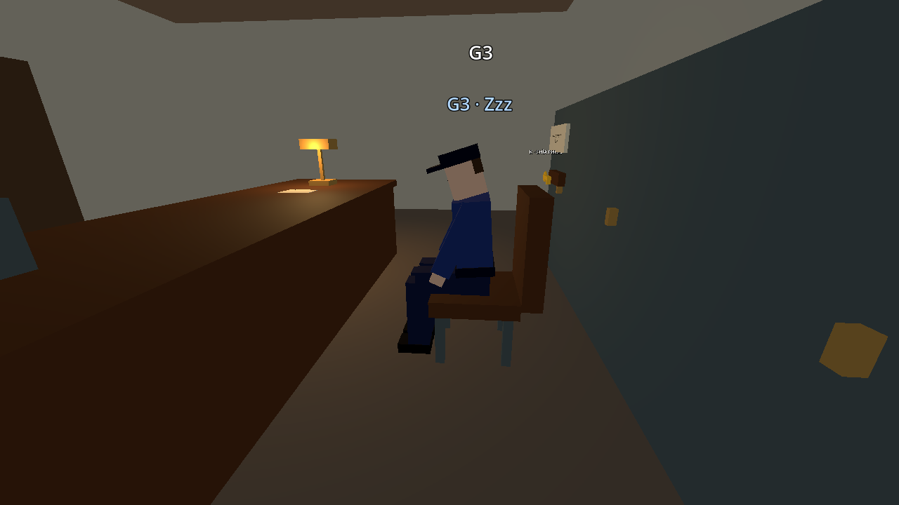
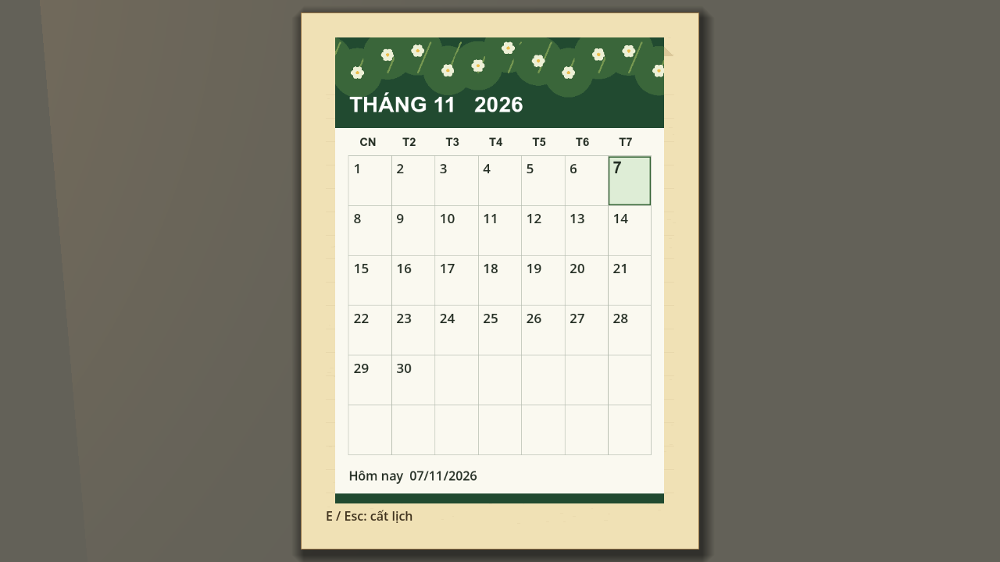
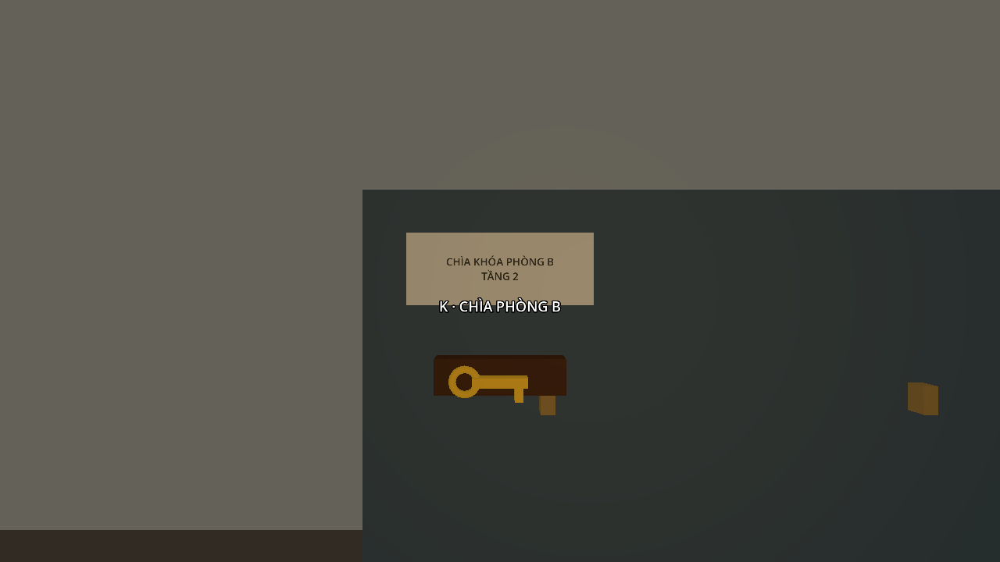
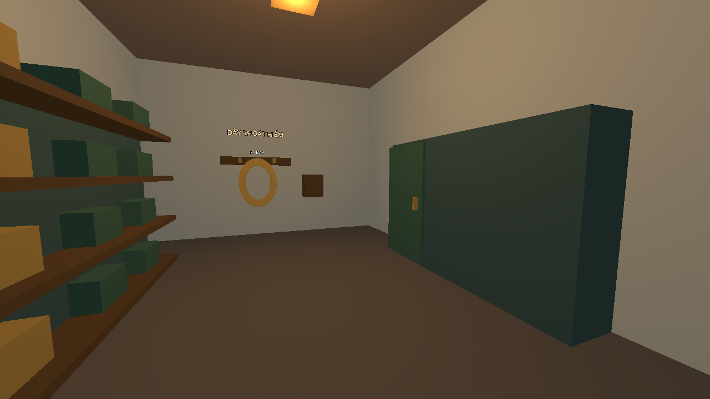

# Bước 19 — Phòng nhân viên, kho phụ và tranh tầng 2

Chạy `res://maps/isg_museum/scenes/museum.tscn` bằng F6 để xem bản cập nhật.

## Phòng nhân viên

G3 ngồi hướng về bàn, đùi hướng ra trước, cẳng chân thẳng xuống và giày chạm sàn.
Khi đứng lên, model khôi phục tư thế đi bộ. Dòng debug mô tả đúng giai đoạn ngủ,
quan sát hoặc trở về ghế.

Lịch C là lịch tháng treo tường với phần đầu trang hoa lá, lưới bảy cột và ngày hôm
nay in đậm, có viền nhẹ. E mở lịch lớn giữa màn hình. Ngày, tháng, năm lấy từ đồng
hồ máy tính và tự cập nhật. Các ghi chú bảo trì đã được bỏ.

Mã kho phụ lấy trực tiếp từ cùng lịch theo dạng **DDMM**, luôn đủ bốn chữ số.
Ví dụ ngày 07/11 dùng **0711**, ngày 01/01 dùng **0101**. Qua nửa đêm, mã của cửa
đang khóa đổi theo ngày mới. Cửa đã mở khóa giữ quyền đóng/mở trong lượt đó.
Giấy G trên bàn chỉ gợi ý ngày hôm nay và thứ tự ngày trước, tháng sau.

Đã bỏ sổ bàn giao ca. Phía trên giá treo chìa có bảng nhỏ ghi
**CHÌA KHÓA PHÒNG B • TẦNG 2**, đọc trực tiếp khi đến gần.

## Kho phụ và N0

Tủ sắt được đặt áp vào **tường nam** của kho. Đã bỏ xe đẩy/bàn nhỏ, đồ trên mặt,
nhãn kiểm tra 14/03 và bảng kiểm tra có tương tác đọc.

Ghế băng cạnh đồng đội N0 ngoài cửa chính đã được bỏ.

## Tầng 2

Theo xác nhận, cửa được bỏ là **cửa từ phòng B sang kho phục chế**. Ô cửa và liên
kết navigation đã được thay bằng tường đặc cao trọn tầng. Mang T2 tới điểm tập kết
đi theo cửa phòng B, hành lang phía đông, phòng đệm nam và cửa vào kho.

T1, T2, T3, A2, B2 và C2 đều được đưa sát mặt tường. Khoảng hở sau model khoảng
1 cm, với vùng tương tác vẫn bắt được tia E từ phía phòng.

## Kiểm tra

Đã bake lại navmesh và chạy **602 kiểm tra** của map. Bộ mới
`verify_room_feedback.gd` có 30 kiểm tra về vị trí tranh, chân G3, tường bịt cửa,
đồ đã bỏ, lịch tháng, năm nhuận, đổi ngày qua nửa đêm và trạng thái cửa đã mở khóa.
Các bộ kiểm tra mang/giao T2 dùng đường hành lang mới.

Nguồn dựng `build_geometry.gd`, `build_exhibits.gd` và `build_contract_teammate.gd`
đã được cập nhật để giữ các thay đổi khi dựng lại scene. Các nội dung về mã cố
định 1403, sổ trực và lối tắt B trong hướng dẫn cũ được thay thế bởi bước này.
