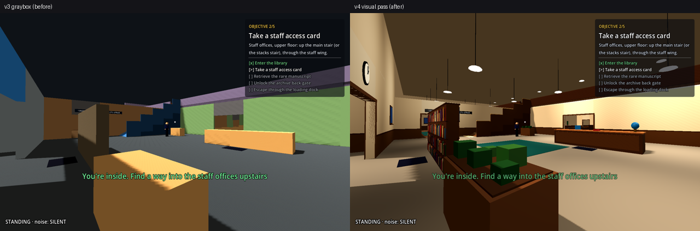
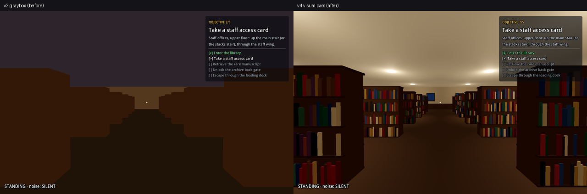
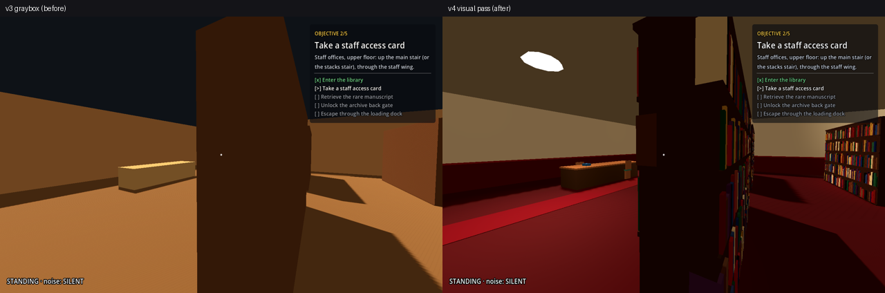

# Expanded Library — Phase 6: Visual Polish

This phase dressed the Expanded Library in the tutorial's low-poly library look, on both floors, without changing anything the game plays on. Every addition is decoration: meshes, MultiMeshes and lights with **no collision**, built by the level builder from the same layout data, on the v3 colliders.

**What stayed exactly the same, with evidence:**
- **The navmesh file is byte-identical** to v3 (`cmp` after every rebuild).
- **Every collider, trigger, guard and patrol point is identical.** `tools/expanded/collision_fingerprint.gd` lists 263 collision objects with their shapes, 6 guards with their tuning and 41 patrol points; the v3 and v4 fingerprints are the same file ([`v4/fingerprint/`](v4/fingerprint)).
- **The automated playtests give the same results** as Phase 5's final matrix: 25 of the 27 runs are identical line for line; the other two differ by one second or one "noticed", and re-running those cases twice on each build gives the same result on v3 and v4 (run-to-run variation of the playtester, [`v4/playtests/v3_vs_v4.md`](v4/playtests/v3_vs_v4.md)).
- **The tutorial looks exactly as before:** its 9 fixed viewpoints render pixel-identical before and after (`tools/capture_views.gd`).

Layout version **v4** ([`LEVEL_LOG.md`](LEVEL_LOG.md), [`LAYOUT.md`](LAYOUT.md#look-and-lighting-v4)); evidence in [`v4/`](v4). No layout geometry changed: v4 only adds a `look` to each furniture group in the layout data.

*Each image: v3 on the left, v4 on the right, same viewpoint. All 21 pairs: [`v4/compare/`](v4/compare); all v4 views (20 player views and 2 overviews): [`v4/views/`](v4/views); the mission with its HUD: [`v4/mission/`](v4/mission).*

## 1. Environment (Task 1)

The tutorial's own assets and palette are reused (`assets/` has no models or textures; the tutorial is built from boxes, its prop scenes and `ShelfBooks`):

| Area | What was added | Reused from the tutorial |
|---|---|---|
| Bookcases (main stacks, browsing hall, upper stacks, archive) | wood bookcases filled with books, a top board | `ShelfBooks` (one MultiMesh of books per bookcase), wood colour |
| Reading hall, browsing hall, balcony | tables with tops, chairs pushed in, books, teal rugs | `chair.tscn`, desk and rug colours |
| Lobby | circulation desk with counter, front panel, monitor and the globe; planters with low shrubs; a book display behind the entrance screen; teal rug; clock | the tutorial's globe and clock, lamp colours |
| Study rooms | carrels with desk tops and green-shaded lamps, carpet | carrel colours, the tutorial's lamp shade |
| Staff offices | desks with monitors and papers, office chairs, carpet | desk colours, `chair.tscn` |
| Service corridor, processing, storage, dock | work tables with stacks of books, steel storage racks with cardboard boxes, crates on pallets with bands, concrete and blue-grey floors, hazard stripes at the exit | crate and hazard colours, the tutorial's hallway floor |
| Archive | dark-red carpet, red runner from the front gate to the back gate, dark bookcases, the vault pedestal in stone and brass, brass-banded crates | the tutorial's restricted floor and runner |
| Doors | wooden posts and lintels on every doorway; cream headers; red on the card gates, amber on the one-way shortcut, green on the exit | `Dressing/Doorways`, header and restricted-trim colours |
| Walls | plaster; a wood wainscot with a rail in public rooms, a dark-red one with a red rail in the restricted zones | wall, trim and restricted-trim colours |
| Stairs | wood ramp with light stripes every 0.45 m, brass-capped balustrade, a light strip at the foot and the top | brass |
| Architecture | windows on all outer walls, posters, three clocks, ceilings under the upper floor, a roof, the outer walls above the double-height halls | window, poster and ceiling colours |
| Lights | 84 ceiling lights and pendants | `ceiling_light.tscn` |

**Geometry budget.** The builder makes about 1,700 boxes and merges them into 292 `BatchedBoxes` (a new 87-line script, `scripts/level/batched_boxes.gd`: a MultiMesh of coloured unit boxes built when the level loads, the same technique as `ShelfBooks`). What stays as separate meshes: books (one MultiMesh per bookcase), 20 chairs, 84 light fixtures, the signs, the mission's objects and a few cylinders and spheres (lamp stems, clocks, the globe). See section 5 for the effect on draw calls.

## 2. Readability (Task 2)

| Must be readable | How |
|---|---|
| Public vs restricted | Public rooms: warm stone and wood floors, wood wainscot, teal rugs. Restricted (service corridor zone D, archive zone F): dark-red wainscot with a red rail, the archive's dark-red carpet, red headers and trims on the card gates, red signs (from v3), a red glow over each card gate. |
| Main routes vs dead ends | Routes are signed (v3's 14 signs, now on the tutorial's sign boards); the doorways the routes use have trims and lit headers; rugs and the archive runner lead along the main paths; study rooms and offices are carpeted rooms off the corridors. |
| Stairs and floor transitions | Light stripes across every ramp and a light strip at each end, brass-capped balustrades. |
| Hiding spots | Unchanged from v3: the dark-blue floor mark at each of the 13 HidingSpots, next to cover that looks like what it is (bookcases are full cover; tables, desks and crates stay visibly low, with nothing tall on them). |
| Interactable items | The card and the manuscript keep their glow and label, now with a warm light over each. |
| Locked doors and shortcuts | Card gates: red header, red trims, red glow; the one-way shortcut: amber header and trims; door panels still turn green / red by the AccessDoor script (from v3). |
| Mission objects and the exit | The exit: green glowing header, green light, yellow-black hazard stripes on the floor; the vault pedestal in stone and brass under a warm light. |

## 3. Lighting and materials (Task 3)

**Palette.** Every material is one of the tutorial's (`LOOKS` in the builder, from `scenes/level/library_graybox.tscn`): the same plaster, woods, trims, rugs, carpets, brass, window and sign colours on both floors.

**Environment.** The tutorial's ambient colour and sun (key light 0.4, its colour and angle). The ambient energy is **0.50** (the tutorial: 0.42), because these rooms are larger and have fewer lights per square metre; with it, the spots between lights are never darker than the v3 graybox was everywhere (0.55, no lamps). Sun shadows reach 40 m (the default 100 m spread the shadow map over the whole building).

**The renderer's limits.** This project uses the Compatibility renderer, which draws at most **32 lights in view** and **8 lights per mesh**, dropping any others in no particular order (so a near light could vanish depending on where the player looks). The first lighting pass broke both limits badly: 98 lights touched up to 98 views' frusta and 599 meshes had more than 8. The final design:
- the tutorial's ceiling light with a shorter reach (6.5 m on ground-floor ceilings, 6 m upstairs, 7 m for pendants in the double-height halls; its own 10 m), about 9.5 m apart (one per small room), with the energy set so a guard's chest under a light gets about the same light on both floors;
- the renderer's **distance fade** (lights fade out from 16 to 21 m away and then take no slot);
- **per-floor render layers and light cull masks:** each floor's lights reach only that floor's surfaces (omni lights here cast no shadows, so they would otherwise shine through the slab); characters, props and the mission's objects are lit by both;
- batches are split until no piece is reached by more than 8 lights.

`tools/expanded/light_report.gd` checks it ([`v4/lighting.md`](v4/lighting.md)):

| Check | Result |
|---|---|
| Lights in view: the player's camera on every navmesh polygon, 16 headings, 3 pitches (43,104 views) | at most **25** (limit 32); views over the limit: **0** |
| Lights per mesh (Godot pairs a light with a mesh when the light's range cube meets the mesh and the mask allows; counted the same way) | at most **8** on any of the meshes; meshes over the limit: **0** |
| Light at a guard's chest on every patrol route (every 0.5 m; ambient + lamps above) | from **0.50** (ambient only, between lights) to about **1.1** (under a light); medians 0.72–0.89 on both floors (table below) |

| Route | Total light min / median / max |
|---|---|
| P1 Lobby | 0.62 / 0.87 / 1.00 |
| P2 Main Stacks | 0.58 / 0.84 / 1.00 |
| P4 Service Corridor | 0.56 / 0.79 / 1.02 |
| P5 Upper Stacks | 0.50 / 0.72 / 0.97 |
| P7 Archive | 0.50 / 0.77 / 1.09 |
| P8 Connector | 0.50 / 0.80 / 1.13 |

**Fairness to the player.** No guard route has a dark patch below the ambient floor and none has a hot spot above about twice it, so a guard is never hidden by darkness or picked out by a spotlight. Detection itself is unchanged: guards see with physics rays against colliders (identical) and the player's visibility rules don't depend on light. In the views ([`v4/views/`](v4/views)) the frozen guards read clearly against the plaster walls and floors.

## 4. Gameplay preserved (Task 4)

The rule for every decorative piece: inside a collider, flush on its faces, or at most a few centimetres out (tabletops 4 cm, wainscots 3 cm, door trims 4 cm, boxes on racks 2 cm); chairs stand at most 0.15 m beyond a table's edge, where nobody can walk (the navmesh keeps 0.5 m from colliders and the player's capsule has a 0.35 m radius); nothing on top of low cover is taller than a lamp or a stack of books; overhead pieces (ceilings, roof, the outer walls above the double-height halls) are above or outside every walkable place, where no sight line between two walkable points passes.

| Revalidated | How | Result |
|---|---|---|
| Collision | collision fingerprint, v3 vs v4 | identical (263 collision objects, all shapes and transforms) |
| Navmesh | `cmp` of the navmesh file after every rebuild; the suite's saved-vs-fresh bake | byte-identical; saved 4512.0 m² = fresh 4512.0 m² |
| Decoration doesn't intrude | new suite check, `_check_dressing` in `tests/expanded_graybox_tests.gd`: no collision node anywhere in the decoration; every solid piece is one box collider; no decorative mesh or batched box within 0.15 m of the navmesh at body height (0.1–1.9 m above it) | 0 collision nodes; 228 solid pieces with one box collider; 1,935 decorative meshes and batched boxes checked, 1,245 of them outside the colliders, **0** in the walkable space |
| Guard sightlines | same colliders (fingerprint); `expanded_ai_tests` vision checks | pass (behind a shelf, through the slab and behind the balcony railing not seen; at the railing seen) |
| Hiding | 13 HidingSpots unchanged (fingerprint); `expanded_graybox_tests` count; the HUD shows HIDDEN behind the entrance screen ([`v4/mission/01b_…`](v4/mission/01b_hidden_behind_entrance_screen.png)) | pass |
| Door interactions, mission objects, checkpoints | `expanded_mission_tests`: the full mission with real input, every bypass refused, closed doors block the player and sight, captures at every stage | pass |
| Alternate routes and shortcuts | `expanded_graybox_tests`: main route and both alternatives walked with real input (480 m, through every gate); 23/23 gate stages; shortcut 41% shorter | pass |
| Stealth balance | the 27-run Phase 5 playtest matrix on v4 | 25 of 27 identical; the 2 others are run-to-run variation (both builds give the same result when re-run); careful 18/18 and learner 6/6 completed, reckless 0/3, as in v3 |

## 5. Performance

**Measured on this machine only** (Linux VM, Xvfb, Mesa **llvmpipe**: software OpenGL on the CPU, 1280×720). Phase 13 measured the tutorial on the same kind of setup at **86 ms** per frame (302 draw calls) and on the reference Windows laptop (i5-8265U, MX130) at **202 FPS** (311 draw calls). No measurement was possible on Windows or any GPU in this environment.

`tools/expanded/profile_expanded.gd` stops a camera at the 20 viewpoints of `capture_views.gd`, with the six guards patrolling, and measures 120 frames each after a warm-up ([`v4/profile/`](v4/profile)):

| Build | Frame ms mean | Frame ms p95 | Draw calls mean / max | Triangles in a frame, max | Load time |
|---|---|---|---|---|---|
| v3 graybox | 95.3 | 117.5 | 345 / 772 | 15,092 | 692 ms |
| **v4 (final)** | **186.4** | **263.7** | **408 / 877** | **246,908** | **1,000 ms** |
| v4 without lamps | 148.6 | 231.2 | 406 / 881 | 246,908 | — |
| v4 without sun shadows | 131.3 | 209.2 | 283 / 626 | 244,838 | — |
| v4 without books | 166.2 | 200.5 | 406 / 874 | 43,051 | — |
| v4 without lamps, sun shadows, books and roof | 66.8 | 87.3 | 280 / 620 | 34,940 | — |

*The diagnostic rows switch parts off (`--disable=…`) to show what each costs; they are not playable configurations. A second full v4 run gave 185.7 ms mean and the same draw calls; v3 was also run twice (95.3 and 94.8 ms). Per-view tables: [`v4/profile/`](v4/profile).*

**What the numbers say:**
- **Draw calls**, the main CPU cost in this renderer: mean **408** against v3's 345 (+18%), peak **877** against 772 (+14%); the tutorial on Windows: 311. Without batching, the first pass needed a mean of 1,361 and up to 3,063; batching, fewer shadow casters and the books' draw distance brought them back near v3.
- **Frame time under software rendering:** about **twice** v3's (186 against 95 ms mean). The diagnostic runs show where the time goes: sun shadows about 55 ms, lamps about 38 ms, books about 20 ms (most of it standing in the book stacks), the roof a little. With all of those off the dressed level renders faster than the v3 graybox did, so the extra cost is per-pixel shading (lamps and sun shadows) and the books, which a CPU rasterizer pays for very differently from a GPU.
- **Triangles:** up to about 250,000 standing in the book stacks (the books within 20 m; beyond that a bookcase shows its box), against at most about 15,000 in v3 and 28,000 for the tutorial.
- **Load time:** 1.0 s against 0.7 s for v3 (the books and batches are built when the level loads).

**Changes made for performance:** batching (1,686 boxes into 292 MultiMeshes); sun shadows only from walls, the upper slab, furniture, headers and stairs (finishes on them would cast invisible shadows), within 40 m; books drawn within 20 m (`ShelfBooks.draw_distance`, a new optional property; 0, the default, keeps the tutorial as it was); the roof unshaded (no lamp lights it) and ceilings excluded from sun shadows (they face down).

**Target.** No FPS target for the Expanded Library is documented; the tutorial's measurements are the reference. The draw-call and light budgets are met; whether the per-pixel cost matters on the MX130 can only be measured there. **This is the main open item of this phase** (see Known issues).

## Files

| File | Change |
|---|---|
| `tools/expanded/build_expanded_graybox.gd` | the visual pass: materials (`LOOKS`, the tutorial's palette), tiled floors / walls / ceilings, wainscots, door trims, stair stripes and caps, furniture dressing by `look`, lights, ceilings and roof, chairs, rugs and floor marks, windows, clocks and posters, mission accents; per-floor render layers and light masks; batching with light-limit splitting; environment (ambient 0.50, key 0.4, shadow distance 40 m) |
| `tools/expanded/expanded_layout.gd` | `VERSION` v4; a `look` on each furniture group (geometry unchanged) |
| `scripts/level/batched_boxes.gd` (new) | `BatchedBoxes`: a MultiMesh of coloured unit boxes built from plain data when the level loads |
| `scripts/level/shelf_books.gd` | two optional properties, `layers` and `draw_distance`; their defaults (1, 0) keep the tutorial's books as they were (pixel-identical) |
| `scenes/level/expanded_library.tscn` | rebuilt (the navmesh file is unchanged) |
| `tests/expanded_graybox_tests.gd` | new section H, `_check_dressing` |
| `tools/expanded/capture_graybox.gd` | top views hide the roof, the ceilings and upper-floor dressing |
| `tools/expanded/capture_views.gd`, `light_report.gd`, `profile_expanded.gd`, `collision_fingerprint.gd` (new) | development tools: the same views on any build; lights against the renderer's limits and on the guards' routes; rendering profile with diagnostics; collision fingerprint |
| `docs/expanded/phase-6-visual-polish.md` (this report), `LEVEL_LOG.md` (v4), `LAYOUT.md`, `README.md`, `docs/qa/REGRESSION_CHECKLIST.md` | documentation |
| `docs/expanded/v4/` | evidence: `views/`, `compare/`, `mission/`, `lighting.md`, `profile/`, `playtests/`, `fingerprint/`, `test_run.txt` |

## Decisions

1. **Decoration only, on the v3 colliders.** The phase asked to preserve the tested layout, gameplay and balance. Making nothing solid means none of it can block a route, open a hiding place, or change what a guard sees, and it can be proven (fingerprint, navmesh file, playtests) instead of re-tested by feel.
2. **The tutorial's assets and palette, built by the builder.** The project has no art assets; the tutorial is built from boxes, three prop scenes and `ShelfBooks`. The same builder-from-data approach as Phases 1–5 keeps the scene reproducible (don't hand-edit it).
3. **Lighting designed against the renderer's limits** (32 in view, 8 per mesh), with a tool that checks them, rather than as many lights as looked good: past the limits Godot drops lights in no particular order, which would make lighting, and so the guards' visibility, depend on where the player looks.
4. **Ambient 0.50 instead of the tutorial's 0.42** (explained in section 3).
5. **Batching into `BatchedBoxes`.** Draw calls are what this renderer pays most for on the CPU. The data is kept in the node (not in a saved MultiMesh) because a headless build, which is how the builder and the tests run, keeps no MultiMesh data: the first batched build was saved with every box collapsed to a point, caught by the screenshots and the dressing check.
6. **Two small optional properties on the shared `ShelfBooks`** instead of a copy of it for this level. The defaults keep the tutorial pixel-identical.
7. **No changes to systems, guards, AI states, scripts the game runs, project settings or the tutorial scene.** Raising the renderer's per-mesh light limit (a project setting) would have been simpler, but it would affect the whole project, so I designed within the limit.

## Tests and results

All run on the final build (`v4/test_run.txt`):

| Run | Result |
|---|---|
| `tools/ci/validate.sh` | VALIDATION PASSED (every script compiles) |
| `tools/ci/run_tests.sh`: the suite | **All tests passed** (Phase 1 … Phase 14, Expanded Library graybox, map selection, Expanded Library guards, Expanded Library mission), 8 warnings (the expected ones) |
| `tools/ci/run_tests.sh`: game flow, map selection | QA FLOW PASSED (15 checks), MAP FLOW PASSED (52 checks, 3 cycles) |
| `tools/ci/export_windows.sh` | EXPORT PASSED |
| Collision fingerprint v3 vs v4 | identical |
| Navmesh file v3 vs v4 | byte-identical |
| Playtest matrix (27 runs) v3 vs v4 | 25 of 27 identical; runs 4 and 19 re-run twice on each build: same results on v3 and v4 |
| Lighting report | ≤ 25 lights in view (limit 32), ≤ 8 per mesh, route light 0.50–1.13 |
| Tutorial, 9 viewpoints, before vs after | pixel-identical |

**Failures during the phase, all fixed and re-run:**
- the new dressing check first flagged the walls', slabs' and ramps' own visual tiles (which are the collider boxes) and a flat landing strip; the check was narrowed to decoration (it skips what lies inside a collider and flat marks on a floor);
- the scene structure check failed once ("There must be three stairs") when the stairs' batch was placed under `Stairs`; it now goes with the ground floor's;
- the first batched build was saved empty (see Decisions, 5), which also meant the stair stripes had never been visible; fixed with `BatchedBoxes`;
- the lighting report found the light limits broken (see section 3) and, after batching, 30 batches over 8 lights; fixed by the split.

## Manual tests (please run on Windows)

1. **Look:** F5 → Expanded Library. Walk the main route (lobby → S1 → balcony → staff wing → Office 2 → archive → vault → back gate → S2 → storage → dock). Check the rooms match the tutorial's style, red marks only the restricted areas, and you can read stairs, doors, gates, the shortcut and the exit.
2. **Lights:** turn slowly in the lobby, the main stacks, the balcony and the archive hall. No light should switch off or flicker as you turn. Guards should be easy to see everywhere, with no dark corners.
3. **Collision:** walk along walls, tables, bookcases and racks. You should never pass through anything decorative (chairs are pushed under tables, out of reach).
4. **Performance:** on the reference laptop, from the project folder: `godot --path . --script res://tools/expanded/profile_expanded.gd -- --out=docs/expanded/v4/profile/windows --label=windows` (about 1 minute; it writes `summary.md`). For comparison, the tutorial's reference is 202 FPS (`tools/benchmark.gd`, Phase 13). Please send the summary.
5. **Tutorial:** play it briefly; it should look and play exactly as before.

## Acceptance

| Criterion | Result | Evidence |
|---|---|---|
| Consistent low-poly style on both floors | **PASS** | the tutorial's palette and props on every room of both floors (section 1); [`v4/views/`](v4/views), [`v4/compare/`](v4/compare) |
| Gameplay elements readable | **PASS** | section 2; [`v4/mission/`](v4/mission) (prompts, gates, items, exit); a human check is in the manual tests |
| Mission completable | **PASS** | `expanded_mission_tests` full mission with real input → WIN; the playtester completed every careful and learner run |
| Collision and navigation work | **PASS** | collision fingerprint identical; navmesh byte-identical; dressing check 0 intrusions; routes walked with real input |
| No new critical stealth or progression issues | **PASS** | playtest matrix unchanged (25/27 identical, 2 run-to-run variations, 0 state violations); guard, mission and AI suites pass; lighting even on every route |
| Performance within agreed targets, or deviations documented | **PASS (deviation documented)** | no FPS target is documented; the renderer's light budgets are met and draw calls are near v3; under software rendering frames cost about twice v3's, mostly per-pixel shading (section 5); no GPU measurement possible here, so this is open until a Windows run |
| The tutorial keeps its appearance and functionality | **PASS** | 9 views pixel-identical; all tutorial suites pass; `ShelfBooks` changes are optional with unchanged defaults |

## Known issues and limitations

1. **Performance on the target hardware is not measured.** Software rendering: draw calls mean 408 vs v3 345, peak 877 vs 772, frame time about twice v3's (per-pixel lamps and sun shadows, books). If the Windows run is too slow, the levers in order: fewer lamps (raise the spacing), sun shadows off indoors, a shorter books draw distance, the per-pixel lamp count. All are builder constants.
2. **No human has looked at it.** Readability and the lighting's fairness were judged from screenshots and the lighting report, not by players.
3. **Omni lights pass through floors onto characters.** Surfaces are masked per floor, but a guard upstairs is also lit from below by the ground floor's lights (on its downward faces only). It makes a guard slightly easier to see, never harder.
4. **Books pop in at 20 m.** Further away a bookcase shows its wooden box.
5. **Metal reads as plain colour** in the batches (brass caps, steel racks): there was no visible sheen on these small boxes.
6. **The roof is a flat unlit colour** (no lamp reaches it).
7. **Screenshots are from software rendering** (Xvfb, llvmpipe), not Windows.
8. **Still open from Phase 5:** the 20–30 minute pacing target (a visual pass doesn't change it; human playtests per `PLAYTEST_PROTOCOL.md`); the one-line timing fix for the tutorial's `guard_tests` awaiting your approval (it passed in all of this phase's runs).

## Next phase

Phase 7, after your approval. Before it, a Windows run of the profile (manual test 4) would settle the performance question.
