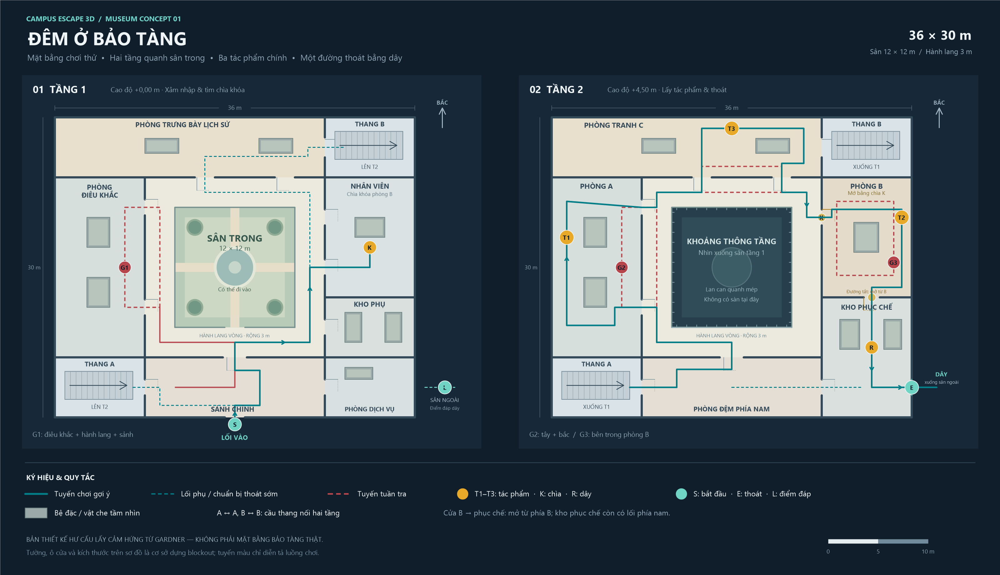
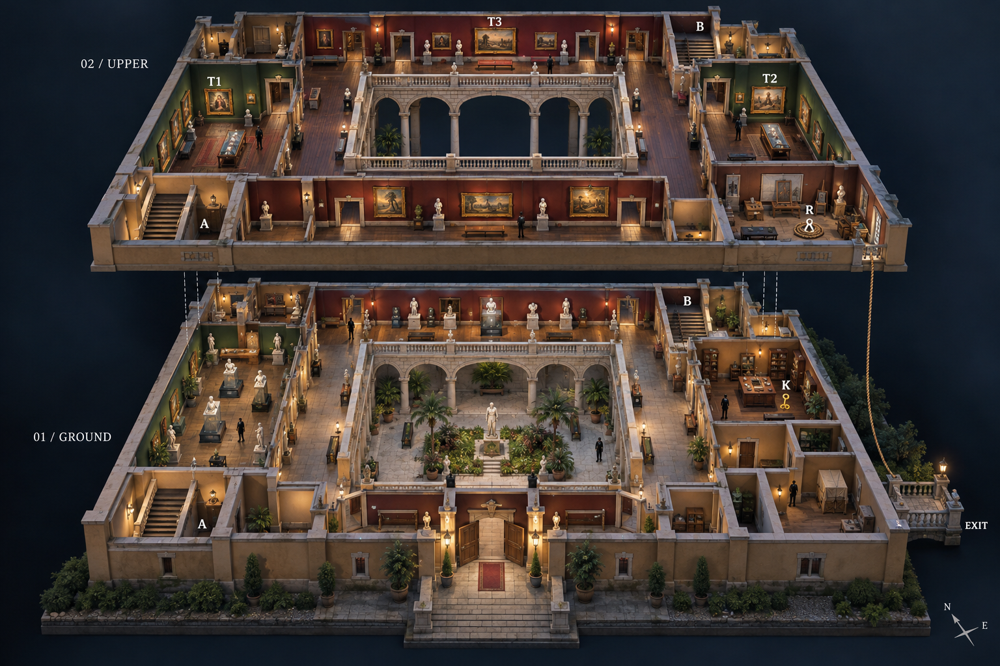
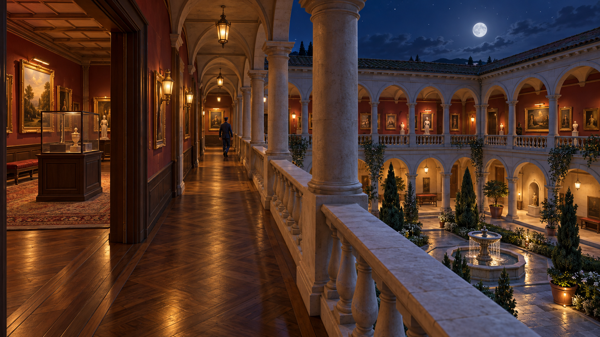

# Đêm ở bảo tàng — thiết kế map v1

Bộ thiết kế cho map lén lút góc nhìn thứ nhất của Campus Escape 3D, theo hướng người chơi đóng vai kẻ trộm. Bối cảnh hư cấu lấy cảm hứng từ vụ trộm bảo tàng Isabella Stewart Gardner năm 1990. Các kích thước, tuyến tuần tra và đường thoát là đề xuất gameplay.

## Các bản vẽ

| Tệp | Nội dung |
|---|---|
| [floorplans.png](floorplans.png) | Mặt bằng hai tầng, 3200 × 1840 px; nhãn tiếng Việt, kích thước, cửa, mục tiêu và tuyến tuần tra |
| [floorplans.svg](floorplans.svg) | Bản vector tương ứng để phóng to hoặc chỉnh sửa |
| [museum-exploded-3d.png](museum-exploded-3d.png) | Phối cảnh tách tầng, thấy phòng tranh, sân trong, hai cầu thang và đường dây thoát bên ngoài |
| [museum-player-view-3d.png](museum-player-view-3d.png) | Góc nhìn người chơi ở hành lang tầng hai: cột, tủ kính có chân đế đặc, bảo vệ và sân phía dưới |
| [floorplan-notes.md](floorplan-notes.md) | Tọa độ, ô cửa, điều kiện khóa, kết nối hai tầng và ghi chú dựng blockout |
| [image-prompts.md](image-prompts.md) | Toàn bộ prompt dùng cho hai ảnh concept, tạo bằng công cụ imagegen tích hợp |
| [build-floorplans.ps1](build-floorplans.ps1) | Công cụ Windows tạo lại PNG và SVG từ cùng dữ liệu |

## Cách đọc nhanh

- **S**: lối vào tầng 1; **K**: chìa khóa trong phòng nhân viên.
- **T1 / T2 / T3**: ba tác phẩm chính ở tầng 2. Chỉ phòng chứa T2 cần chìa K.
- **A / B**: hai cầu thang nối tầng ở tây nam và đông bắc.
- **R**: dây trong kho phục chế; **E**: cửa sổ mặt ngoài phía đông; **L**: vị trí đáp dưới sân ngoài.
- **G1 / G2 / G3** và đường đỏ: vị trí minh họa cùng tuyến tuần tra dự kiến.
- Đường xanh liền: tuyến chơi gợi ý; xanh đứt: đường phụ hoặc tiếp cận đường thoát sớm.
- Khối xám xanh: phần bệ đặc / vật che. Phần kính trong suốt phía trên cần cho phép nhìn xuyên qua.

## Luồng chơi đề xuất

1. Vào sảnh tầng 1, quan sát G1 và tìm chìa K ở phòng nhân viên.
2. Chọn thang A hoặc B để lên tầng 2. Có thể chuẩn bị dây và cửa sổ trước.
3. Lấy T1 và T3 theo thứ tự tùy chọn, tránh tuyến G2 giữa phòng tây và phòng bắc.
4. Dùng K vào phòng B lấy T2, tránh G3 tuần tra quanh bệ trưng bày trong phòng.
5. Mở chốt từ phía phòng B để sang kho phục chế. Cửa này tạo lối tắt sau khi tiếp cận phòng B; không cho đi từ kho vào B từ đầu màn.
6. Lấy R nếu chưa có, gắn dây tại E. Điều kiện thoát dự kiến: đủ ba tác phẩm, dây đã gắn và không còn bị truy đuổi trực tiếp.

Người chơi vẫn có thể trở lại qua cửa khóa đã mở. Kho phục chế luôn có lối từ phòng phía nam, nên không cần thu thập đủ tác phẩm mới chuẩn bị được đường thoát.

## Kích thước để bắt đầu dựng

- Khung nhà: **36 × 30 m**; sân trong: **12 × 12 m**; hành lang vòng: **3 m**.
- Mặt sàn: tầng 1 **+0,00 m**, tầng 2 **+4,50 m**. Sân trong ở tầng 2 là khoảng rỗng có lan can.
- Phạm vi bản đầu: **hai tầng, ba tác phẩm, ba bảo vệ, hai cầu thang, một đường thoát**.
- Tọa độ trên mặt bằng: x về đông, y về nam; khi dựng Godot có thể dùng X = x, Z = y, Y = cao độ.
- Chừa lối đi quanh bệ, kiểm tra khả năng cúi nấp, góc nhìn qua cửa, kích thước cầu thang và navmesh bằng nhân vật thực tế trước khi thêm trang trí.

## Phạm vi và kiểm tra

Mặt bằng PNG/SVG là tham chiếu cho vị trí phòng, cửa và đường đi. Hai ảnh 3D là ảnh concept do imagegen tạo để trao đổi phong cách, không phải screenshot từ Godot hoặc mô hình 3D nhập được. Chi tiết trang trí, số nhân vật minh họa và độ rộng nhìn trong phối cảnh có thể khác bản vẽ; khi dựng map ưu tiên mặt bằng. Khoảng cách tách hai tầng trong ảnh chỉ nhằm trình bày, không phải chiều cao công trình.

Đã kiểm tra trực quan bản vẽ và hai ảnh; đối chiếu khoảng thông tầng, vị trí cầu thang, khóa phòng B, lối vào kho và hướng thoát ra sân ngoài. SVG đã kiểm tra đọc được như XML. Chưa dựng scene hay đo nhịp chơi; kích thước và tuyến tuần tra sẽ được điều chỉnh sau khi chơi thử blockout.
