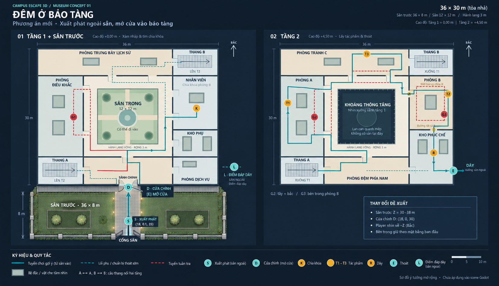
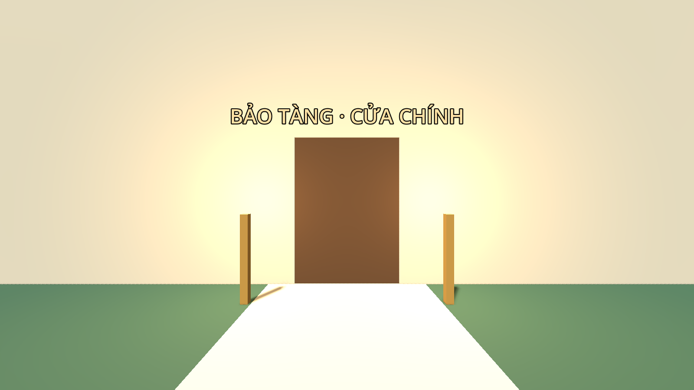

# Phương án vào bảo tàng từ sân trước

Ảnh minh họa mới dựa trên [sơ đồ ban đầu](../concept-v1/floorplans.png), tạo ngày 01/11/2026
bằng công cụ imagegen tích hợp. **Đã áp dụng điểm xuất phát và sân/cửa vào scene Godot ngày 01/11/2026.**

- Giữ khung tòa nhà X=0…36, Z=0…30 và bố trí hai tầng theo sơ đồ ban đầu.
- Thêm sân trước phía nam X=0…36, Z=30…38: kích thước 36 × 8 m.
- **S**: xuất phát ở `(18, 0.1, 35)`, nhìn về bắc (-Z).
- **D**: cửa chính tại `(18, 0, 30)`, nhấn E để mở và đi vào sảnh.
- **L**: điểm đáp dây ở phía đông nhà, tách biệt với vị trí xuất phát.
- Cổng sân ở phía nam; đường màu xanh nối S → D → sảnh → tuyến chơi bên trong.

Sơ đồ là ảnh minh họa có chú thích; tọa độ nêu trên và mặt bằng gốc dùng để đối chiếu khi dựng scene.
Prompt đầy đủ và công cụ được ghi trong [front-yard-floorplan-prompt.md](front-yard-floorplan-prompt.md).

## Cách chạy bản đã dựng

Mở `res://maps/museum/scenes/museum.tscn`, nhấn **F6**. Player đứng ngoài sân tại S,
nhìn về cửa chính. Đi theo lối sáng màu, đến gần cửa và nhấn **E** để mở.
Cửa chính không cần K; chìa K vẫn chỉ dùng cho phòng B. Cửa chính mở giữ nguyên trong lượt chơi.

## Các node đã thay đổi

| Node | Cấu hình |
|---|---|
| `Museum/Player` | Position `(18,0.1,35)`, Rotation `(0,0,0)`; hướng bắc (-Z) |
| `NavigationRegion3D/Geometry/FrontYard/Ground` | Size `(36,0.3,8)`, Position `(18,-0.15,34)`; collision world |
| `NavigationRegion3D/Geometry/FrontYard/Walkway` | Đường nhìn thấy rộng 3 m, ngang mặt đất; dùng sàn sân làm collision |
| `NavigationRegion3D/Doors/Entrance` | Position `(18,0,30)`, cửa rộng 2 m, chế độ FREE |
| `FrontYard/Fence*`, `ClosedStreetGate` | Ranh giới sân; cổng phía đường đóng cố định để không bước ra ngoài map |

Đã bỏ khối cũ `Geometry/Exterior/EntranceSecured`. Cửa mới dùng scene
`scenes/entrance_door.tscn` và script `scripts/museum_door.gd` với chế độ FREE.
Khi mở, Panel ẩn và mất collision; Passage bật để nối navmesh ngoài sân với sảnh.
Hai chế độ KEY/LATCH của cửa B và chốt kho giữ nguyên ID và điều kiện.

Builder `tools/build_geometry.gd` đã có sân mới khi dựng lại toàn map. Lần chuyển đổi này
dùng tùy chọn `--update-entrance` để bổ sung sân vào scene đã có và giữ nguyên các phòng bên trong.
Vật liệu, cây và hàng rào hiện dùng khối thử, chưa phải bộ asset hoàn thiện như ảnh minh họa.

## Kết quả kiểm tra 01/11/2026

- Navmesh bake lại từ static colliders, cửa đóng: **453 polygon**.
- `verify_blockout.gd`: **62 kiểm tra đạt**, gồm nền tại spawn, biên sân, cửa chặn khi đóng,
  tia camera/E, đi từ sân vào sảnh, kết nối navmesh và toàn bộ kiểm tra thang/ba guard.
- `verify_demo.gd`: **54 kiểm tra đạt**, gồm mở cửa trước khi lấy đồ, Restart / Play Again /
  bị bắt tải lại map, đưa Player về sân và đóng lại cửa chính.
- Toàn project: **161 script biên dịch được**. Không thay đổi script dùng chung.

Restart / Play Again và bị bắt đều đưa Player về S và khôi phục cửa đóng. Cửa sổ E phía đông
tầng 2 tiếp tục là điểm thắng của lượt chơi; cửa chính chỉ là lối vào.
