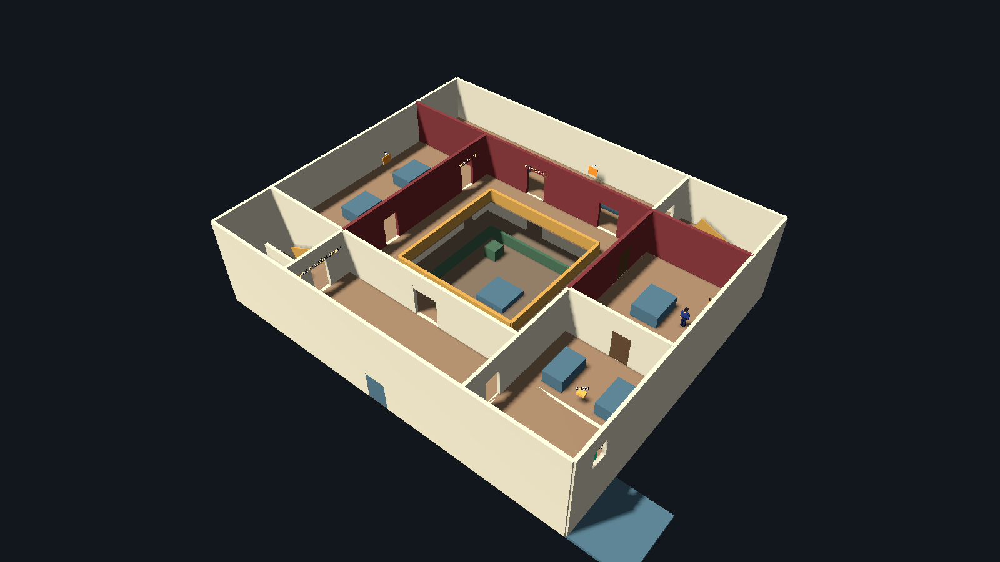
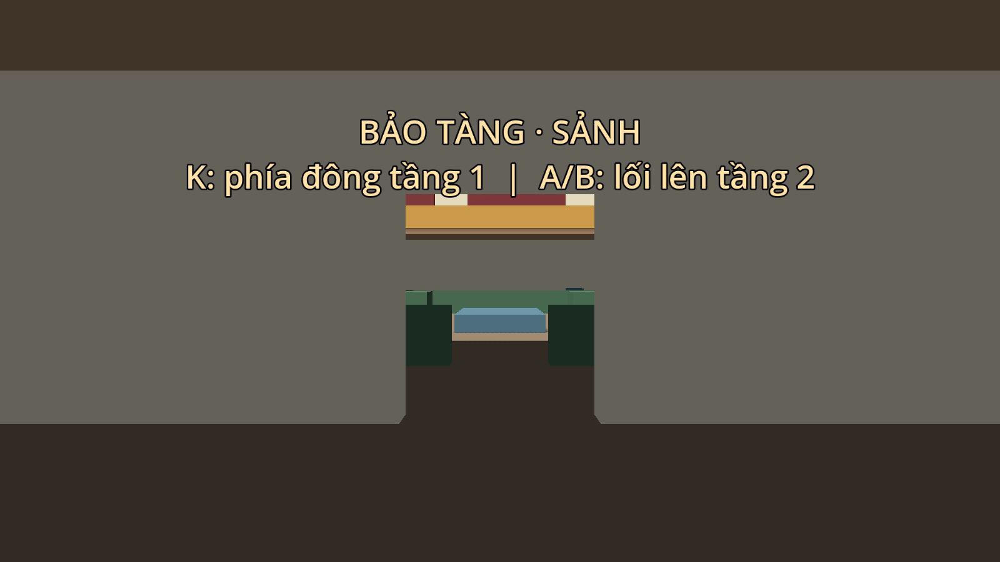
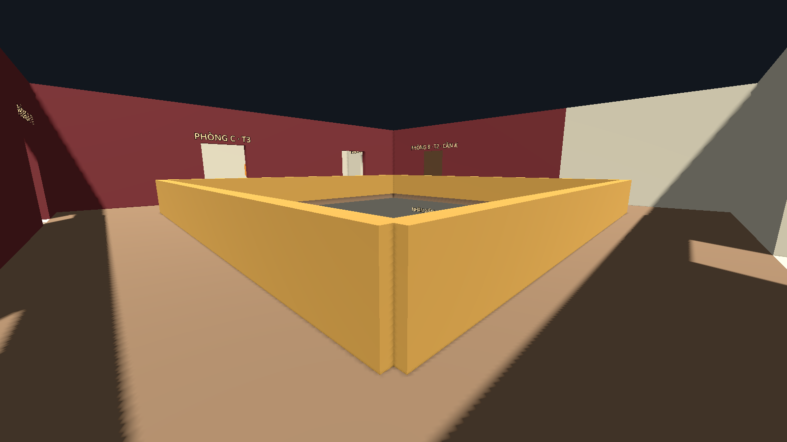
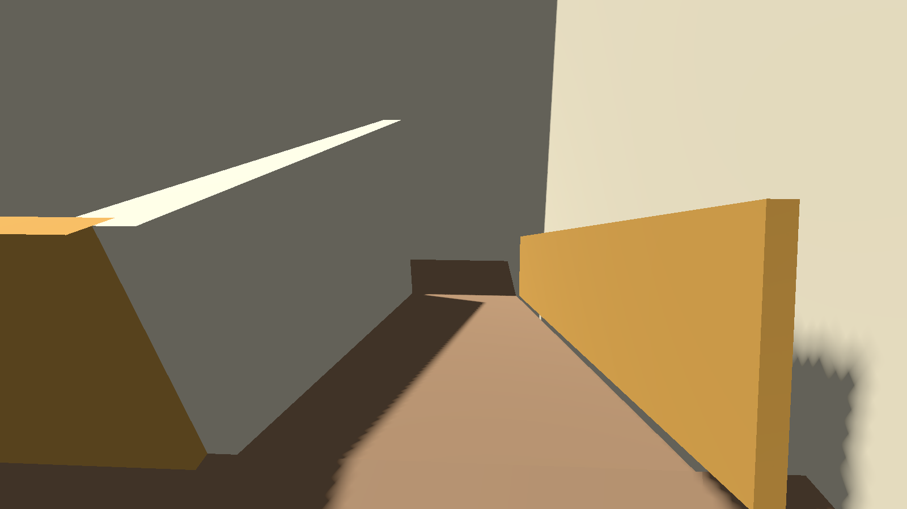

# Bước 6 — Bảo tàng hai tầng chạy được

Ngày 29/10/2026, `museum.tscn` đã thay phòng thử bằng mặt bằng 36 × 30 m theo
[floorplans.png](concept-v1/floorplans.png) và [tọa độ thiết kế](concept-v1/floorplan-notes.md).
Đây là bản dựng khối để thử di chuyển và gameplay; tranh, dây, chìa vẫn dùng hình đại diện.



## Mở và chơi thử

1. Mở project, mở `res://maps/museum/scenes/museum.tscn`, nhấn **F6**.
2. Player bắt đầu ở sảnh phía nam `(18, 0.1, 28.5)`, nhìn về bắc (-Z).
3. WASD di chuyển, chuột để nhìn, C/Ctrl để cúi, Shift để chạy, E để tương tác, Esc để pause.
4. Tìm **K** trong phòng nhân viên phía đông tầng 1. Có thể lấy T1/T3 hoặc dây trước K.
5. Chọn thang **A** ở tây nam hoặc **B** ở đông bắc để lên tầng 2. Hai thang là dốc chữ U:
   đi hết vế dưới, quay trên chiếu nghỉ, rồi đi tiếp vế trên.
6. T1 ở phòng A phía tây; T3 ở phòng C phía bắc. Dùng K mở cửa phòng B phía đông để lấy T2.
7. Từ trong B, dùng E mở chốt cửa ở phía nam phòng. Sau lần mở đó đi qua lại được.
8. Dây ở kho phục chế phía đông nam. Kho còn có cửa từ phòng đệm phía nam, vào được từ đầu.
9. Đủ ba tranh và dây, cắt đuôi và tránh tầm nhìn bảo vệ, đến cửa sổ **THOÁT** phía đông kho và nhấn E.

Thắng hiện menu; **Play again** / **Restart level** khôi phục cả chìa, tranh, dây, cửa,
link điều hướng và nhiệm vụ. Khi bị bắt, màn CAUGHT hiện khoảng 2.5 giây rồi tải lại map.
F5 vẫn mở menu của nhóm; bảo tàng chưa đăng ký trong catalog.



## 6.1. Hệ tọa độ và sàn

Gốc ở góc tây bắc; X tăng về đông, Z tăng về nam, Y là cao độ. Các node Geometry và
NavigationRegion3D ở `(0,0,0)`, scale `(1,1,1)`. Khung nhà X=0…36, Z=0…30;
mặt sàn tầng 1 Y=0, tầng 2 Y=4.5. Sân trong X=12…24, Z=9…21 có sàn tầng 1,
không có sàn tầng 2. Không còn sàn/tường của phòng thử quanh gốc cũ.

Sàn nằm trong scene con `museum_geometry.tscn`, nhánh `Geometry/Floors`:

| Node | Size (X,Y,Z) | Position (X,Y,Z) |
|---|---|---|
| Ground | (36, 0.3, 30) | (18, -0.15, 15) |
| UpperNorthMain | (27, 0.3, 9) | (13.5, 4.35, 4.5) |
| UpperNorthEastRing | (9, 0.3, 3) | (31.5, 4.35, 7.5) |
| UpperStairBEntrance | (2, 0.3, 6) | (28, 4.35, 3) |
| UpperSouthMain | (27, 0.3, 9) | (22.5, 4.35, 25.5) |
| UpperSouthWestRing | (9, 0.3, 3) | (4.5, 4.35, 22.5) |
| UpperStairAEntrance | (2, 0.3, 6) | (8, 4.35, 27) |
| UpperWestMiddle | (12, 0.3, 12) | (6, 4.35, 15) |
| UpperEastMiddle | (12, 0.3, 12) | (30, 4.35, 15) |

Bốn dải tổng quát của hướng dẫn được chia thành tám khối để chừa toàn bộ lỗ thang:
A tại X=0…7, Z=24…30; B tại X=29…36, Z=0…6. Chiếu nghỉ và mặt dốc nằm trong
`StairA` / `StairB`, không phải các tấm sàn ngang bịt lỗ.

## 6.2. Phòng, đường vòng và bảo vệ

Đối chiếu lại ngày **30/10/2026**: chín hạng mục dưới đây đã có trong scene hiện tại.
Đường dẫn `Geometry/...` tính từ `Museum/NavigationRegion3D`; các node khác tính từ `Museum`.

| Bước | Nội dung đã dựng | Node/tệp để kiểm tra trong Godot |
|---|---|---|
| 1 | Sàn tầng 1, tường ngoài, sân trong | `Geometry/Floors/Ground`, `Geometry/Exterior`, `Geometry/Courtyard` |
| 2 | Các phòng tầng 1, ô cửa và hành lang vòng | `Geometry/Floor1Rooms`; các cửa nằm đúng tọa độ trong floorplan-notes |
| 3 | Sàn tầng 2 chia tám khối, chừa sân và lỗ thang | `Geometry/Floors/Upper*`; bảng Size/Position tại mục 6.1 |
| 4 | Hai đường lên/xuống, Player đứng thẳng đi qua được | `Geometry/StairA`, `Geometry/StairB`; đã thử cả hai chiều bằng bộ điều khiển Player |
| 5 | Phòng A/B/C, kho phục chế và các lối vòng | `Geometry/Floor2Rooms`; kho còn cửa phía nam, B có cửa khóa và chốt đi kho |
| 6 | Lan can sân tầng 2 cao 1.2 m, có collision | `Geometry/Courtyard/UpperRailNorth_0`, `UpperRailSouth_0`, `UpperRailWest_0`, `UpperRailEast_0` |
| 7 | T1–T3, dây và điểm thoát đã chuyển lên tầng 2 | `Interactables/Painting_T1`, `Painting_T2`, `Painting_T3`, `Rope`, `EscapeWindow` |
| 8 | Ba guard được gán ba route riêng | `Guard_G1/G2/G3` → `PatrolRoute_G1/G2/G3`; cả ba đi ít nhất hai vòng không kẹt |
| 9 | Bake toàn map và kiểm tra kết nối | `resources/museum_navigation.tres`: 394 polygon; hai thang nối hai tầng, cửa có điều kiện nối sau khi mở |

Lần đối chiếu này đã bake lại navmesh, chạy **45 kiểm tra hình học/di chuyển/tuần tra** và
**50 kiểm tra nhiệm vụ/cửa/thắng-thua**, đều đạt. Bản bake cho cùng dữ liệu với navmesh
đã lưu. Không cần tạo lại hoặc nhân đôi các khối, guard và vật phẩm đang có.

- Tường ngoài cao 9 m; vách mỗi tầng cao 4.5 m, dày 0.3 m. Ô cửa cao 2.8 m;
  rộng 1.6 m thông thường, 2 m ở phòng bắc/thang B, 2.4 m từ sảnh vào hành lang.
- Hành lang vòng bám đường bao X=9…27, Z=6…24, quanh sân trong 12 × 12 m.
  Khoảng 3 m trên bản vẽ tính giữa trục vách/lan can; với hai phía dày 0.3 m,
  khoảng rộng lọt lòng hiện tại là 2.7 m.
- Cửa phòng A ở `(9,9)` và `(9,19)`; phòng C ở `(15,6)` và `(23,6)`;
  cửa phòng B tầng 2 ở `(27,10)`; chốt B → kho ở `(32,18)`.
- Lan can đặc cao 1.2 m bao quanh sân tầng 2, có collision. Tầng 1 có vách sân thấp và
  lối vào phía nam tại `(18,21)`. Đây là hình học thử; phần cột/vòm và lan can trang trí làm sau.
- Lối vào chính có cánh chắn cố định để không đi ra ngoài map. Cửa sổ thoát có bậu chặn
  bước hụt; hoàn tất bằng E. Sân đáp ngoài nhà đã có khối sàn tại X=36…41, Z=24…30.
- Bệ đặc chặn cơ thể và tia nhìn. Chưa thêm phần kính trong suốt.

| Guard | Route | Phạm vi tuần tra |
|---|---|---|
| Guard_G1 | PatrolRoute_G1, 11 điểm | Phòng điêu khắc, hành lang tây/nam và sảnh tầng 1 |
| Guard_G2 | PatrolRoute_G2, 10 điểm | Phòng A, hành lang tây/bắc và phòng C tầng 2 |
| Guard_G3 | PatrolRoute_G3, 4 điểm | Vòng quanh bệ trong B, không yêu cầu đi qua cửa khóa |



## 6.3. Hai đường dốc chữ U

Mỗi vế tăng 2.25 m trong 5 m theo phương ngang, góc khoảng **24.23°**,
rộng 2.2 m. Chiếu nghỉ giữa ở Y=2.25; sảnh trên Y=4.5. Collision là mặt dốc
mượt, không có các bậc đứng chặn capsule. Player/guard dùng bộ điều khiển chung.

| Thang | Vế dưới | Chiếu nghỉ | Vế trên |
|---|---|---|---|
| A | `(7,0,28.25)` → `(2,2.25,28.25)` | X=0.4…2, Z=24.65…29.35 | `(2,2.25,25.75)` → `(7,4.5,25.75)` |
| B | `(29,0,4.25)` → `(34,2.25,4.25)` | X=34…35.6, Z=0.65…5.35 | `(34,2.25,1.75)` → `(29,4.5,1.75)` |

Vách giữa hai vế và lan can ngăn bước ngang từ mặt dốc này sang mặt dốc khác.
Đã thử Player đứng thẳng lên/xuống cả hai thang, qua cửa tầng trên; guard cũng đi theo
đường navmesh lên/xuống được. Khi trang trí bằng bậc, giữ mặt dốc collision này.



## 6.4. Chìa, cửa và mục tiêu

| Node trong Interactables | Position | Mục tiêu |
|---|---|---|
| Key | (31.5, 0.9, 13) | take_key |
| Painting_T1 | (1.5, 6, 12) | take_t1 |
| Painting_T2 | (35, 6, 10) | take_t2; cần take_key |
| Painting_T3 | (18, 6, 1.1) | take_t3 |
| Rope | (32, 5.4, 23) | take_rope |
| EscapeWindow | (35.65, 5.6, 27) | escape; cần T1/T2/T3/dây và hết bị truy đuổi/nhìn thấy |

K dùng trạng thái ObjectiveManager làm cờ; Player chưa bật inventory. HUD có sáu mục tiêu.
`museum_door.gd` là tương tác riêng của map, dùng scene `museum_door.tscn`:

```text
NavigationRegion3D
├── Geometry (instance museum_geometry.tscn)
└── Doors
    ├── GalleryB (27, 4.5, 10; Mode = KEY)
    └── RestorationShortcut (32, 4.5, 18; Mode = LATCH)
```

Cửa gồm Area bắt E, Panel StaticBody3D và NavigationLink3D tên Passage. Mở cửa ẩn Panel,
bỏ layer/mask collision và bật Passage. Cửa mở giữ nguyên đến khi tải lại scene.
Chốt kho kiểm tra phía người chơi theo hướng thế giới `open_from=(0,0,-1)`, tức phía B.
Không có tương tác đóng cửa trong bản này.

Navmesh được bake **khi cửa còn đóng** nên đường AI không xuyên cánh cửa.
Khi mở, Passage nối hai phía ở cùng cao độ. Đây là cơ chế map riêng, không dùng điều kiện
thẻ thư viện và không cho guard bỏ qua collision của cửa.
[NavigationLink3D](https://docs.godotengine.org/en/stable/classes/class_navigationlink3d.html)
cho phép bật/tắt kết nối giữa hai vị trí trên navmesh.

## Sửa map trong editor

1. Để sửa phòng/sàn/dốc: mở `res://maps/museum/scenes/museum_geometry.tscn`.
   Trong scene chính, có thể bấm biểu tượng mở scene cạnh instance Geometry.
2. Khối dựng dùng StaticBody3D với hai con `Mesh` và `Collision`. Khi đổi kích thước,
   chỉnh Size của **BoxMesh và BoxShape3D cùng nhau**; giữ Scale `(1,1,1)`.
3. Để đổi vật phẩm, guard, điểm tuần tra hoặc cửa: chỉnh trong `museum.tscn`.
4. Sau khi sửa hình học/collision, bake lại navmesh từ region của **scene chính**.
   Giữ cửa đóng lúc bake. Dùng Static Colliders, mask world=1, Agent Radius=0.4,
   Height=1.8, Max Climb=0.25, Max Slope=40. Giữ cell_size/cell_height=0.25 của project.
5. Lưu scene/resource và chạy kiểm tra bên dưới, rồi F6 tự đi lại.

`tools/build_geometry.gd` là nguồn dựng lại scene hình học. **Chạy builder sẽ ghi đè
chỉnh sửa trực tiếp trong museum_geometry.tscn**: chỉ chạy khi đã chuyển các chỉnh sửa
muốn giữ vào builder. Không cần chạy builder để F6, và không chạy trong game.

## Kiểm tra đã chạy

Godot 4.7.2, ngày 29/10/2026:

- `verify_blockout.gd`: **45 kiểm tra đạt** — tọa độ spawn, bốn dải sàn, khoảng thông tầng,
  lỗ thang/lan can, đường đến các phòng, navmesh đóng/mở cửa, Player qua cửa,
  Player và guard lên/xuống A/B, ba guard đi đủ hai vòng không kẹt.
- `verify_demo.gd`: **50 kiểm tra đạt** — 60 thứ tự thu thập hợp lệ (K trước T2), tia camera/E
  cho năm vật phẩm, điều kiện cửa và phía chốt, chặn tương tác xuyên vật cản, thiếu đồ,
  bị nhìn thấy/truy đuổi, WIN, Play Again, Restart và bị bắt rồi khôi phục toàn map.
- Navmesh mới: **394 polygon**, lấy từ static colliders của toàn region.
- `tools/ci/check_scripts.gd`: **161 script biên dịch được**; không sửa mã dùng chung.
- Bốn ảnh trong tài liệu được chụp từ renderer Compatibility của Godot, không phải ảnh concept.

Chạy tại gốc project bằng PowerShell:

```powershell
& '.local/godot/Godot_v4.7.2-stable_win64_console.exe' --headless --path . --script res://maps/museum/tools/bake_navigation.gd
& '.local/godot/Godot_v4.7.2-stable_win64_console.exe' --headless --fixed-fps 60 --path . --script res://maps/museum/tools/verify_blockout.gd
& '.local/godot/Godot_v4.7.2-stable_win64_console.exe' --headless --fixed-fps 60 --path . --script res://maps/museum/tools/verify_demo.gd
```

Công cụ kiểm tra tăng tốc thời gian mô phỏng; tắt phần trình bày âm thanh của guard trong
bài kiểm tra, không thay hành vi game. Log thực thi nằm trong `.local/logs/museum-*-verification.log`
khi chạy với `--log-file` tương ứng. Môi trường kiểm tra có thông báo không đọc được kho
chứng chỉ hệ thống Windows; cả hai bài kiểm tra kết thúc mã 0, không có lỗi script.
Bake báo làm tròn bán kính/chiều cao theo ô voxel; đây là thông báo làm tròn tham số.

Trước khi demo với nhóm, tự chạy F6 để đánh giá nhịp chơi, độ khó, độ dễ tìm đường và cảm giác
camera. Chưa triển khai giữ E, hoạt ảnh lấy tranh/thả dây, model trang trí, checkpoint hoặc export mới.
