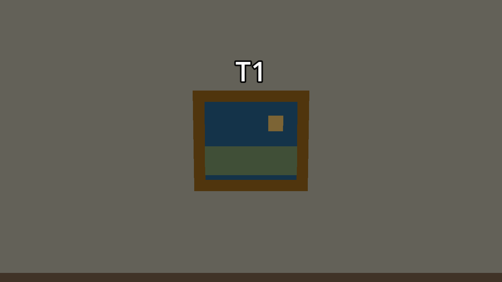
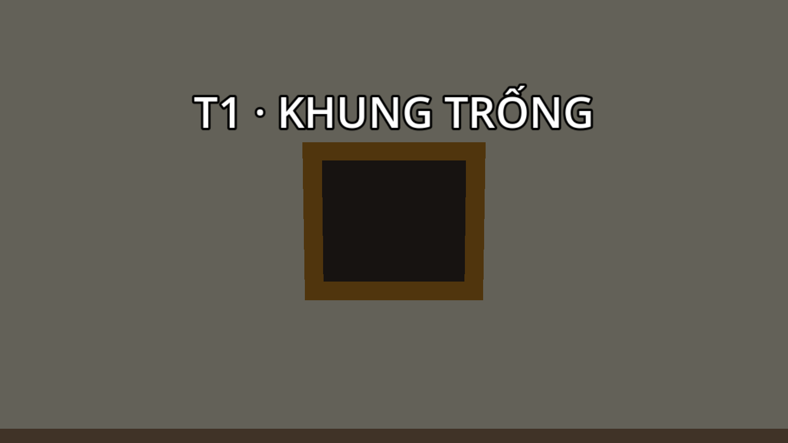

# Bước 7 — G2 phát hiện khung T1 trống

Triển khai ngày **02/11/2026** cho T1 và G2 trong `res://maps/museum/scenes/museum.tscn`.

Lấy T1 chỉ lấy phần mặt tranh; khung vàng và phần lót phía sau vẫn nằm trên tường.
G2 có một điểm kiểm tra trong tuyến tuần tra. Sự kiện lấy tranh không gửi vị trí người chơi
hoặc thông báo tự động cho guard. Bảo vệ phải tới điểm kiểm tra, quay nhìn đúng hướng và
có tầm nhìn rõ tới khung mới nhận ra mất tranh.

## Thử bằng F6

1. Mở `museum.tscn`, nhấn **F6**, mở cửa chính bằng E và lên tầng 2.
2. Vào phòng A phía tây. T1 hiện treo sát tường tây tại `(0.23,6,12)`;
   đến gần khoảng `(1.7,4.5,12)`, nhìn tranh và nhấn E.
3. Quan sát G2: sau đoạn tuần tra phòng bắc/hành lang, guard đi xuống phòng A,
   vòng phía nam bệ và đi vào lối sát tường tây để kiểm tra T1.
4. Khi tranh còn nguyên, G2 dừng khoảng 2 giây, quay nhìn tranh rồi tiếp tục tuần tra.
5. Thử lấy tranh ngay sau lượt kiểm tra, rời xa và nấp sau bệ. Khung vẫn nhìn thấy,
   HUD đánh dấu lấy T1 xong; G2 chưa lập tức biết tranh đã mất.
6. Ở lần kiểm tra tiếp theo có tầm nhìn rõ, HUD báo **“G2 đã phát hiện thiếu tác phẩm T1”**.
   Lời thoại trên đầu guard: **“G2: Tranh T1 đâu rồi? Kiểm tra phòng A!”**.
7. G2 dừng kiểm tra khoảng 2 giây rồi tìm quanh phòng A. Hết lượt tìm, guard trở lại
   tuần tra. Nếu thật sự thấy người chơi, phản ứng thị giác bình thường có thể ngắt
   việc kiểm tra/tìm kiếm và dẫn tới truy đuổi.

Lấy T1 sát lúc G2 sắp kiểm tra sẽ rút ngắn thời gian rời phòng. Sau khi đã phát hiện một lần,
G2 nhớ khung đó và không lặp lại thông báo/tìm kiếm vô hạn ở mỗi vòng.

| Trước khi lấy | Sau khi lấy |
|---|---|
|  |  |

Hai ảnh chụp từ Godot, dùng hình khối thử. Lời thoại hiện bằng chữ trên đầu G2,
chưa có bản thu âm giọng nói. Bản này chưa có tranh thay thế và chưa mở rộng kiểm tra T2/T3.

## Điều kiện phát hiện và phản ứng

- G2 kiểm tra khi đến `PatrolRoute_G2/Inspect_T1`, không kiểm tra khung từ mọi vị trí trên map.
- Tầm kiểm tra tối đa 6 m, dùng góc nhìn của `GuardVision` và raycast lớp `world`.
  Khung phía sau guard, xa quá, khác cao độ hoặc sau vật cản không được coi là nhìn thấy.
- Cần nhìn khung thiếu mặt tranh liên tục ít nhất 0.4 giây trong lượt kiểm tra.
  Quay mặt/vật cản làm mất tầm nhìn sẽ xóa phần xác nhận đang tích lũy.
- Phát hiện khung trống chuyển từ PATROL sang INVESTIGATE; không tạo dữ liệu
  `last_known_position` của người chơi và không tự chuyển sang CHASE.
- Lượt tìm theo bốn điểm định sẵn trong phòng A. Mỗi điểm guard dừng khoảng 1.5 giây
  và quay quan sát. Các điểm này không phụ thuộc vị trí hiện tại của Player.
- Thị giác/nghe tiếng động vẫn hoạt động: bằng chứng mới có thể thay đổi cuộc tìm kiếm;
  xác nhận nhìn thấy Player luôn được ưu tiên chuyển sang CHASE.
- Pause dừng cả timer kiểm tra, lời thoại và chuyển động. Thắng đóng băng guard như trước.
- Restart / Play Again / bị bắt dùng cơ chế tải lại scene, nên mặt tranh, khung, nhiệm vụ,
  ký ức phát hiện, điểm xuất phát ngoài sân và các cửa cùng được khôi phục.

## Node và script

```text
Museum
├── PatrolRoute_G2 (14 Marker3D)
│   ├── P1 … P12
│   ├── Inspect_T1 (2.25, 4.6, 12)
│   └── P14
├── RoomSearch_T1
│   ├── S1 (2.25, 4.6, 9)
│   ├── S2 (7, 4.6, 9)
│   ├── S3 (7, 4.6, 21)
│   └── S4 (2.25, 4.6, 21)
├── Guard_G2 (instance Guard + museum_inspector.gd)
│   └── Speech (Label3D)
└── Interactables
    └── Painting_T1 (instance painting_t1.tscn)
        ├── Canvas
        ├── Frame
        ├── Backing
        ├── CollisionShape3D
        ├── Label3D
        └── InspectionTarget
```

| Tệp | Vai trò |
|---|---|
| `scripts/museum_painting.gd` | Kế thừa pickup; hoàn thành T1, ẩn Canvas, giữ Frame và Backing; bỏ layer tương tác |
| `scenes/painting_t1.tscn` | Khung, tranh và phần lót là các node riêng; InspectionTarget là điểm guard nhìn |
| `scripts/museum_inspector.gd` | Guard riêng của map; raycast khung, ghi nhận phát hiện một lần, phát thông báo và lời thoại |
| `scripts/museum_patrol_state.gd` | Giữ hành vi tuần tra chung, thêm lượt kiểm tra tại Inspect_T1 |
| `scripts/museum_investigate_state.gd` | Dừng xem xét, đi qua các điểm tìm kiếm, trở lại tuần tra; chuyển tiếp bằng chứng mới sang AI chung |
| `scripts/museum_demo.gd` | Nối tín hiệu notice của G2 tới ObjectiveHud |

Không sửa `shared/` hoặc `features/`. T2/T3 tiếp tục dùng pickup ban đầu.
Khung mới chỉ có hình hiển thị và Area bắt E, không thêm collider lớp world;
không cần bake lại navmesh ở bước này. G2 đã đi được hai vòng trên navmesh hiện có.

## Các tham số chỉnh trên Guard_G2

| Thuộc tính | Mặc định | Ý nghĩa |
|---|---|---|
| Painting Path | `../Interactables/Painting_T1` | Khung cần kiểm tra |
| Inspection Point Name | `Inspect_T1` | Tên Marker3D trong route, không phải chỉ số cố định |
| Search Points Path | `../RoomSearch_T1` | Nhóm các điểm tìm quanh phòng |
| Inspection Duration | 2 s | Thời gian lượt kiểm tra bình thường và bước xem xét sau phát hiện |
| Discovery Delay | 0.4 s | Thời gian nhìn liên tục để xác nhận mất tranh |
| Frame Detection Distance | 6 m | Khoảng cách tối đa nhận diện khung |
| Search Stop Duration | 1.5 s | Thời gian quay nhìn ở mỗi điểm tìm kiếm |

Khi đổi vị trí T1 hoặc bệ, thử lại góc quay và raycast từ Inspect_T1.
Không đặt điểm tìm kiếm trong bệ/tường. Khi đổi collision môi trường mới cần bake lại.

## Kiểm tra

```powershell
& '.local/godot/Godot_v4.7.2-stable_win64_console.exe' --headless --fixed-fps 60 --path . --log-file 'D:/IT/SE_GAME_3D/.local/logs/museum-empty-frame-verification.log' --script res://maps/museum/tools/verify_empty_frame.gd
```

Ngày 02/11/2026, Godot 4.7.2:

- **48 kiểm tra cơ chế mới đạt**: E lấy T1, khung còn lại, tuần tra/kiểm tra thực,
  hướng nhìn/khoảng cách/tầng/vật cản, không phát hiện xuyên tường, độ trễ đến lượt kiểm tra
  tiếp theo, HUD/lời thoại, dừng xem xét, đi tìm quanh phòng, trở lại tuần tra,
  không báo lặp, pause, CHASE từ thị giác thực và Restart.
- **62 kiểm tra blockout đạt**: G2 hoàn thành hai vòng với route mới 14 điểm, không kẹt;
  sàn, thang, cửa và hai guard còn lại tiếp tục hoạt động.
- **54 kiểm tra vòng chơi đạt**: năm pickup, cửa, thoát, thắng/thua và reset.
- **166 script của project biên dịch được**. Tổng ba bài kiểm tra hành vi: **164**, đều mã thoát 0.
