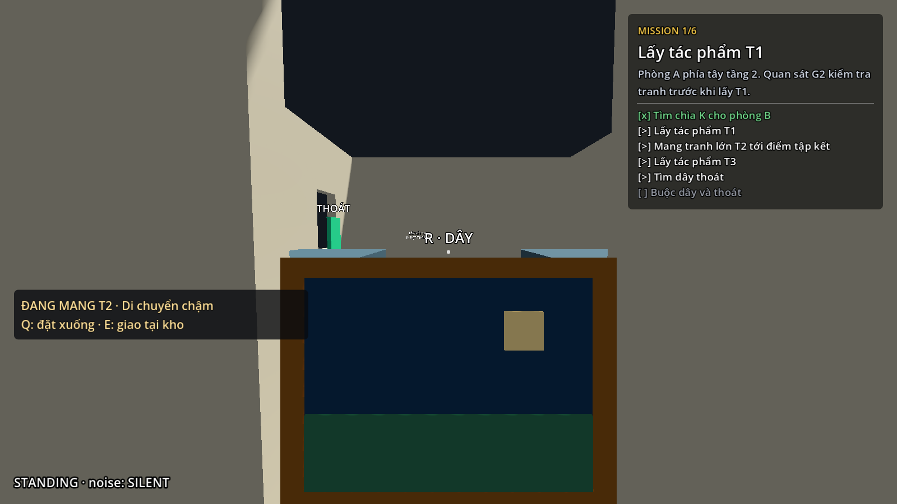
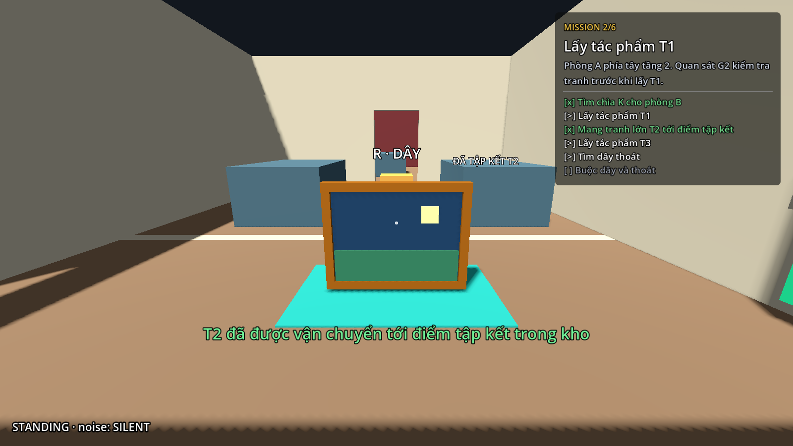

# Bước 8 — Mang tranh lớn T2 tới kho

Đã triển khai trong `res://maps/museum/scenes/museum.tscn`.
T2 là một vật thể phải vận chuyển; nhấc khỏi tường chưa hoàn thành nhiệm vụ.
Chỉ giao tranh tại điểm tập kết trong kho mới hoàn thành `take_t2` và được
tính vào điều kiện thoát. T1 vẫn để lại khung trống cho G2 kiểm tra;
T3 vẫn được lấy ngay như trước.

## Chạy thử bằng F6

1. Mở scene chính bảo tàng, nhấn **F6**, đi từ sân trước vào bằng **E**.
2. Lấy chìa **K** tại phòng nhân viên tầng 1, rồi lên tầng 2 và mở phòng B.
3. Nếu muốn chuẩn bị trước, đi vào phía nam phòng B và mở chốt **B → kho**.
   Có thể tới kho từ cửa phía nam trước khi lấy T2, lấy dây và xem vị trí tập kết.
4. Quan sát G3 trong phòng B. Đến gần T2 trên tường phía đông, nhìn tranh và
   nhấn **E**. Tranh xuất hiện dưới tâm ngắm; nhiệm vụ vận chuyển vẫn chưa xong.
5. Đi bộ thử, giữ **Shift** rồi thử cúi bằng **C/Ctrl**. Khi mang T2:
   đi bộ **2 m/s**, cúi **1.1 m/s**, Shift không tăng tốc.
6. Chọn sàn phẳng đủ trống, nhấn **Q**. Tranh được đặt xuống;
   người chơi đi/chạy bình thường trở lại. Nhìn vào tranh, nhấn **E** để nhấc lại.
7. Mang T2 tới **thảm xanh trong kho**, gần cửa sổ thoát, nhìn vào vùng tập kết
   rồi nhấn **E**. Tranh xuất hiện trên thảm, HUD đánh dấu nhiệm vụ hoàn thành.
8. Lấy đủ T1, T3 và dây, cắt đuôi bảo vệ rồi dùng cửa sổ thoát như trước.

Tranh không tự được giao khi người chơi đi ngang thảm. Khi chưa giao T2,
dù đã lấy các đồ khác và đang cầm tranh, cửa sổ vẫn từ chối cho thoát.





Đây là ảnh chụp từ bản Godot hiện tại. Tranh dùng hình khối và màu tạm,
chưa có hoạt ảnh tay, độ rung hoặc động tác nâng/hạ.

## Hai đường vận chuyển

**Đường ngắn:** Từ phòng B, mở chốt ở `(32, 4.5, 18)`, đi thẳng vào lối giữa
hai bệ trong kho, rồi tới thảm ở `(32, 4.5, 26)`.
Chốt chỉ mở lần đầu từ phía B; vẫn mở được bằng E khi đang cầm T2.

**Đường vòng:** Ra cửa phòng B tại `(27, 4.5, 10)`, đi xuống hành lang phía đông
tới `(25.5, 4.5, 22.5)`, rẽ về cửa giữa phía nam tại X=18,
đi xuống sảnh tầng 2 rồi quay sang cửa kho phía tây `(27, 4.5, 27)`.
Không đi thẳng dọc X=25.5 xuyên qua Z=24 vì có tường ngăn.
Đường vòng dùng được khi chốt B → kho còn đóng, nhưng phải đi xa hơn khi đang mang nặng.

## Quy tắc đặt tranh

- Q đặt tranh đứng trên sàn phía trước người chơi, không ném tranh.
- Cần sàn gần cùng độ cao với chân, đủ đỡ cả bốn góc, không dốc quá mức.
  Các dốc cầu thang hiện tại không cho đặt tranh.
- Không đặt xuyên tường, cánh cửa đóng, vào bệ trưng bày hoặc mép thông tầng.
  Nếu thiếu chỗ, HUD báo lý do và tranh vẫn nằm trên tay.
- Tranh đã đặt là vật tương tác, chưa là vật cản vật lý. Nó không chặn đường
  người chơi hay AI; không cần bake lại navmesh cho cơ chế này.
- Sau khi giao tại kho, T2 được giữ ở điểm tập kết, không nhấc lại được.

## Cây scene liên quan

```text
Museum
├── Player (instance dùng museum_player.gd)
│   └── Head/Camera3D
│       └── Visual (của T2, chỉ xuất hiện tại đây khi mang)
├── CarryHud (CanvasLayer + museum_carry_hud.gd)
└── Interactables
    ├── Painting_T2 (painting_t2.tscn + museum_carry_painting.gd)
    │   ├── Visual (tranh và khung khi trên tường/sàn/tập kết)
    │   ├── CollisionShape3D
    │   └── Label3D
    └── T2Depot (t2_depot.tscn + museum_depot.gd)
        ├── Mat
        ├── CollisionShape3D
        ├── DepositPose (Marker3D)
        └── Label3D
```

`Painting_T2` giữ một instance duy nhất với bốn trạng thái:
`WALL → CARRIED ↔ DROPPED`, rồi `CARRIED → DELIVERED`.
Chỉ chuyển `Visual` xuống camera khi mang; Area tắt layer tương tác để không
chặn tia E dùng cửa hoặc điểm tập kết. Khi đặt xuống, hình và Area trở về cùng vị trí.

`museum_player.gd` kế thừa Player dùng chung, chỉ áp dụng cho instance bảo tàng.
Khi mang, nó giảm tốc ngay cả nếu đang chạy lúc nhấc tranh; giữ Shift không
tiêu stamina nếu sau này bật cơ chế stamina của nhóm.
`museum_demo.gd` giữ ID `take_t2` nhưng đổi nội dung thành nhiệm vụ vận chuyển.
`museum_depot.gd` chỉ nhận T2 đang được người chơi cầm, ở trong tầm tương tác
và không bị tường chắn. Không dùng inventory cho bản thử này.

Các tệp mới nằm trong `maps/museum/`; không cần sửa Player hay HUD dùng chung.

## Chỉnh trong Inspector

| Muốn chỉnh | Node / tệp | Thuộc tính |
|---|---|---|
| Tốc độ khi mang | Player | Carry Walk Speed / Carry Crouch Speed |
| Khoảng đặt trước chân | Painting_T2 | Drop Distance, mặc định 1.15 m |
| Vị trí tập kết | Interactables/T2Depot | Position, hiện `(32, 4.5, 26)` |
| Hướng/cao độ tranh sau giao | T2Depot/DepositPose | Transform |
| Hình tranh tạm | painting_t2.tscn/Visual | Mesh, Material |
| Vị trí hình khi cầm | museum_carry_painting.gd | Transform của Visual trong `_on_interact` |

Nếu đổi kích thước tranh, sửa đồng bộ Mesh/Shape và kích thước kiểm tra
`BoxShape3D` cùng bốn điểm đỡ trong `_find_drop_transform()`;
không chỉ phóng to hình rồi giữ vùng kiểm tra cũ.

## Khởi động lại và kiểm tra

Pause giữ nguyên tranh đang cầm/đã đặt và không cho Q/E thay đổi trạng thái.
Restart, Play Again và bị bảo vệ bắt tải lại toàn scene: T2 quay về tường,
tốc độ bình thường, nhiệm vụ và cửa quay về trạng thái đầu.

Đã chạy **249 kiểm tra hành vi**, gồm 62 về hình học/di chuyển/tuần tra,
57 về nhiệm vụ và vòng chơi, 48 về khung T1 và 82 về vận chuyển T2.
Các kiểm tra T2 có thao tác E/Q, tốc độ thực, stamina, đặt/nhặt lại,
từ chối vị trí không an toàn, vận chuyển thực tế qua cả hai đường,
giao tranh, Pause, Restart và một lần bị bắt thật khi đang cầm tranh.

Chạy lại kiểm tra riêng T2 khi cần:

```powershell
& '.local/godot/Godot_v4.7.2-stable_win64_console.exe' --headless --fixed-fps 60 --path . --log-file 'D:/IT/SE_GAME_3D/.local/logs/verify-carry.log' --script res://maps/museum/tools/verify_carry.gd
```

Tạo lại hai ảnh bằng renderer:
`--script res://maps/museum/tools/capture_carry.gd` (không dùng `--headless`).
