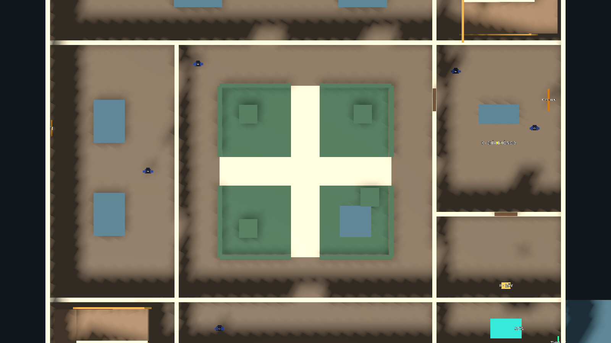

# Bước 10 — Sân trong có bốn lối, đường dấu cộng

Đã mở thêm ba lối bắc, tây và đông, nối với lối nam có sẵn.
Mỗi lối rộng 2 m, mặt sàn Y=0, không có bậc chắn.

| Lối | Tâm lối vào (X, Y, Z) |
|---|---|
| Bắc | (18, 0, 9) |
| Nam | (18, 0, 21) |
| Tây | (12, 0, 15) |
| Đông | (24, 0, 15) |

Hai dải lát rộng 2 m cắt nhau tại `(18, 0, 15)`.
Đài phun nước được chuyển vào ô vườn đông nam, thu từ 3 m xuống 2.2 m;
một bồn cây được dời để giữ khoảng trống xung quanh. Giao điểm hoàn toàn thông thoáng.
Mặt lát chỉ là hình ảnh, collision vẫn dùng sàn tầng 1 liên tục nên không tạo bậc.
Lan can và khoảng thông tầng phía trên giữ nguyên.



Ảnh ẩn sàn/tường tầng 2 và lan can phía trên chỉ để nhìn rõ tầng 1;
chúng vẫn hiện và có collision khi chơi bình thường.

Navmesh đã bake lại với static colliders, có 467 polygon.
G4 vẫn tuần ở hành lang vòng theo thiết kế chín bảo vệ;
các lối mới cho phép người chơi băng qua sân và AI sử dụng khi cần tìm đường.

Mở `res://maps/museum/scenes/museum.tscn`, nhấn **F6** để thử.
Đã kiểm tra Player đứng đi hai chiều qua cả bốn lối, guard đi qua hai trục,
navmesh nối thẳng qua sân, lan can tầng trên, chín tuyến tuần tra và vòng chơi.
Tổng cộng 274 kiểm tra hành vi đạt: 87 blockout, 57 demo, 48 T1, 82 T2.

Tệp hình học: `scenes/museum_geometry.tscn`, nhóm `Courtyard`.
Nguồn builder đã cập nhật để tạo lại đúng bốn lối.
Chỉ cập nhật riêng sân trên hình học hiện có bằng:

```powershell
& '.local/godot/Godot_v4.7.2-stable_win64_console.exe' --headless --path . --log-file 'D:/IT/SE_GAME_3D/.local/logs/courtyard-build.log' --script res://maps/museum/tools/build_geometry.gd -- --update-courtyard
```

Chế độ này thay phần sân tầng 1; vẫn cần bake lại navigation sau khi đổi collision.
Chạy builder không có cờ sẽ dựng lại toàn bộ hình học như trước.
