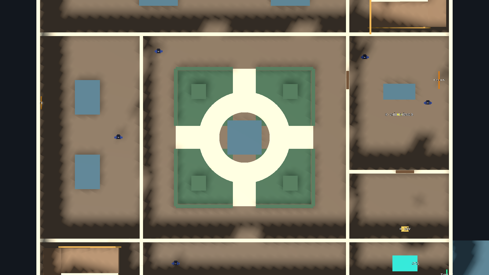

# Bước 11 — Đài phun nước giữa sân, cửa đóng/mở

Đài phun nước trở lại `(18, 0.3, 15)`, kích thước 3 × 0.6 × 3 m.
Bốn lối bắc/nam/đông/tây giữ nguyên, nối vào đường vòng tròn bán kính trong
2.2 m, ngoài 4 m. Người chơi đi vòng qua đài, không đi xuyên giao điểm.
Bốn bồn cây trở về bốn góc. Tầng 2 giữ nguyên lan can và khoảng rỗng.

Phòng dịch vụ có cửa ở `(27, 0, 27)`, mở tự do, ban đầu đóng.
G5 chỉ tuần sảnh chính với 5 điểm, không vào phòng dịch vụ.

## Dùng cửa

Nhìn vào cửa trong tầm tương tác, nhấn **E** để mở; nhìn lại vào cùng vùng cửa,
nhấn **E** để đóng. HUD đổi giữa “Mở…” và “Đóng…”.
Áp dụng cho cửa chính, cửa phòng dịch vụ, cửa phòng B và cửa chốt kho.

- Cửa đóng có collision, chặn di chuyển và tia nhìn; link navigation bị tắt.
- Cửa mở ẩn tấm cửa và bỏ collision, bật link navigation. Vùng tương tác vẫn
  còn ở khung cửa để đóng lại. Đây là bản thử, chưa có hoạt ảnh bản lề.
- Không đóng khi người chơi/bảo vệ đang ở thể tích cánh cửa; HUD báo có người chắn.
- Cửa B vẫn cần K ở lần mở đầu. Chốt kho vẫn cần mở lần đầu từ phía B.
  Sau khi mở khóa/chốt, có thể đóng và mở lại từ cả hai phía trong lượt chơi đó.
- Đóng cửa cắt đường nhìn, nhưng bảo vệ vẫn nhớ nơi vừa thấy người chơi và
  có thể tiếp tục điều tra. Cửa không tự xóa trạng thái truy đuổi.
- Restart/bị bắt khôi phục tất cả cửa đóng và trạng thái khóa ban đầu.

Mở `res://maps/museum/scenes/museum.tscn`, nhấn **F6** để thử.
Để kiểm tra tránh tầm nhìn, vào phòng dịch vụ rồi quay về cửa và E đóng,
đứng cách mặt cửa để không chắn nó. Bảo vệ không nhìn xuyên tấm cửa.

Navmesh đã bake lại: 463 polygon, gồm tấm cửa dịch vụ đóng.
291 kiểm tra hành vi đạt: 89 blockout, 72 demo, 48 T1, 82 T2.
Có kiểm tra Player/guard đi vòng đài, G5 ở sảnh trong hai vòng tuần,
tia nhìn thực của guard khi mở/đóng, chống đóng đè người, link navigation,
đóng/mở lại cửa khóa/chốt, Pause và tải lại scene.
