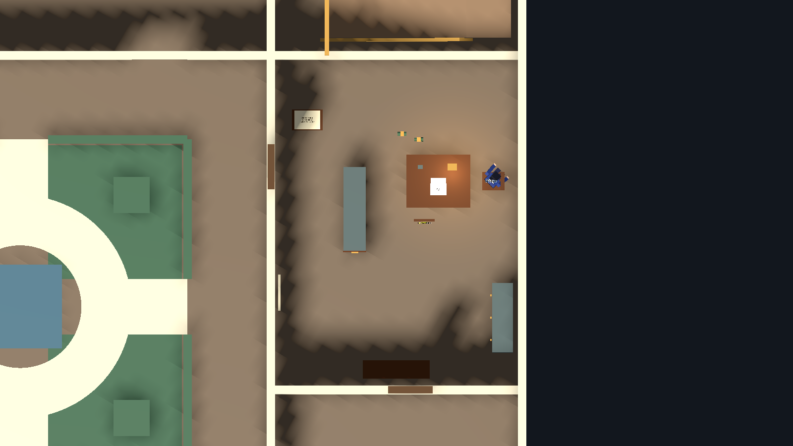
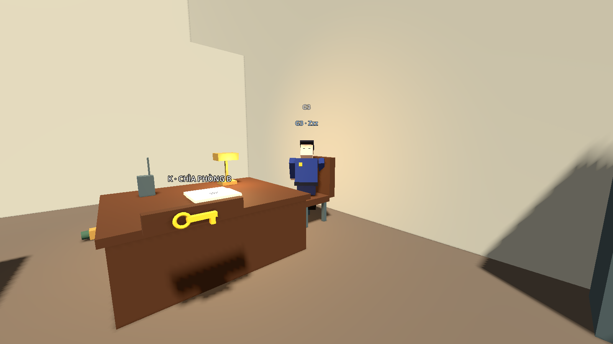
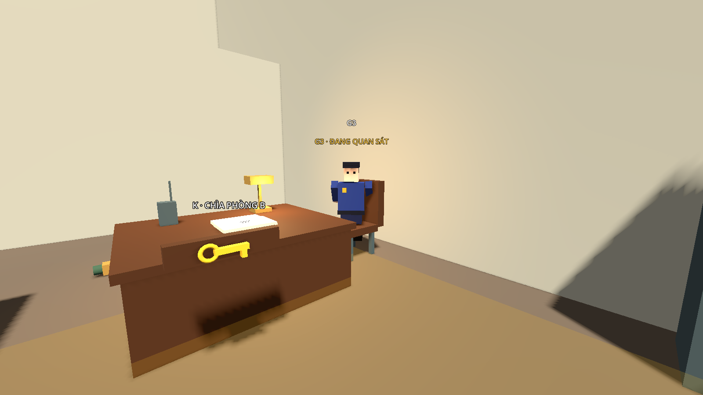

# Bước 13 — Phòng nhân viên ca đêm và G3 ngủ/thức

Tài liệu mô tả bản dựng trước khi đổi sang bố cục A–H. Bản A–H đã được triển khai,
xem [bước 14](step-14-staff-ah.md). Nội dung bên dưới là lịch sử bản dựng trong scene chính
`res://maps/museum/scenes/museum.tscn`. Đây là bản đồ họa thử bằng hình khối,
có collision và tương tác; chưa phải bộ model hiện thực như ảnh concept.

## Nội thất và vật phẩm

| Nội dung | Vị trí / tác dụng |
|---|---|
| Bàn trực, ghế G3 | Phía đông bắc phòng, ghế ở (34.9,0,10.5) |
| Chìa K | Móc cạnh phía nam bàn, (32.5,1.05,12), E lấy yên lặng |
| Tủ hồ sơ cao 2.2 m | (30,1.1,11.5), chắn tầm nhìn thực, có lối vòng hai đầu |
| Bảng bảo trì | Tường phía tây, E đọc các ngày kiểm tra |
| Ghi chú DDMM | Bàn phụ gần cửa, E đọc cách suy ra mã kho |
| Sổ trực | Trên bàn G3, E đọc hướng dẫn ca đêm |
| Tủ cá nhân, ghế nghỉ | Sát tường đông và nam |
| Đèn bàn và bộ đàm | Đồ trang trí trên bàn, đèn có ánh sáng |
| Hai chai/lon nằm trên sàn | Trên đường ngắn, gần (31.7,8.8) và (32.3,9); va vào phát tiếng và NoiseEvent |

Giữ một cửa phòng nhân viên tại (27,0,10), E mở/đóng từ hai phía.
Mặt ghế chỉ để nhìn, không có collision chặn capsule của G3 khi đứng dậy.
Tủ, bàn và ghế nghỉ có collision; bộ đàm chưa có tương tác riêng.

Đọc bằng E, đóng bằng E hoặc Esc. Thế giới tiếp tục chạy khi đọc.
Esc đóng tài liệu trước, không đồng thời mở Pause. Tài liệu tự đóng khi bị bắt,
Pause hoặc thắng. Nội dung không yêu cầu bật inventory.

Ngày kiểm tra dây là 14/03, ghi chú chỉ cách nhập DDMM nên mã suy ra là **1403**.
Lần triển khai này làm các manh mối trong phòng; chưa chuyển dây xuống kho phụ
và chưa thêm cửa mật mã cho kho. Dây vẫn ở kho phục chế tầng 2.

## G3 hoạt động

| Pha | Hành vi |
|---|---|
| sleeping | Ngồi, mắt nhắm, Zzz; tắt phát hiện bằng mắt và ẩn nón nhìn |
| observing | Vẫn ngồi, quay về hướng tiếng động ước lượng; hiện nón nhìn, quan sát 6 giây |
| searching | Khi nghi ngờ thật, đứng lên kiểm tra dấu hiệu và các điểm trong phòng trong 18 giây |
| chasing | Khi nhìn rõ, chuyển truy đuổi/bắt theo hệ thống hiện có |
| returning | Không tìm thấy thì đi về ghế bằng navigation |
| settling | Ngồi xuống, quan sát thêm 3 giây rồi ngủ |

Đi bộ/cúi bình thường không đánh thức G3. Chạy gần ghế hoặc va chai/lon tạo
tiếng đủ lớn mới làm thức; có kiểm tra khoảng cách và vật chắn âm thanh.
Tiếng động chỉ cung cấp vị trí **ước lượng**, không cung cấp vị trí người chơi.
Khi chưa thấy người chơi, G3 không lập tức đứng dậy truy đuổi.

Nón nhìn màu vàng khi thức, đỏ khi truy đuổi; các tia minh họa dừng ở vật chắn
theo chiều cao mắt. Phát hiện thực tế dùng GuardVision và collision, không dựa
vào việc người chơi có đứng trong hình quạt trên sàn hay không.

Tủ hồ sơ và cửa đóng chặn tầm nhìn. Mất dấu khi đuổi dẫn tới tìm kiếm rồi về ghế.
Nếu G3 ở ngoài phòng và cửa đang đóng, khi về ghế sẽ mở lại cửa để đi vào;
không dịch chuyển qua tường. Nếu có người đứng ngay vị trí ghế, G3 chờ chỗ trống.
Các bảo vệ khác vẫn có thể phát hiện người chơi hoặc nghe tiếng động bình thường.

## Chơi thử

1. Mở scene chính, **F6**, vào cửa chính và tới cửa phòng nhân viên tầng 1.
2. Mở cửa, đi vào phía tây tủ hồ sơ, vòng xuống cuối tủ rồi sang phía đông.
3. Tiếp cận cạnh nam bàn để lấy K; tránh hai chai/lon phía bắc tủ.
4. E đọc bảng bảo trì, ghi chú và sổ trực; ghi nhớ ngày kiểm tra dây.
5. Cố tình chạy hoặc va chai/lon để thử đánh thức. Nấp sau tủ khi nón nhìn hiện.
6. Ra chỗ trống cho G3 thấy thoáng qua: G3 phải đứng kiểm tra phòng.
7. Giữ mình trong tầm nhìn: nghi ngờ tăng tới đỏ và G3 truy đuổi.
8. Cắt đuôi rồi quan sát G3 về ghế/ngủ. Restart hoặc bị bắt khôi phục chìa, đồ và trạng thái ngủ.

## Ảnh thực tế từ Godot

## Chỉnh và kiểm tra

G3 dùng `staff_guard.gd`; các thông số Wake Loudness, Observe Duration,
Room Search Duration và Settle Duration chỉnh được trong Inspector.
PatrolRoute_G3 giữ bốn điểm dùng **khi tìm kiếm**, không còn là tuyến đi liên tục.
`StaffInterior` nằm trong scene hình học; `StaffReader` là CanvasLayer ở scene chính.

Builder có chế độ `--update-staff-interior` dựng lại riêng nội thất, bỏ bàn StaffDesk cũ;
chế độ này sẽ ghi đè chỉnh sửa trực tiếp trong StaffInterior.
Bake lại navigation khi thay các vật cản. Navmesh hiện có 457 polygon.

Đã qua **347 kiểm tra hành vi**: 105 blockout, 72 demo, 83 T2, 48 T1 và 39 phòng
nhân viên. Bộ riêng kiểm tra nghe/nhìn thực, đường lấy chìa, các tài liệu,
va chai/lon, bước chạy thực, tìm kiếm, mất dấu, về ghế, cửa chặn đường,
bắt và tải lại scene. Tám bảo vệ còn lại vẫn tuần tra qua ít nhất hai vòng.

Chỉ thay đổi bên trong `maps/museum/`, không sửa AI/Player/HUD dùng chung.
