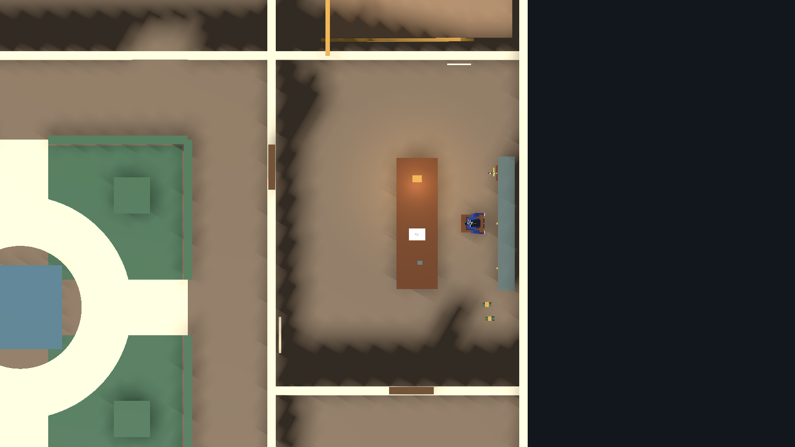
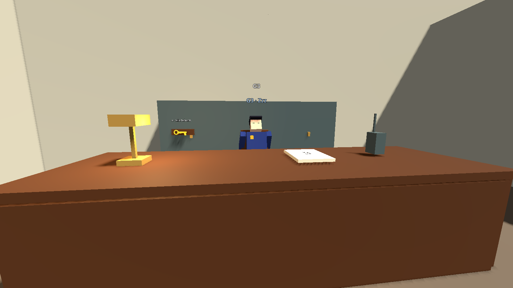
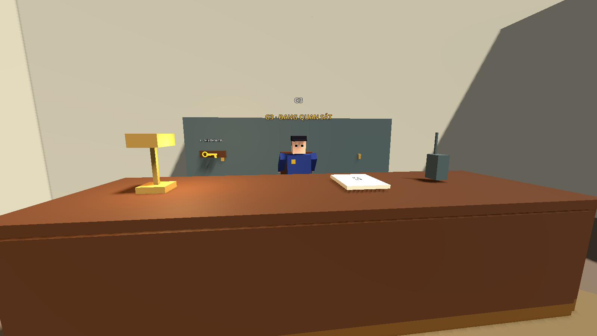

# Bước 14 — Áp dụng phòng nhân viên A–H

Đã sửa `res://maps/museum/scenes/museum.tscn` theo bản thiết kế duy nhất trong
`concept-v3/staff-room-floorplan.png`. Bố trí được căn trong phòng thực tế 9 × 12 m;
giữ một cửa phía tây và sàn Y=0.

| Ký hiệu | Bản dựng trong Godot |
|---|---|
| A | Bàn dài bắc–nam, tâm (32.2,0.55,12), kích thước (1.4,1.1,4.6), mặt trước kín ở phía tây |
| B | G3 ngồi tại (34.1,0,12), nhìn về phía tây |
| C | Bảng bảo trì trên tường tây, tâm (27.3,1.5,16) |
| D | Tủ sát tường đông, tâm (35.4,1,12); chìa K ở mặt ngoài tại (34.95,1.2,10.2) |
| E | Cửa phòng nhân viên giữ tại (27,0,10), E mở/đóng |
| F | Hai chai/lon phía nam ghế B, gần (34.7,14.9) và (34.8,15.4) |
| G | Mảnh giấy trên bàn A, tâm (32.2,1.112,11); cập nhật ở bước 15 |
| H | Sáu waypoint vòng quanh cả bốn cạnh A; chỉ dùng khi G3 kiểm tra |

Đã bỏ tủ hồ sơ cao giữa phòng, bàn phụ và ghế nghỉ của phương án cũ.
Phần trái phòng thoáng. Đèn, bộ đàm và sổ trực nằm trên bàn A.
Tài liệu C/G và sổ trực vẫn đọc bằng E, đóng bằng E/Esc, không dừng thế giới.

## Cúi nấp và lấy chìa

Đứng ở phía tây bàn A, G3 thức có thể nhìn thấy đầu người chơi.
Giữ **C hoặc Ctrl** để cúi: phần mặt trước kín của bàn chặn các tia nhìn.
Không phải vùng tàng hình; khi G3 đi sang cùng phía bàn vẫn có thể thấy bạn.

Lộ trình tham khảo: E → C ở góc tây nam → vòng đầu bắc bàn A → G → D.
Nhìn vào chìa treo ngoài tủ rồi E lấy. Chìa không còn ở bàn A.
Đường phía nam ghế gần F có thể gây tiếng động nếu va phải chai/lon.

## Vòng kiểm tra H

PatrolRoute_G3 giữ sáu Marker3D H1–H6, tọa độ X/Z:

1. H1: (33.8,9) — đông bắc bàn.
2. H2: (30.6,9) — tây bắc.
3. H3: (30.6,15.2) — tây nam.
4. H4: (33.8,15.2) — đông nam.
5. H5: (33.8,12.8) — dọc phía đông, dưới ghế.
6. H6: (33.8,11) — dọc phía đông, trên ghế; nối lại H1.

G3 bình thường ngồi ngủ. Tiếng lớn đánh thức để quan sát; khi có nghi ngờ thật,
G3 đứng dậy đi H. Nếu không có dấu hiệu mới sẽ hoàn thành một vòng rồi về B ngủ.
Ngân sách kiểm tra mặc định 24 giây; ở mỗi điểm dừng khoảng 1 giây.
Nếu có tiếng động hoặc nhìn thấy người chơi, G3 có thể lệch tuyến để kiểm tra
bằng chứng thật, sau đó tiếp tục điểm H đang kiểm tra. Báo đỏ vẫn ưu tiên truy đuổi.

Các điểm nằm ngoài collision bàn, tủ và ghế; F không nằm trên tuyến H.
H là waypoint AI, không vẽ đường tím lên sàn khi chơi bình thường.

Tiếng chạy trong cùng phòng được G3 nghe rõ dù bàn A nằm giữa. Vật thấp trong
phòng không làm tiếng chạy giảm như bị ngăn bởi tường. Chỉ áp dụng cho RUN
trong phòng nhân viên, không tăng âm xuyên tường hành lang hoặc xuyên tầng.
Đi bộ/cúi vẫn không đánh thức G3. Nghe tiếng chỉ làm G3 thức quan sát;
nghi ngờ và truy đuổi cần bằng chứng nhìn thấy như trước.

## Chạy thử

Mở scene chính, nhấn **F6**, vào phòng nhân viên tầng 1.
Thử cúi sau bàn, đi vòng đầu bắc để lấy chìa ở D; thử va F để đánh thức G3,
lộ mặt thoáng qua rồi nấp để quan sát G3 đi H và quay về ghế.

Ảnh dùng đồ họa khối thử. Concept-v3 giữ nguyên một ảnh thiết kế; ảnh chụp Godot
đặt ngoài thư mục concept để không tạo thêm phương án thiết kế.

Navmesh đã bake lại: 443 polygon. Đã chạy 362 kiểm tra hành vi: 105 blockout,
72 demo, 83 T2, 48 T1, 54 phòng nhân viên. Có kiểm tra đứng/cúi thực tế,
E lấy chìa ở D, đường E→C→G→D, sáu điểm H đúng thứ tự, về ghế,
tiếng động, truy đuổi/bắt, reset và tám tuyến tuần tra còn lại.

Nguồn hình học ở `tools/build_geometry.gd`, hàm `staff_interior()`.
Chế độ `--update-staff-interior` dựng lại riêng nội thất; bake navigation sau khi
thay collision. Tài liệu bước 13 mô tả bản cũ và được giữ làm lịch sử.

G đã chuyển lên bàn; lịch C cập nhật ngày giờ máy tính. Xem [bước 15](step-15-paper-calendar.md).
