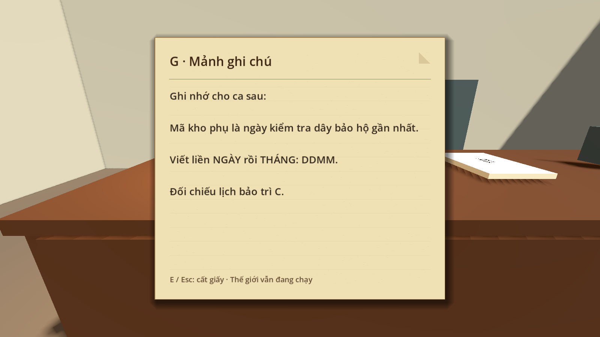
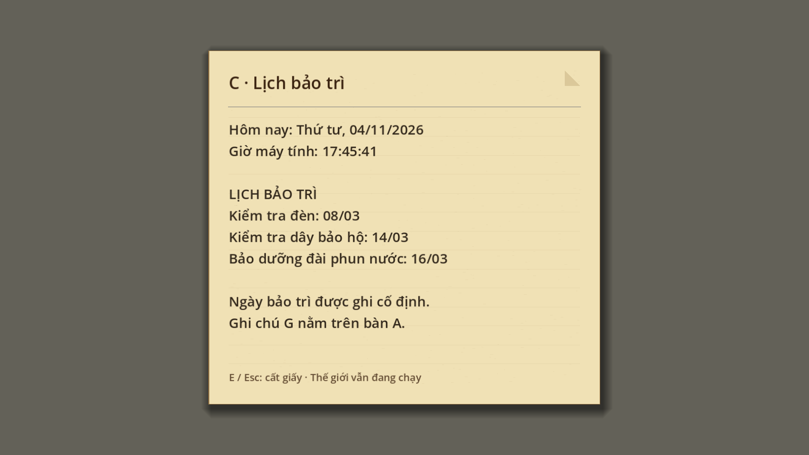

# Bước 15 — Giấy ghi chú và lịch thời gian thực

G là mảnh giấy nhỏ nằm trên bàn A tại `(32.2, 1.112, 11)`. Đến phía tây bàn,
nhìn xuống giấy và nhấn **E**: nội dung hiện giữa màn hình trên nền giấy có vân,
bóng đổ và chữ lớn. Nhấn **E hoặc Esc** để cất giấy. Thế giới vẫn chạy khi đọc.

Lịch C cập nhật ngày, tháng, năm và giờ địa phương theo máy tính mỗi giây,
cả trên tường lẫn trong giao diện đọc. Không cần kết nối mạng.
Các ngày bảo trì là dữ kiện cố định của câu đố: kiểm tra dây **14/03**,
kết hợp hướng dẫn DDMM trên G suy ra **1403**. Mã không tự đổi theo ngày máy tính.
Cửa nhập mã kho phụ đã được triển khai ở [bước 16](step-16-aux-storage.md).

Mở `res://maps/museum/scenes/museum.tscn`, chạy lại bằng F6 để thử.
Script `staff_calendar.gd` phụ trách đồng hồ; `staff_reader.gd` dựng giao diện giấy.
Builder `--update-staff-interior` giữ vị trí mới của G khi dựng lại nội thất.

Đã qua 54 kiểm tra phòng nhân viên, gồm tương tác E/Esc, giấy nằm gọn giữa viewport,
đổi ngày/tháng/năm khi lịch đang mở, và các hành vi nghe tiếng, cúi nấp, tuần tra H.
