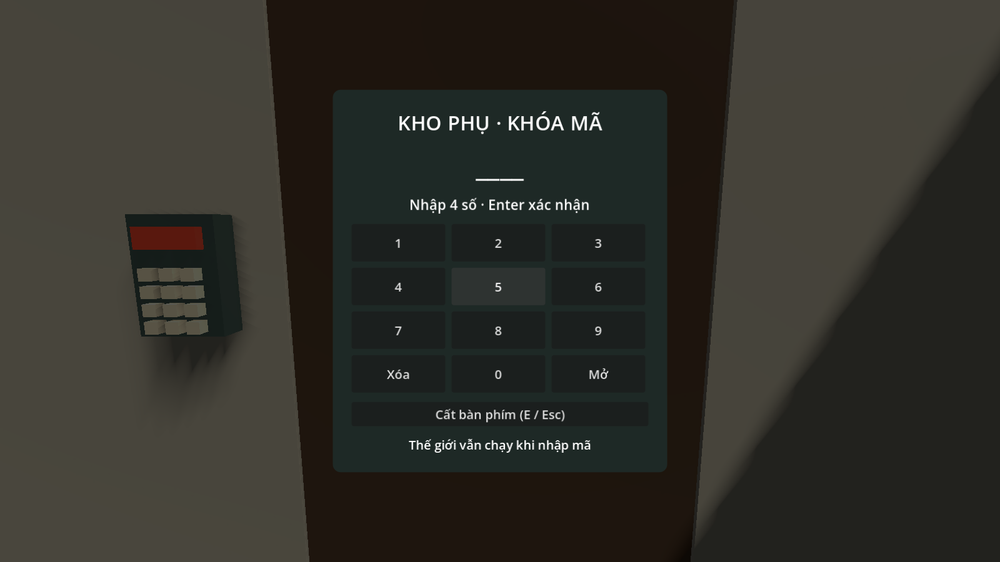
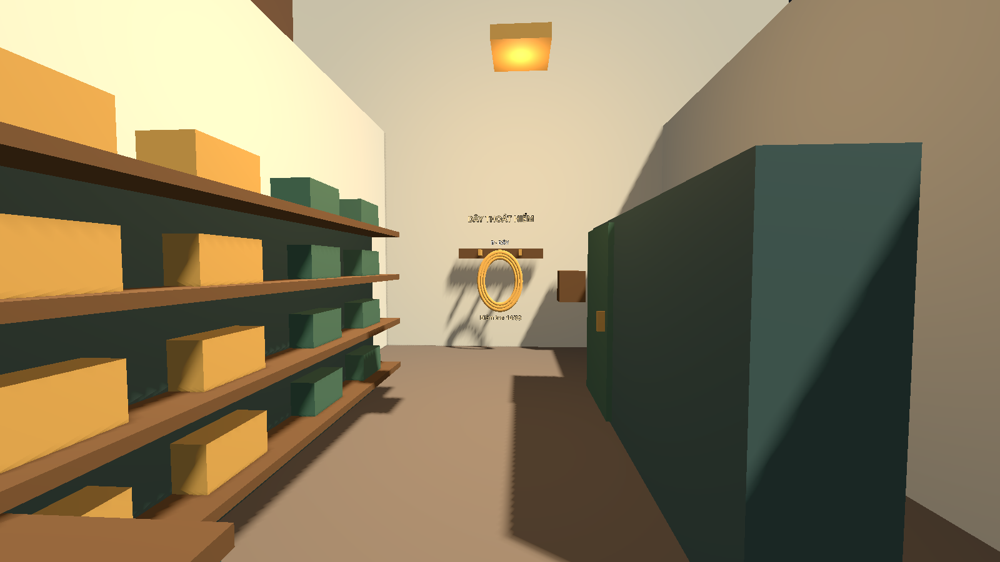
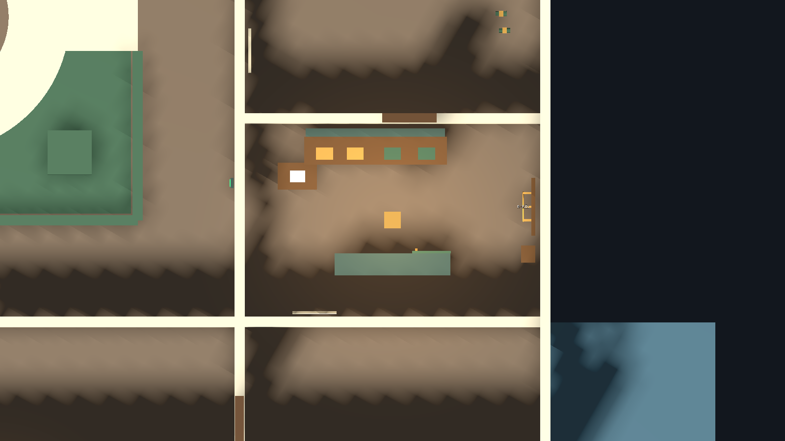

# Bước 16 — Kho phụ khóa mã và dây tầng 1

Ảnh được duyệt nằm tại [concept-v3/aux-storage-concept.png](concept-v3/aux-storage-concept.png).
Bản Godot giữ phòng có sẵn X=27…36, Z=18…24, mặt sàn Y=0 (9 × 6 m).
Ảnh tham khảo minh họa 4 × 5 m; bố cục được xoay để cửa vào nằm phía tây.
Đây là nội thất khối thử có collision và gameplay, chưa phải đồ họa hoàn thiện như ảnh concept.

| Thành phần | Vị trí trong map |
|---|---|
| Cửa kho phụ | (27,0,21), nối hành lang phía đông tầng 1 |
| Bàn phím | Ngoài cửa, gần (26.72,1.45,19.9) |
| Kệ dụng cụ | Dọc tường bắc, tâm (31,1.075,18.65) |
| Xe đẩy | Gần cửa, tâm (28.7,0.425,19.7) |
| Giá treo dây | Tường đông; dây tại (35.35,1.4,20.6) |
| Tủ sắt | (31.5,1.1,22.3), có collision chặn người và tầm nhìn |
| Chỗ nấp | Phía nam tủ, có thể đứng gần (32,0,23.2) |
| Bảng kiểm tra | Tường nam, gần (29.2,1.55,23.72), E đọc |

## Chơi thử

1. Mở `res://maps/museum/scenes/museum.tscn`, nhấn **F6**.
2. Vào phòng nhân viên, đọc lịch C và giấy G trên bàn. Ngày kiểm tra dây 14/03,
   cách đọc DDMM suy ra **1403**. Có thể nhập mã đã nhớ mà không đọc lại giấy.
3. Đến cửa kho phụ, nhìn cửa hoặc bàn phím trên tường rồi **E**.
4. Gõ bốn số và **Enter**, hoặc bấm các nút số và nút **Mở**.
   **Backspace/Xóa** xóa một số; **E/Esc** đóng giao diện.
5. Mã đúng mở cửa, tắt collision cánh cửa và bật liên kết navigation.
   Đèn bàn phím chuyển từ đỏ sang xanh. Cửa đã giải mã dùng E đóng/mở từ hai phía.
6. Đi vào kho, nhìn cuộn dây trên giá và **E** lấy. Móc treo vẫn còn; HUD hoàn thành
   nhiệm vụ lấy dây. Đóng cửa khi rời đi nếu cần che tầm nhìn.

Nhập sai hai lần đầu có tiếng bíp nhỏ; lần sai thứ ba phát cảnh báo lớn qua
NoiseSystem, có thể thu hút bảo vệ gần đó. Vẫn có thể nhập lại, không khóa vĩnh viễn.
Thế giới và bảo vệ tiếp tục hoạt động khi nhập mã, còn người chơi đứng tại chỗ.
Pause hoặc bị bắt sẽ đóng giao diện; Restart / Play Again / bị bắt tải lại map,
khôi phục khóa, dây và nhiệm vụ cùng lúc.

Kho không có bảo vệ mới. Tủ che được tầm nhìn từ cửa tới vùng phía nam tủ;
bảo vệ đi vào cùng phía vẫn có thể thấy người chơi. Không phải vùng tàng hình.
Dây không còn ở tầng 2; điểm tập kết T2 và cửa sổ thoát vẫn ở kho phục chế tầng 2.

## Chỉnh sửa và kiểm tra

Nguồn nội thất: hàm `storage_interior()` trong `tools/build_geometry.gd`.
Chạy builder với `--update-storage` chỉ thay nội thất kho phụ và biển kho phục chế;
sau khi đổi collision, chạy `tools/bake_navigation.gd` để bake lại navmesh.

Logic riêng: `storage_door.gd`, `storage_keypad.gd`, `storage_rope.gd`.
Không sửa controller, objective hay cửa dùng chung của map khác.

Đã chạy **397 kiểm tra**: 106 blockout, 72 nhiệm vụ/demo, 83 vận chuyển T2,
48 khung T1, 54 phòng nhân viên và 34 kho phụ. Kiểm tra kho dùng camera E thật,
nhập số bàn phím, collision, đi bộ, navigation, nghe tiếng và tầm nhìn bảo vệ.
Navmesh đã bake lại, 443 polygon.
